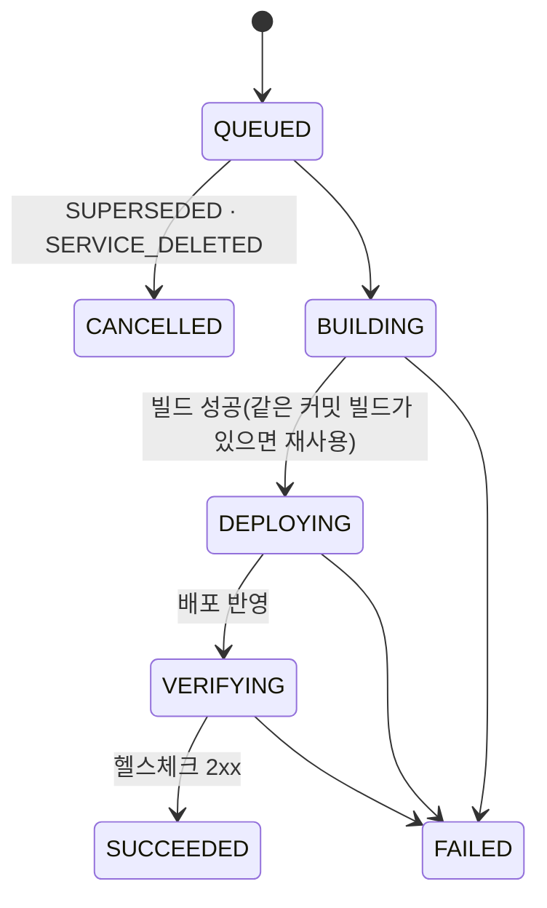

# 배포 요청 API — 원터치 배포 (API 서버 3)

등록한 서비스의 Git 브랜치나 커밋을 **요청 한 번**으로 빌드해 고른 환경 1곳에 배포한다. 헬스체크를 통과해야 새 버전으로 바꾸고, 대표 주소와 환경별 주소를 돌려준다. 근거: SPEC [specs/api-3-one-touch-deploy.md](../../specs/api-3-one-touch-deploy.md), 원장 F1. 서비스 등록은 [services.md](services.md).

- 공통 봉투·camelCase·null 규칙·`X-Request-ID` 는 [environments.md](environments.md#공통-규칙)와 같다. 경로는 `/api/v1/orgs/{orgId}` 아래이고 그 조직 멤버만 본다. 조회는 뷰어(에이전트 토큰 가능), 접수는 **개발자 이상의 사람**이다(에이전트 토큰은 403 `AGENT_READ_ONLY`, [auth.md](auth.md)).
- **접수만 동기다.** API 는 요청을 `QUEUED` 로 저장하고 202 를 준다. 빌드·배포·헬스체크는 별도 일꾼(`python -m app.worker`)이 진행한다. **일꾼이 없으면 요청은 `QUEUED` 에 남는다.** 진행 상황은 단건 조회로 폴링한다(실시간 푸시 없음).
- **이번 실행은 가짜다(`simulated: true`).** 빌드·배포·대표 주소 연결·되돌리기·내리기는 가짜 실행기가 흉내 낸다(`EXECUTOR_MODE=fake`, 실제 실행기는 인프라 3·5 이후). 흐름·상태·DB 기록·계약은 실제와 같다. 헬스체크는 기본 가짜(늘 통과)이고 `HEALTH_CHECKER_MODE=http` 로 실제 HTTP 확인을 켤 수 있다. `simulated` 는 요청 행에 저장한 값이다.

## 엔드포인트

| 메서드 · 경로 | 요청 | 성공 | 실패 | 최소 역할 |
|---|---|---|---|---|
| `POST /api/v1/orgs/{orgId}/services/{id}/deploy-requests` | `CreateDeployRequest` | 202 `DeployRequestDetail` | 404 `SERVICE_NOT_FOUND`·`ENVIRONMENT_NOT_FOUND`·`REPO_NOT_ACCESSIBLE`, 409 `SERVICE_DELETING`·`ENVIRONMENT_UNHEALTHY`·`PUBLIC_HOST_CONFLICT`, 422 `VALIDATION_ERROR`·`REF_NOT_FOUND`·`SIMULATE_NOT_ALLOWED`, 502 `SOURCE_PROVIDER_UNAVAILABLE` | 개발자 |
| `GET /api/v1/orgs/{orgId}/services/{id}/deploy-requests?page&size&environmentId` | — | 200 `Page[DeployRequestSummary]`(최신순) | 404 `SERVICE_NOT_FOUND` | 뷰어·에이전트 |
| `GET /api/v1/orgs/{orgId}/deploy-requests/{id}` | — | 200 `DeployRequestDetail` | 404 `DEPLOY_REQUEST_NOT_FOUND` | 뷰어·에이전트 |

코드 클래스: `CreateDeployRequest`, `DeployRequestSummary` = `DeployRequestSummaryResponse`, `DeployRequestDetail` = `DeployRequestDetailResponse`(`app/schemas/deploy_request.py`).

### 접수 `POST /api/v1/orgs/{orgId}/services/{id}/deploy-requests`

```json
{"environmentId": "b87d8364-7724-4cd1-a59d-306860497d18", "branch": "main"}
```

| 칸 | 규칙 |
|---|---|
| `environmentId` | 필수. 환경 하나(요청 1번 = 환경 1개) |
| `branch` · `commitSha` | **정확히 하나.** 둘 다·둘 다 없음은 422(`reason = EXACTLY_ONE_OF_BRANCH_OR_COMMIT_SHA`). `branch` 는 1~255자, 공백·제어 문자·`~^:?*[\`·`..`·`@{`·끝 `/`·끝 `.lock` 금지. `commitSha` 는 7~40자 소문자 16진수 |
| `simulate` | 선택. `{"failAt": "BUILDING" \| "DEPLOYING" \| "VERIFYING"}` — 그 단계에서 이 요청을 일부러 실패시킨다. 가짜 실행기 모드에서만 받는다(아니면 422 `SIMULATE_NOT_ALLOWED`) |

접수 순서:

1. 서비스(없음 404, `DELETING` 409)·환경(없음·삭제 404, 마지막 접속 확인 `FAILED` 409 `ENVIRONMENT_UNHEALTHY`)을 확인한다.
2. 브랜치·커밋을 **이 순간 40자 커밋 SHA 로 고정**한다(없으면 422 `REF_NOT_FOUND`). 저장소 주소와 서비스 설정도 이 순간 사본을 저장한다 — 뒤에 서비스가 바뀌어도 이 요청은 이 값을 쓴다.
3. 그 환경과 첫 요청이면 연결을 만든다(`trafficWeight = 0`, 주소 `https://{service}.{environment}.{도메인}`). 이 주소를 쓰는 살아 있는 연결이 이미 있으면 409 `PUBLIC_HOST_CONFLICT`(환경 이름을 바꾼 뒤 옛 이름으로 새 환경을 만든 경우).
4. **같은 연결에는 실행 중 1개 + 대기 1개까지만 둔다.** 대기 요청이 있으면 그 요청을 `CANCELLED`(`cancelReason = SUPERSEDED`, `supersededById = 새 요청`)로 밀어내고 새 요청이 대기한다. 실행 중 요청은 끝까지 진행되고, 대기 요청은 그 뒤에 시작한다. 사용자가 요청을 직접 취소하는 API 는 없다.
5. 202 + `DeployRequestDetail`(`status = QUEUED`).

### 진행 (일꾼)



- **빌드**: 같은 서비스·저장소·커밋의 빌드가 있으면 다시 빌드하지 않는다(`build.reused = true`). 빌드 결과는 이미지 주소 + `sha256` digest 이고, 배포는 digest 로만 한다. 비공개 저장소는 빌드 직전에 GitHub App 설치 토큰(1시간)을 새로 받아 메모리로만 넘긴다. 제한 시간은 빌드 시작 기준 `BUILD_TIMEOUT_SECONDS`(900).
- **배포**: 빌드가 성공하면 배포 기록(`deploymentId`)을 만들고 배포 실행기가 반영한다. 제한 시간은 `DEPLOYING` 시작 기준 `DEPLOY_TIMEOUT_SECONDS`(300).
- **헬스체크**: 일꾼이 실행될 때마다 **환경별 주소 + `healthCheckPath`** 를 한 번 GET 한다(요청 하나 5초, 리다이렉트 따르지 않음). 2xx 면 통과, 아니면 `HEALTH_CHECK_INTERVAL_SECONDS`(5) 뒤 다시 확인한다. `VERIFYING` 시작 + `healthCheckTimeoutSeconds`(접수 때 사본)를 넘기면 마지막 결과로 끝낸다: 2xx 가 아닌 응답이면 `HEALTH_CHECK_FAILED`, 연결 실패면 `PUBLIC_URL_UNREACHABLE`, 한 번도 확인하지 못했으면 `HEALTH_CHECK_TIMEOUT`. 대표 주소는 성공 처리 뒤에야 이 환경을 가리키므로 이 단계에서 확인하지 않는다.
- **성공 처리**: 연결의 현재 배포를 새 배포 기록으로 바꾼다. 이 서비스에 서비스 중(`trafficWeight > 0`) 연결이 없으면 대표 주소 라우터가 이 연결로 주소를 보내고, "적용했다"고 답하면 `trafficWeight = 100` 이 된다(**서비스 중**). 이미 서비스 중인 연결이 있으면 이 연결은 **예비**(`trafficWeight = 0`)로 남는다. 트래픽 전환·이전은 API 서버 8 이 한다.
- **예비 자동 따라가기**: 서비스 중 연결의 수동 요청이 성공하면, 현재 배포가 있는 예비 연결마다 `trigger = STANDBY_SYNC` 요청이 생긴다(`sourceRequestId` = 원본, 같은 커밋·같은 빌드 — 재빌드 없음, 설정 사본은 환경별 주소만 다름). 이 요청도 같은 겹침 규칙을 따라 예비 연결의 대기 요청을 밀어낸다. 예비 연결 요청의 성공·실패는 서비스 중 연결에 영향이 없고, 예비 요청은 다시 따라가기를 만들지 않는다. 서비스가 `DELETING` 이면 만들지 않는다. 예비 연결에 사용자가 다른 커밋을 직접 배포하는 것은 막지 않는다(그때는 서비스 상세에서 `OUT_OF_SYNC` 로 보인다).
- **실패와 되돌리기**: 배포 기록이 생긴 뒤의 모든 실패(배포 실패·시간 초과, 헬스 실패 3종, 일꾼 상실)는 되돌리기를 불러 직전 버전을 유지하고 결과를 `revertStatus`(`SUCCEEDED`·`FAILED`)에 적는다. 되돌리기가 실패해도 `errorCode` 는 바꾸지 않는다. 연결의 현재 배포·비율은 그대로다.
- **일꾼 복구**: 일꾼이 죽어도 임대(30초)가 끝나면 다른 일꾼이 같은 단계부터 이어 간다. 외부 작업은 멱등 키로 두 번 만들지 않는다([executors.md](../executors.md)). 같은 요청에서 임대를 3번 잃으면 `WORKER_LOST` 로 끝난다.

### 목록 `GET /api/v1/orgs/{orgId}/services/{id}/deploy-requests`

- 쿼리: `page`(0부터), `size`(1~100, 기본 20), `environmentId`(선택, 그 환경 요청만).
- `createdAt` 내림차순(최신 먼저), 같으면 `id` 내림차순. 삭제가 끝난 서비스는 404.

### 단건 `GET /api/v1/orgs/{orgId}/deploy-requests/{id}`

이력이므로 서비스가 삭제된 뒤에도 조회된다. 배포 요청 행은 지우지 않는다(DB 트리거가 DELETE 를 막는다).

## 응답 스키마

`DeployRequestSummary`(목록 항목) — 모든 칸이 항상 있다.

| 칸 | 타입 | 설명 |
|---|---|---|
| `id` | uuid | 접수 번호 |
| `serviceId` | uuid | |
| `environment` | `{id, name, kind}` | |
| `serviceEnvironmentId` | uuid | 연결 id |
| `trigger` | `MANUAL`·`STANDBY_SYNC` | |
| `sourceRequestId` | uuid \| null | 따라가기의 원본 요청 |
| `ref` | `{type: BRANCH \| COMMIT, value}` | 사용자가 준 값 |
| `commitSha` | string | 접수 때 고정한 40자 SHA |
| `status` | `QUEUED`·`BUILDING`·`DEPLOYING`·`VERIFYING`·`SUCCEEDED`·`FAILED`·`CANCELLED` | |
| `cancelReason` | `SUPERSEDED`·`SERVICE_DELETED` \| null | `CANCELLED` 일 때만 |
| `errorCode` | 코드 \| null | `FAILED` 일 때만 |
| `revertStatus` | `SUCCEEDED`·`FAILED` \| null | 되돌리기가 필요 없었으면 null |
| `stageTimes` | `{queuedAt, buildingAt, deployingAt, verifyingAt, finishedAt}` | 지나지 않은 단계는 null |
| `simulated` | boolean | 가짜 실행기로 처리한 요청인지 |

`DeployRequestDetail` = 위 + 아래.

| 칸 | 타입 | 설명 |
|---|---|---|
| `repoUrl` | string | 접수 때 고정한 저장소 |
| `supersededById` | uuid \| null | 이 요청을 밀어낸 요청 |
| `errorMessage` | string \| null | 오류 코드별 **고정 문장**(외부 응답 원문은 싣지 않는다) |
| `build` | `{id, status, imageRepository, imageDigest, reused}` \| null | 쓰는 빌드. `reused = true` 면 이 요청이 새로 만든 빌드가 아니다 |
| `deploymentId` | uuid \| null | 빌드 성공 뒤 만든 배포 기록 |
| `urls` | `{main, environment}` | 대표 주소, 환경별 주소(접수 때 사본) |

예 (성공):

```json
{
  "success": true,
  "data": {
    "id": "5c0e…",
    "serviceId": "6f1d…",
    "environment": {"id": "e1…", "name": "aws-seoul", "kind": "aws"},
    "serviceEnvironmentId": "a1…",
    "trigger": "MANUAL",
    "sourceRequestId": null,
    "ref": {"type": "BRANCH", "value": "main"},
    "repoUrl": "https://github.com/team-echo/shop-api",
    "commitSha": "9534efe0e0be2170f510a9b7a2886f6b18110c24",
    "status": "SUCCEEDED",
    "cancelReason": null,
    "supersededById": null,
    "errorCode": null,
    "errorMessage": null,
    "revertStatus": null,
    "build": {"id": "b1…", "status": "SUCCEEDED", "imageRepository": "registry.echo.test/shop-api", "imageDigest": "sha256:…", "reused": false},
    "deploymentId": "d1…",
    "urls": {"main": "https://shop-api.apps.echo.test", "environment": "https://shop-api.aws-seoul.apps.echo.test"},
    "stageTimes": {"queuedAt": "2026-11-02T03:00:00Z", "buildingAt": "2026-11-02T03:00:01Z", "deployingAt": "2026-11-02T03:00:05Z", "verifyingAt": "2026-11-02T03:00:08Z", "finishedAt": "2026-11-02T03:00:09Z"},
    "simulated": true
  }
}
```

## 실패 이유 코드 (`errorCode`)

| 코드 | 단계 | 뜻 |
|---|---|---|
| `REPO_NOT_ACCESSIBLE` | 빌드 | 빌드 직전 저장소에 접근하지 못함(App 설치가 사라짐 등) |
| `REF_NOT_FOUND` | 접수 | 브랜치·커밋 없음(접수 응답 422 로만 나온다) |
| `SOURCE_PROVIDER_UNAVAILABLE` | 빌드 | 빌드 직전 GitHub 한도 초과·5xx·시간 초과 |
| `BUILD_FAILED` | 빌드 | 빌드 실패(`simulate.failAt = BUILDING` 포함) |
| `BUILD_TIMEOUT` | 빌드 | 빌드 시작 뒤 `BUILD_TIMEOUT_SECONDS` 초과. 같은 커밋 다음 요청은 새 빌드를 만든다 |
| `DEPLOY_FAILED` | 배포 | 배포 실행기 실패(`simulate.failAt = DEPLOYING` 포함) |
| `DEPLOY_TIMEOUT` | 배포 | `DEPLOYING` 시작 뒤 `DEPLOY_TIMEOUT_SECONDS` 초과 |
| `HEALTH_CHECK_FAILED` | 헬스 | 마감까지 2xx 가 아님(`simulate.failAt = VERIFYING` 은 첫 확인에서) |
| `PUBLIC_URL_UNREACHABLE` | 헬스 | 마감 때 마지막 확인이 연결 실패 |
| `HEALTH_CHECK_TIMEOUT` | 헬스 | 마감까지 한 번도 확인하지 못함 |
| `WORKER_LOST` | 아무 단계 | 일꾼이 같은 요청에서 임대를 3번 잃음 |
| `INTERNAL_ERROR` | — | 예약(지금은 쓰지 않음) |

## HTTP 오류 (접수)

| 상황 | HTTP | code |
|---|---|---|
| 요청 스키마 위반(branch·commitSha 둘 다·둘 다 없음, 형식, 모르는 `failAt`, 모르는 칸) | 422 | `VALIDATION_ERROR` |
| `simulate` 를 가짜가 아닌 실행기 모드에서 보냄 | 422 | `SIMULATE_NOT_ALLOWED` |
| 브랜치·커밋 없음 | 422 | `REF_NOT_FOUND` |
| 서비스 없음·삭제됨 | 404 | `SERVICE_NOT_FOUND` |
| 환경 없음·삭제됨·서비스와 다른 조직의 환경 | 404 | `ENVIRONMENT_NOT_FOUND` |
| 에이전트 토큰으로 접수 | 403 | `AGENT_READ_ONLY`(거부 기록 남음) |
| 뷰어의 접수 | 403 | `ROLE_FORBIDDEN`(거부 기록 남음) |
| 저장소 접근 불가 | 404 | `REPO_NOT_ACCESSIBLE` (+ `installUrl`) |
| 서비스 삭제 중 | 409 | `SERVICE_DELETING` |
| 환경 마지막 접속 확인 실패 | 409 | `ENVIRONMENT_UNHEALTHY` |
| 같은 환경별 주소를 가진 살아 있는 연결 있음 | 409 | `PUBLIC_HOST_CONFLICT` |
| GitHub 한도 초과·5xx·시간 초과 | 502 | `SOURCE_PROVIDER_UNAVAILABLE` |
