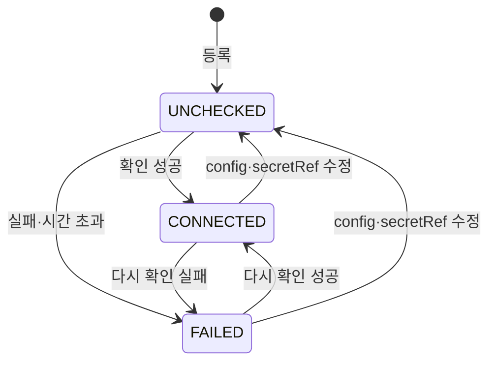

# 환경 API (API 서버 2)

AWS·GCP·온프레 클러스터를 **환경**으로 등록·조회·수정·삭제하고 접속을 확인한다. 근거: SPEC [specs/api-2-environment-api-adapters.md](../../specs/api-2-environment-api-adapters.md), 원장 F2·NFR-15.

- 실행 중인 서버의 OpenAPI: `GET /docs`(Swagger UI) · `GET /openapi.json`. 이 문서와 같은 계약이다.
- **로그인·조직 범위(API 서버 6).** 모든 경로는 `/api/v1/orgs/{orgId}` 아래이고(종류 목록만 조직 밖), 그 조직 멤버만 본다. 조회는 뷰어(에이전트 토큰 가능), 등록·수정·다시 확인은 개발자, 삭제는 어드민이다. 검사 순서·오류는 [auth.md](auth.md).
- **어댑터는 기본이 가짜(simulated)이고, `ENVIRONMENT_ADAPTER_MODE=real` 이면 실제 클러스터에 붙는다**(API 서버 12). 가짜는 네트워크 호출 없이 고정 값을 돌려주고 응답의 `clusterInfo.simulated = true` 가 그 표시다. 실제 모드는 배포 실행기와 같은 접근 경로로 `GET /version`(접속 증명: 틀린 토큰이면 401)과 `GET /api/v1/nodes`(노드 수)만 읽는다 — 쓰기 요청 없음. aws·gcp 는 저장 비밀 없이 워크로드 신원(구글 신분증 → STS 역할 / 워크로드 액세스 토큰)으로 붙고 `secretRef` 의 값을 읽지 않는다(자리 표시 값이어도 된다). onprem 은 `secretRef` 의 서비스 계정 토큰으로 `apiUrl` 에 붙는다. 일시 오류(연결 실패·5xx·429)는 0.5초 뒤 한 번 더 시도한다. 이유 코드: 401·403·STS 거절 → `AUTH_FAILED`, 역할/`apiUrl` 없음·`/version` 404·쿠버네티스가 아닌 응답 → `CONFIG_INVALID`, 연결 실패·TLS·5xx·429 → `UNREACHABLE`. 노드 목록만 권한이 막히면 `CONNECTED` + `clusterInfo = null` + `clusterInfoError = AUTH_FAILED`(온프레 `echo-executor` 에 `nodes get,list` 가 필요하다). 요청·응답 모양은 가짜와 같다.

## 공통 규칙

- 모든 JSON 응답은 봉투 `{"success", "code", "message", "data", "details"}` 다.
  - 성공: `{"success": true, "data": ...}`. **`data` 안의 칸은 항상 있고, 값이 없으면 `null`** 이다.
  - 실패: `{"success": false, "code", "message"[, "details"]}`. `data` 는 없다.
  - 봉투의 `code`·`message`·`details` 는 값이 없으면 뺀다.
- JSON 이름은 camelCase 다. `config` 안의 키도 camelCase 다(DB 에는 snake_case 로 저장한다).
- 시각은 ISO 8601 UTC(`2026-11-01T15:00:16.668145Z`).
- **다른 파트·API 는 환경을 `id`(uuid)로만 가리킨다.** `name` 은 표시용이며 수정할 수 있다. 이름은 **조직 안에서** 유일하다.
- 모든 응답에 `X-Request-ID` 헤더가 붙는다.

## 엔드포인트

| 메서드 · 경로 | 요청 | 성공 | 최소 역할 |
|---|---|---|---|
| `POST /api/v1/orgs/{orgId}/environments` | `CreateEnvironmentRequest` | 201 `ApiResponse[EnvironmentDetailResponse]` | 개발자 |
| `GET /api/v1/orgs/{orgId}/environments?page&size&kind` | — | 200 `ApiResponse[Page[EnvironmentSummaryResponse]]` | 뷰어·에이전트 |
| `GET /api/v1/orgs/{orgId}/environments/{id}` | — | 200 `ApiResponse[EnvironmentDetailResponse]` | 뷰어·에이전트 |
| `PATCH /api/v1/orgs/{orgId}/environments/{id}` | `UpdateEnvironmentRequest` | 200 `ApiResponse[EnvironmentDetailResponse]` | 개발자 |
| `DELETE /api/v1/orgs/{orgId}/environments/{id}` | — | 204 (본문 없음) | 어드민 |
| `POST /api/v1/orgs/{orgId}/environments/{id}/connection-check` | — | 200 `ApiResponse[EnvironmentDetailResponse]` | 개발자 |
| `GET /api/v1/environment-kinds` | — | 200 `ApiResponse[list[EnvironmentKindResponse]]` | 로그인한 누구나(조직 밖) |

SPEC §8.2 의 이름과 코드 클래스 이름: `EnvironmentCreate` = `CreateEnvironmentRequest`, `EnvironmentUpdate` = `UpdateEnvironmentRequest`, `EnvironmentSummary` = `EnvironmentSummaryResponse`, `EnvironmentDetail` = `EnvironmentDetailResponse`, `EnvironmentKind` = `EnvironmentKindResponse`(`app/schemas/environment.py`).

### 등록 `POST /api/v1/orgs/{orgId}/environments`

```json
{
  "name": "aws-seoul",
  "kind": "aws",
  "config": {"region": "ap-northeast-2", "clusterName": "echo-eks"},
  "secretRef": "env:ECHO_SECRET_TEAM_ECHO__AWS_SEOUL_KUBECONFIG"
}
```

- `name`: 소문자·숫자·하이픈 1~63자, 처음과 끝은 소문자·숫자. 살아 있는 환경 중 유일.
- `kind`: `GET /api/v1/environment-kinds` 의 값. 등록 뒤 바꿀 수 없다.
- `config`: 종류별 설정(아래 표). camelCase 키만 받는다. snake_case 키는 모르는 칸으로 거부한다.
- `secretRef`: **필수.** 비밀값 자체는 받지 않는다. 운영자가 비밀 저장소에 직접 넣고 그 위치만 준다.
- 모르는 칸은 거부한다.
- 흐름: 행을 `UNCHECKED` 로 저장·커밋 → 접속 확인(제한 시간 5초) → 결과 저장 → 201. **접속 확인이 실패해도 201** 이고, 결과는 `connectionStatus`·`connectionError` 에 있다.

| kind | config 키 | 위치(`location`) |
|---|---|---|
| `aws` | `region`(예 `ap-northeast-2`), `clusterName` | `region` |
| `gcp` | `projectId`(예 `echo-hack-123`), `region`(예 `asia-northeast3`), `clusterName` | `region` |
| `onprem` | `location`(예 `seoul`, `team-laptop`), `kubeContext` | `location` |

온프레 `location` 은 자유 문구다. [좌표 표](#좌표-coordinates)의 도시 코드를 넣으면 지도에 표시되고, 그 밖의 글자는 좌표 없는 이름표로 남는다.

**선택 칸(실제 실행기, API 서버 3-2)** — 비워도 되고, 기존 행·요청은 그대로 유효하다. 실제 실행기(`EXECUTOR_MODE=real`)가 반영할 때 쓴다.

| kind | 칸 | 뜻 | 예 |
|---|---|---|---|
| `aws` | `roleArn` | 실행기가 넘겨받을 IAM 역할. 비면 서버 설정 `EXECUTOR_AWS_ROLE_ARN` | `arn:aws:iam::123456789012:role/echo-dev-executor` |
| `aws` | `ingressDomain` | 이 환경의 하위 도메인. 있으면 새 연결의 환경별 주소가 `{service}-{suffix}.{ingressDomain}` | `aws-tokyo.echoport.uk` |
| `aws` | `ingressGroup` | ALB 그룹 이름(실제 반영 때 필요) | `echo-apps` |
| `aws` | `certificateArn` | ALB HTTPS 인증서 ACM ARN(실제 반영 때 필요, 자동 찾기 안 함) | `arn:aws:acm:…:certificate/…` |
| `gcp` | `clusterLocation` | GKE 위치(존 또는 리전). 비면 `region` | `asia-northeast3-a` |
| `gcp` | `ingressDomain` | 위와 같음 | `gcp-seoul.echoport.uk` |
| `onprem` | `apiUrl` | 쿠버네티스 창구 공개 주소(터널, https) | `https://k3s-k2f6xje5.echoport.uk` |
| `onprem` | `tunnelTarget` | 앱 주소 CNAME 대상 | `<터널 id>.cfargotunnel.com` |
| 모두 | `ingressClass` | 비면 aws `alb`, gcp `nginx`, onprem `traefik` | — |

- `ingressDomain` 은 서버 `PUBLIC_BASE_DOMAIN` 의 **바로 아래 한 단계**여야 한다(`aws-tokyo.{PUBLIC_BASE_DOMAIN}`). 두 단계·다른 도메인·도메인 자체는 422 `ENVIRONMENT_CONFIG_INVALID`(`field = config.ingressDomain`, `reason = INVALID_FORMAT`). 온프레에는 이 칸이 없다(`UNKNOWN_FIELD`).
- 온프레 창구 토큰은 환경의 `secretRef`(`env:ECHO_SECRET_…`)로 가리킨다. aws·gcp 는 `secretRef` 를 실제 반영에 쓰지 않는다(워크로드 신원).
- 값이 없는 선택 칸은 저장·응답 `config` 에 키로 남기지 않는다(새 칸을 쓰지 않는 환경은 예전과 같은 모양).

각 종류의 정확한 형식은 `GET /api/v1/environment-kinds` 의 `configSchema`(JSON Schema)를 본다. 새 종류를 더하면 코드 변경 없이 여기에 나타난다.

### `secretRef` 형식

저장소 이름은 첫 콜론에서만 나눈다. 전체 255자 이하.

| 형식 | 예 | 지금 조회 |
|---|---|---|
| `env:<NAME>` (`NAME` 은 `ECHO_SECRET_<조직 키>__` 로 시작, 대문자·숫자·`_`) | `env:ECHO_SECRET_TEAM_ECHO__AWS_SEOUL_KUBECONFIG` | 서버 프로세스 환경변수를 읽는다 |
| `k8s:<namespace>/<secret>/<key>` | `k8s:echo-system/aws-seoul/kubeconfig` | 형식만. 확인은 `SECRET_STORE_UNSUPPORTED` |
| `aws-sm:<이름 또는 ARN>` | `aws-sm:echo/aws-seoul` | 형식만. 확인은 `SECRET_STORE_UNSUPPORTED` |
| `gcp-sm:projects/<p>/secrets/<s>[/versions/<v>]` | `gcp-sm:projects/echo-hack-123/secrets/gke` | 형식만. 확인은 `SECRET_STORE_UNSUPPORTED` |

- 형식이 틀리면 422 `VALIDATION_ERROR`, `details = [{"field": "secretRef", "reason": "INVALID_SECRET_REF"}]`.
- `env:` 이름을 `ECHO_SECRET_` 로 제한하는 이유: API 로 서버 자체 설정(`DATABASE_URL` 등)을 열쇠로 지정하지 못하게 하기 위해서다.
- **조직 열쇠 이름(API 서버 6)**: 환경 API 에서 `env:` 이름은 한 겹 더 좁혀 `ECHO_SECRET_<조직 키>__` 로 시작해야 한다. 조직 키는 slug 의 `-` 를 `_` 로 바꾸고 대문자(`team-echo` → `TEAM_ECHO`, 밑줄 두 개로 끝). 아니면 422 `SECRET_REF_NOT_IN_ORGANIZATION`(`details = [{"field": "secretRef", "reason": "SECRET_REF_NOT_IN_ORGANIZATION"}]`). 다른 조직의 열쇠를 가리키지 못하게 하기 위해서다. `k8s:`·`aws-sm:`·`gcp-sm:` 은 형식만 검사하고 조직으로 묶지 않는다.
- 비밀값은 메모리에서만 쓰고 저장·로그·응답·예외 메시지에 넣지 않는다.

### 목록 `GET /api/v1/orgs/{orgId}/environments`

- 쿼리: `page`(0부터, 기본 0), `size`(1~100, 기본 20, 범위 밖은 422), `kind`(정확히 일치, 선택).
- 소프트 삭제된 환경은 빠진다. `createdAt` 오름차순, 같으면 `id`.
- **저장된 값만 쓴다.** 어댑터·비밀 저장소를 부르지 않으므로 클러스터 하나가 죽어도 목록은 뜬다.

### 단건 `GET /api/v1/orgs/{orgId}/environments/{id}`

저장된 값 + 그 자리에서 읽은 `clusterInfo`(제한 시간 동일). **저장된 접속 상태는 바꾸지 않는다.** 읽지 못하면 `clusterInfo = null`, 이유는 `clusterInfoError`, 상태 코드는 200.

### 수정 `PATCH /api/v1/orgs/{orgId}/environments/{id}`

- 바꿀 수 있는 칸: `name`, `config`(**전체 교체**, 부분 병합 없음), `secretRef`. 들어온 칸만 바꾼다.
- `kind` 가 지금과 다르면 422 `ENVIRONMENT_KIND_IMMUTABLE`, 같으면 무시한다.
- 어느 칸이든 `null` 은 422 `VALIDATION_ERROR`(`reason = NULL_NOT_ALLOWED`).
- `config`·`secretRef` 가 실제로 바뀌면 접속 상태를 `UNCHECKED` 로 되돌리고 커밋한 뒤 다시 확인한다. `name` 만 바뀌면 다시 확인하지 않는다.
- 빈 본문 `{}` 은 200 + 현재 값.
- 사용 중인 환경도 수정할 수 있다.

### 삭제 `DELETE /api/v1/orgs/{orgId}/environments/{id}`

- 살아 있는 서비스-환경 연결이 있으면 409 `ENVIRONMENT_IN_USE`.
- 없으면 소프트 삭제 → 204. 이후 단건·수정·삭제·다시 확인은 404 이고, 같은 이름으로 다시 등록할 수 있다.

### 다시 확인 `POST /api/v1/orgs/{orgId}/environments/{id}/connection-check`

커밋된 값으로 접속을 확인하고 `connectionStatus`·`connectionCheckedAt`·`connectionError` 를 저장한다. 같은 상태여도 시각은 새로 적는다. 자동 주기 확인은 하지 않는다(API 서버 5, 11/5 결정).

- 확인 도중 다른 요청이 `config`·`secretRef` 를 바꾸면 이 확인의 결과는 버리고, 응답은 그 시점 DB 값이다(이때 `clusterInfo`·`clusterInfoError` 는 null).
- 확인 도중 환경이 삭제되면 404.

### 종류 목록 `GET /api/v1/environment-kinds`

```json
{"success": true, "data": [{"kind": "aws", "configSchema": {"type": "object", "properties": {"region": {...}, "clusterName": {...}}, "required": ["region", "clusterName"], "additionalProperties": false, ...}}, ...]}
```

종류 이름 순. 프론트는 `configSchema` 로 등록 폼을 만든다.

## 응답 스키마

`EnvironmentSummaryResponse`(목록 항목) — 모든 칸이 항상 있다.

| 칸 | 타입 | 설명 |
|---|---|---|
| `id` | uuid | 다른 파트는 이 값으로만 가리킨다 |
| `name` | string | 표시용, 바뀔 수 있다 |
| `kind` | string | `aws`·`gcp`·`onprem`… |
| `location` | string \| null | 환경 카드의 위치. 저장된 config 를 지금 양식으로 읽지 못하면 null |
| `coordinates` | `{lat: number, lng: number}` \| null | 지도·재난 판정용 좌표([찾는 규칙](#좌표-coordinates)). 표에 없거나 config 를 읽지 못하면 null |
| `config` | object \| null | camelCase 키. 읽지 못하면 null |
| `secretRef` | string \| null | 저장 값 그대로(형식이 틀린 옛 값도 그대로 보인다) |
| `connectionStatus` | `UNCHECKED`·`CONNECTED`·`FAILED` | 마지막 접속 확인 결과 |
| `connectionCheckedAt` | string \| null | `UNCHECKED` 면 null |
| `connectionError` | 이유 코드 \| null | `FAILED` 일 때만 값 |
| `createdAt`·`updatedAt` | string | |

`EnvironmentDetailResponse` = 위 + 아래 두 칸.

| 칸 | 타입 | 설명 |
|---|---|---|
| `clusterInfo` | `{serverVersion, nodeCount, simulated}` \| null | `serverVersion` 은 쿠버네티스 `gitVersion` 모양(`v1.31.0`). **`simulated = true` 면 가짜 어댑터 값**이다 |
| `clusterInfoError` | 이유 코드 \| null | `clusterInfo` 가 null 인 이유. 접속 실패면 `connectionError` 와 같다 |

예 (`POST` 201):

```json
{
  "success": true,
  "data": {
    "id": "b87d8364-7724-4cd1-a59d-306860497d18",
    "name": "aws-seoul",
    "kind": "aws",
    "location": "ap-northeast-2",
    "coordinates": {"lat": 37.57, "lng": 126.98},
    "config": {"region": "ap-northeast-2", "clusterName": "echo-eks"},
    "secretRef": "env:ECHO_SECRET_TEAM_ECHO__AWS_SEOUL_KUBECONFIG",
    "connectionStatus": "CONNECTED",
    "connectionCheckedAt": "2026-11-01T15:00:16.668145Z",
    "connectionError": null,
    "createdAt": "2026-11-01T15:00:16.653778Z",
    "updatedAt": "2026-11-01T15:00:16.666984Z",
    "clusterInfo": {"serverVersion": "v1.31.0", "nodeCount": 3, "simulated": true},
    "clusterInfoError": null
  }
}
```

## 좌표 (`coordinates`)

목록 항목과 단건(등록·단건·수정·다시 확인) 응답에 항상 있다. **저장하지 않고** 응답 때 `config` 의 위치 글자로 서버 표(`app/core/places.py`)에서 찾는다. 네트워크 호출은 없다.

| kind | 찾는 값 | 표 |
|---|---|---|
| `aws` | `config.region` | AWS 리전 |
| `gcp` | `config.region` (`clusterLocation` 존은 쓰지 않는다) | GCP 리전 |
| `onprem` | `config.location` 을 소문자로 바꾼 값 | 온프레 도시 |

| 표 | 키 | lat | lng |
|---|---|---|---|
| AWS 리전 | `ap-northeast-1` | 35.68 | 139.69 |
| AWS 리전 | `ap-northeast-2` | 37.57 | 126.98 |
| AWS 리전 | `ap-northeast-3` | 34.69 | 135.5 |
| AWS 리전 | `us-east-1` | 38.9 | -77.4 |
| AWS 리전 | `us-west-2` | 45.6 | -121.2 |
| AWS 리전 | `eu-west-1` | 53.3 | -6.3 |
| GCP 리전 | `asia-northeast1` | 35.68 | 139.69 |
| GCP 리전 | `asia-northeast2` | 34.69 | 135.5 |
| GCP 리전 | `asia-northeast3` | 37.57 | 126.98 |
| 온프레 도시 | `tokyo` | 35.68 | 139.69 |
| 온프레 도시 | `osaka` | 34.69 | 135.5 |
| 온프레 도시 | `fukuoka` | 33.59 | 130.4 |
| 온프레 도시 | `seoul` | 37.57 | 126.98 |
| 온프레 도시 | `busan` | 35.18 | 129.08 |

- 표는 종류별로 따로 본다. 온프레 `location: "ap-northeast-1"` 은 리전 표를 보지 않아 null 이다. aws·gcp `region` 은 양식 패턴이 도시 글자(`tokyo`)를 등록 단계에서 거부한다.
- 표에 없는 값(aws `ap-southeast-1`, 온프레 `team-laptop`), 표가 없는 종류, 저장된 config 를 지금 양식으로 읽지 못하는 행은 null 이다.
- 좌표를 바꾸려면 `PATCH` 로 위치 글자를 고친다(`config` 는 전체 교체다). 직접 좌표를 넣는 칸은 없다.
- 새 리전·도시는 표에 한 줄 더한다. 프론트 표(echo-frontend `src/lib/geo.ts`)는 서버 값이 null 이거나 없을 때만 쓰이므로, 둘이 어긋나면 서버 값이 이긴다.
- 서비스 상세·배포 요청 응답의 `environment` 참조(`{id, name, kind}`)에는 좌표가 없다. 환경 `id` 로 이 응답과 합친다.

## 접속 상태 흐름



확인 도중 서버가 죽으면 `UNCHECKED` 로 남고 '다시 확인'으로 풀린다.

## 접속 실패 이유 코드 (`connectionError`, `clusterInfoError`)

| 코드 | 뜻 |
|---|---|
| `TIMEOUT` | 제한 시간(기본 5초, `ENVIRONMENT_CHECK_TIMEOUT_SECONDS`) 초과 |
| `SECRET_REF_MISSING` | 행에 secretRef 가 없다 |
| `SECRET_REF_INVALID` | 저장된 secretRef 가 형식에 맞지 않는다 |
| `SECRET_NOT_FOUND` | 저장소에 값이 없거나 빈 값이다 |
| `SECRET_STORE_UNSUPPORTED` | 아직 조회하지 않는 저장소(k8s·aws-sm·gcp-sm) |
| `CONFIG_INVALID` | 저장된 config 를 지금 양식으로 읽지 못한다 |
| `AUTH_FAILED` | 자격 증명 거부(실제 어댑터용) |
| `UNREACHABLE` | 클러스터에 닿지 않는다(실제 어댑터용) |
| `UNKNOWN` | 그 밖의 오류 |

접속 확인까지의 실패는 `FAILED` 가 된다. 클러스터 정보 읽기만 실패하면 `CONNECTED` 그대로 두고 `clusterInfo = null`, `clusterInfoError = <코드>` 다.

## HTTP 오류

| 상황 | HTTP | code |
|---|---|---|
| 요청 스키마 위반(이름 형식, secretRef 형식, null, page·size 범위, 모르는 칸 등) | 422 | `VALIDATION_ERROR` + `details[{field, reason}]` |
| 모르는 종류 | 422 | `UNKNOWN_ENVIRONMENT_KIND` |
| 설정 양식 위반 | 422 | `ENVIRONMENT_CONFIG_INVALID` + `details` |
| 종류 변경 | 422 | `ENVIRONMENT_KIND_IMMUTABLE` |
| `env:` 비밀 참조가 이 조직의 열쇠 이름이 아님 | 422 | `SECRET_REF_NOT_IN_ORGANIZATION` + `details` |
| 같은 조직의 살아 있는 환경과 이름 중복(등록·수정) | 409 | `ENVIRONMENT_NAME_CONFLICT` |
| 사용 중인 환경 삭제 | 409 | `ENVIRONMENT_IN_USE` |
| 없거나 삭제된 환경(확인 도중 삭제 포함), 다른 조직의 환경 | 404 | `ENVIRONMENT_NOT_FOUND` |
| 로그인 안 함 · 조직 멤버 아님 · 역할 모자람 | 401 · 404 · 403 | `UNAUTHENTICATED` · `ORGANIZATION_NOT_FOUND` · `ROLE_FORBIDDEN` 등([auth.md](auth.md)) |

`ENVIRONMENT_CONFIG_INVALID` 의 `details`: `field` = `config.` + camelCase 경로(루트 위반은 `config`), `reason` = `MISSING`(빠짐) · `UNKNOWN_FIELD`(모르는 칸, 들어온 키 그대로) · `INVALID_FORMAT`(그 외). 입력 값·정규식은 넣지 않는다.

```json
{
  "success": false,
  "code": "ENVIRONMENT_CONFIG_INVALID",
  "message": "invalid environment config",
  "details": [
    {"field": "config.region", "reason": "INVALID_FORMAT"},
    {"field": "config.clusterName", "reason": "MISSING"}
  ]
}
```
