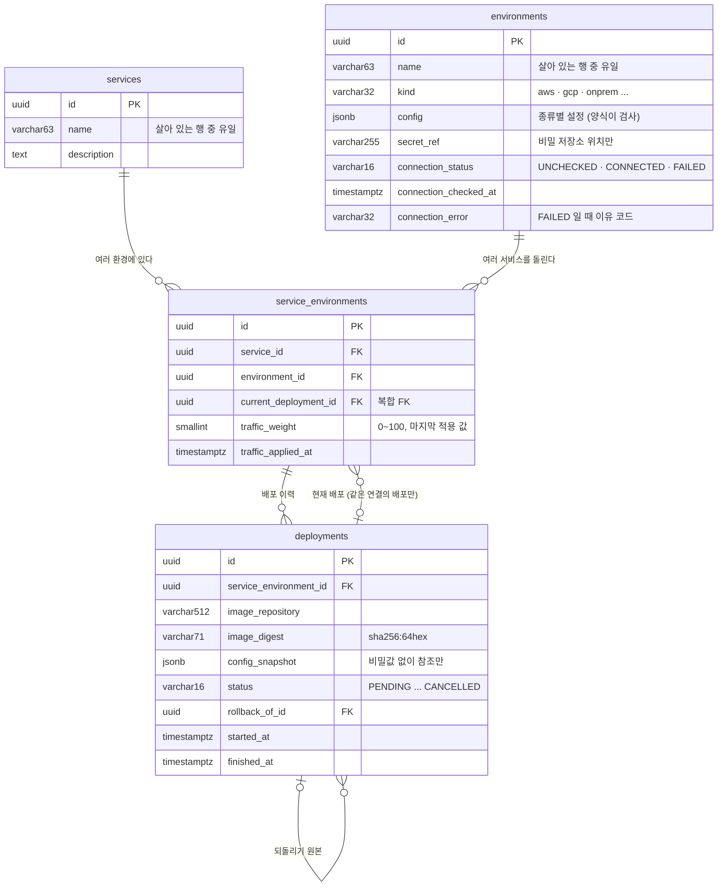
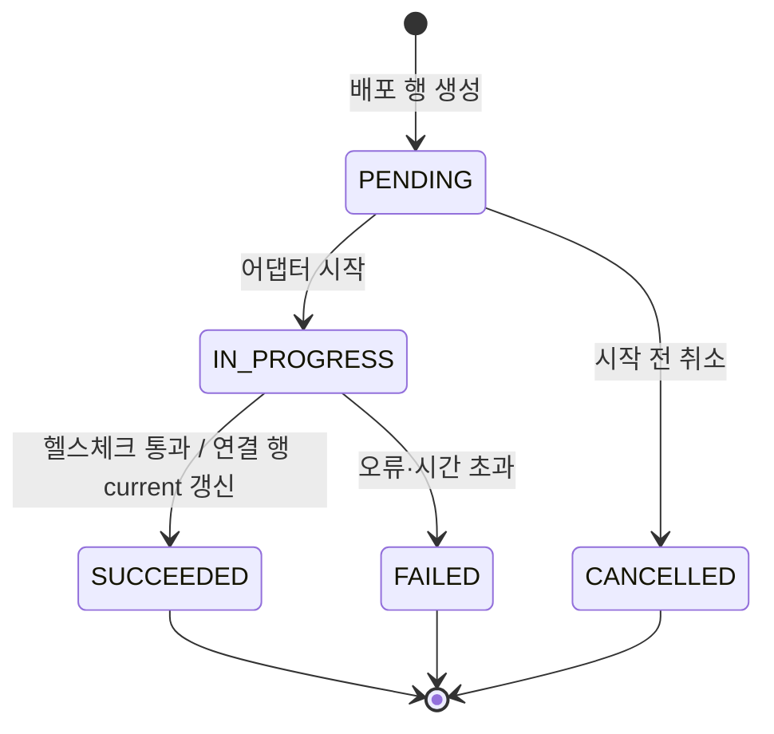
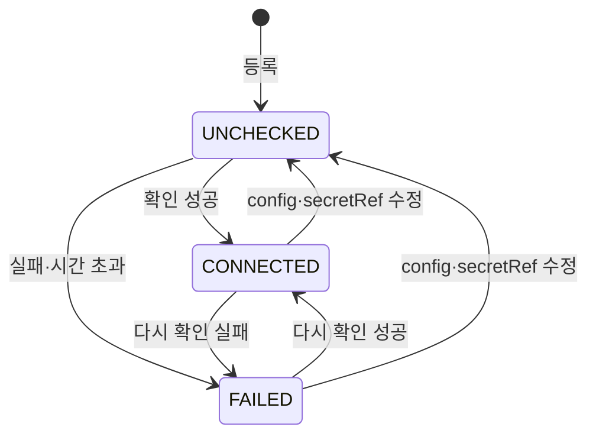

# 공통 모델 스키마 — 환경·서비스·배포

> 서비스 하나가 여러 환경(AWS·GCP·온프레)에 **동시에** 있을 수 있다. 클라우드 간 이전 중에는 같은 이미지를 A·B 두 곳에서 함께 돌리며 트래픽을 옮긴다.
> 새 환경 종류는 **설정 양식 파일 하나**로 더하고 표는 고치지 않는다(NFR-15).

- 원본: 이 파일(코드와 같은 커밋에서 고친다). 노션 설계 문서는 이 파일을 옮긴 것이다.
- 물리 DDL: [.claude/rules/db-schema.sql](../.claude/rules/db-schema.sql) (`scripts/dump_schema.sh` 로 뽑음) · 용어: [term-dictionary.md](../.claude/rules/term-dictionary.md)
- 근거: 원장 F1(원터치 배포·되돌리기), F2(공통 모델·어댑터), F3(환경 카드), F7(단계적 트래픽 전환), NFR-15(이식성)

---

## ① 한눈에 보기 (ER)



`services`·`environments`·`service_environments` 는 소프트 삭제 칸(`is_deleted`, `deleted_at`)을, 네 표 모두 `created_at`·`updated_at` 을 가진다(그림에서는 생략).

---

## ② 표별 칸 설명

공통 규칙

- PK 는 `id uuid`. ORM 은 Python 에서 만들고(flush 전에 id 를 알 수 있게), SQL 로 직접 넣으면 DB 가 `gen_random_uuid()` 로 만든다.
- `created_at`·`updated_at`: `timestamptz NOT NULL DEFAULT now()`. `updated_at` 은 ORM 으로 수정할 때 갱신된다.
- 소프트 삭제: `is_deleted boolean NOT NULL DEFAULT false`, `deleted_at timestamptz NULL`, `CHECK (is_deleted = (deleted_at IS NOT NULL))`. 유일성은 `WHERE is_deleted = false` 부분 unique index 로 건다 → 지운 이름은 다시 쓸 수 있다.
- 이름 칸: Kubernetes 이름 규칙 `^[a-z0-9]([-a-z0-9]{0,61}[a-z0-9])?$` CHECK (클러스터 리소스 이름으로 그대로 쓴다).
- FK 삭제 동작은 모두 `RESTRICT`. 상태·범위 값은 PostgreSQL ENUM 대신 `varchar`/`smallint` + CHECK (값 추가가 `ALTER TYPE` 보다 쉽다).

### `services` — 서비스

| 칸 | 타입 | NULL | 제약 | 뜻 |
|---|---|---|---|---|
| `id` | uuid | N | PK | |
| `name` | varchar(63) | N | 이름 형식 CHECK, `uq_services_name_live` | 서비스 이름(예 `shop-api`) |
| `description` | text | Y | | 설명 |

### `environments` — 환경

| 칸 | 타입 | NULL | 제약 | 뜻 |
|---|---|---|---|---|
| `id` | uuid | N | PK | |
| `name` | varchar(63) | N | 이름 형식 CHECK, `uq_environments_name_live` | 환경 이름(예 `aws-seoul`) |
| `kind` | varchar(32) | N | **DB CHECK 없음** — 설정 양식 레지스트리가 검사 | 환경 종류(`aws`·`gcp`·`onprem`) |
| `config` | jsonb | N | 기본 `{}`, `jsonb_typeof(config) = 'object'` | 종류별 설정. 형식은 종류의 설정 양식이 저장 전에 검사 |
| `secret_ref` | varchar(255) | Y | API 가 형식 검사(아래) | 접속 자격 증명의 **보관 위치**(값 아님). API 등록 때는 필수 |
| `connection_status` | varchar(16) | N | 기본 `UNCHECKED`, 3개 값 CHECK(`ck_environments_connection_status_valid`) | 마지막 접속 확인 결과. ④-2 상태 흐름 |
| `connection_checked_at` | timestamptz | Y | `(status = 'UNCHECKED') = (checked_at IS NULL)` (`ck_environments_connection_checked_at_consistency`) | 마지막 확인 시각 |
| `connection_error` | varchar(32) | Y | `(status = 'FAILED') = (error IS NOT NULL)` (`ck_environments_connection_error_consistency`). **값 CHECK 없음** — 앱이 `ConnectionErrorCode` 값만 쓴다 | 실패 이유 코드(`TIMEOUT`·`SECRET_NOT_FOUND` …) |

- 접속 상태 세 칸은 기존 표에 `add_column` 으로 더해 DB 에서 맨 뒤(소프트 삭제 칸 뒤)에 놓인다. 모델도 `sort_order=APPENDED_COLUMN_SORT_ORDER`(200)로 같은 순서를 쓴다.
- `secret_ref` 형식(저장소 이름은 첫 콜론에서 나눈다): `env:ECHO_SECRET_<NAME>`(서버 프로세스 환경변수, 지금 실제 조회하는 유일한 저장소) · `k8s:<namespace>/<secret>/<key>` · `aws-sm:<이름 또는 ARN>` · `gcp-sm:projects/<p>/secrets/<s>[/versions/<v>]`. 자세한 규칙은 [docs/api/environments.md](api/environments.md).

### `service_environments` — 서비스-환경 연결

| 칸 | 타입 | NULL | 제약 | 뜻 |
|---|---|---|---|---|
| `id` | uuid | N | PK | |
| `service_id` | uuid | N | FK `services.id` | |
| `environment_id` | uuid | N | FK `environments.id` | |
| `current_deployment_id` | uuid | Y | 복합 FK `(current_deployment_id, id)` → `deployments(id, service_environment_id)` | 지금 이 연결에서 돌고 있는 배포 |
| `traffic_weight` | smallint | N | 기본 0, `BETWEEN 0 AND 100` | 마지막으로 앞단 프록시에 적용한 비율(%) |
| `traffic_applied_at` | timestamptz | Y | | 그 비율을 적용한 시각 |
| (유일성) | | | `uq_service_environments_service_id_environment_id_live` | 같은 서비스×환경의 살아 있는 연결은 하나 |

- **연결을 만드는 쪽(API 서버 3)은 대상 환경 행을 `SELECT ... FOR UPDATE` 로 잠근 뒤 연결을 만든다.** 환경 삭제도 같은 행을 잠그고 살아 있는 연결이 있는지 본 뒤 소프트 삭제하므로(있으면 409 `ENVIRONMENT_IN_USE`), 이 순서를 지켜야 "지운 환경에 새 연결"이 생기지 않는다.

### `deployments` — 배포 (지우지 않는 이력)

| 칸 | 타입 | NULL | 제약 | 뜻 |
|---|---|---|---|---|
| `id` | uuid | N | PK, `UNIQUE (id, service_environment_id)` | 복합 FK 가 가리키는 대상 |
| `service_environment_id` | uuid | N | FK, 인덱스 `(service_environment_id, created_at)` | 어느 연결에 올렸나 |
| `image_repository` | varchar(512) | N | | 저장소 URI(tag 없음) |
| `image_digest` | varchar(71) | N | `^sha256:[0-9a-f]{64}$` | 배포 기준 이미지 |
| `config_snapshot` | jsonb | N | 기본 `{}`, object CHECK | 배포 때 쓴 설정. 비밀값 없이 참조만 |
| `status` | varchar(16) | N | 기본 `PENDING`, 5개 값 CHECK | ④ 상태 흐름 |
| `rollback_of_id` | uuid | Y | FK `deployments.id`, `rollback_of_id <> id` | 되돌리기라면 원본 배포 |
| `started_at`·`finished_at` | timestamptz | Y | | 시작·끝 시각 |
| (삭제 금지) | | | `BEFORE DELETE` 트리거 `trg_deployments_prevent_delete` | 행 DELETE 는 예외(23001) |

### 환경 설정 양식 (`app/adapters/`)

| kind | `config` 필드 | 검사 | 환경 카드 "위치" |
|---|---|---|---|
| `aws` | `region`, `cluster_name` | region `^[a-z]{2}(-[a-z]+)+-\d{1,2}$` | `region` |
| `gcp` | `project_id`, `region`, `cluster_name` | project_id `^[a-z][a-z0-9-]{4,28}[a-z0-9]$`, region `^[a-z]+-[a-z]+\d{1,2}$` | `region` |
| `onprem` | `location`, `kube_context` | 빈 값·앞뒤 공백 거부 | `location` |

모든 양식은 모르는 키를 거부(`extra="forbid"`)하고 빈 문자열을 거부한다. 위반은 `ENVIRONMENT_CONFIG_INVALID`(422), 모르는 종류는 `UNKNOWN_ENVIRONMENT_KIND`(422)이며, 오류에는 위반한 **필드 경로와 이유 코드만**(로그용 `invalid_fields`, 응답용 `details`) 담고 입력 값은 담지 않는다.

- **키 표기**: DB(`config` 칸)는 snake_case(`cluster_name`), API 는 camelCase(`clusterName`)다. 양식 하나가 두 표기를 알고, API 경계는 camelCase 만, DB 쪽(모델 이벤트·`parsed_config()`)은 snake_case 만 받는다.
- **동작 클래스**: 종류마다 `EnvironmentAdapter`(`check_connection`·`read_cluster_info`, 모두 async)를 같은 파일에 하나 둔다. 이번 aws·gcp·onprem 은 네트워크 호출이 없는 **가짜(simulated)** 이고 결과에 `simulated=True` 를 단다(aws `v1.31.0`/노드 3, gcp `v1.31.1-gke.1000`/3, onprem `v1.31.4+k3s1`/1).

---

## ③ 실제 행 예시 — shop-api 가 AWS 90%·GCP 10% 로 같은 이미지를 돌리는 순간

GCP 로 이전하는 중이다. 같은 digest 를 두 클라우드에 올리고 프록시 가중치를 90:10 으로 둔 상태다. 온프레 환경은 등록만 돼 있고 아직 이 서비스가 없다. (id 는 실제로 uuid 다. 읽기 쉽게 별칭으로 적는다.)

**services**

| id | name | description |
|---|---|---|
| `svc-shop` | `shop-api` | 데모 쇼핑몰 API |

**environments** — 세 종류가 같은 칸에 들어간다(F2 데모 증거)

| id | name | kind | config | secret_ref | connection_status |
|---|---|---|---|---|---|
| `env-aws` | `aws-seoul` | `aws` | `{"region": "ap-northeast-2", "cluster_name": "echo-eks"}` | `env:ECHO_SECRET_AWS_SEOUL_KUBECONFIG` | `CONNECTED` |
| `env-gcp` | `gcp-seoul` | `gcp` | `{"project_id": "echo-hack-123", "region": "asia-northeast3", "cluster_name": "echo-gke"}` | `env:ECHO_SECRET_GCP_SEOUL_KUBECONFIG` | `CONNECTED` |
| `env-onp` | `onprem-k3s` | `onprem` | `{"location": "team-laptop", "kube_context": "k3d-echo"}` | `env:ECHO_SECRET_ONPREM_K3S_KUBECONFIG` | `FAILED` (`connection_error = SECRET_NOT_FOUND`) |

API 응답에서는 같은 행의 `config` 키가 camelCase(`clusterName`, `projectId`, `kubeContext`)로 나간다.

**service_environments** — 한 서비스, 두 환경, 동시에 가동

| id | service_id | environment_id | current_deployment_id | traffic_weight | traffic_applied_at |
|---|---|---|---|---|---|
| `link-aws` | `svc-shop` | `env-aws` | `dep-aws-1` | 90 | 2026-11-08 14:02:10+00 |
| `link-gcp` | `svc-shop` | `env-gcp` | `dep-gcp-1` | 10 | 2026-11-08 14:02:10+00 |

**deployments** — 같은 digest, 연결마다 한 행

| id | service_environment_id | image_repository | image_digest | config_snapshot | status | rollback_of_id |
|---|---|---|---|---|---|---|
| `dep-aws-1` | `link-aws` | `ghcr.io/team-echo/shop-api` | `sha256:4f4f…4f` | `{"replicas": 2, "env": {"DB_PASSWORD": {"secret_ref": "shop-api/db"}}}` | `SUCCEEDED` | |
| `dep-gcp-1` | `link-gcp` | `ghcr.io/team-echo/shop-api` | `sha256:4f4f…4f` | (위와 같음) | `SUCCEEDED` | |

환경 카드(F3)는 이 네 표를 한 번에 읽는다: 클라우드 = `environments.kind`, 위치 = 설정 양식의 `display_location()`, 버전 = 현재 배포의 `image_digest`, 트래픽 = `traffic_weight`(+ `traffic_applied_at`).

```sql
-- 살아 있는 연결과 현재 배포 (AC-4 테스트와 같은 조회)
SELECT e.name, e.kind, se.traffic_weight, d.image_digest
FROM service_environments se
JOIN environments e ON e.id = se.environment_id
LEFT JOIN deployments d ON d.id = se.current_deployment_id
WHERE se.service_id = :shop_api_id AND se.is_deleted = false;
```

이 예시는 테스트 데이터(`tests/integration/factories.py`)와 같은 모양이고, `test_live_links_one_service_two_environments_share_same_digest` 가 2행·같은 digest 를 확인한다.

---

## ④ 배포 상태 흐름



- 재시도와 되돌리기는 상태를 되감지 않고 **새 배포 행**을 만든다. 되돌리기 행은 `rollback_of_id` 로 원본을 가리키고 원본의 `image_repository`·`image_digest`·`config_snapshot` 을 복사한다(F1: 이미지와 설정을 함께 되돌린다).
- DB 는 상태 **값**만 CHECK 로 막는다. 전환 규칙은 API 서버 3 의 상태 전환 코드가 지킨다.

### ④-2 환경 접속 상태 흐름 (`environments.connection_status`)



- 등록·다시 확인·config/secret_ref 수정 직후 요청 안에서 한 번 확인한다(제한 시간 기본 5초). 자동 주기 확인은 없다(API 서버 5).
- 확인은 DB 트랜잭션·행 잠금 없이 하고, 결과는 행을 다시 `FOR UPDATE` 로 읽어 저장한다. 그 사이 config·secret_ref 가 바뀌었으면 결과를 버린다(옛 설정의 결과가 새 설정에 붙지 않게).
- 단건 조회는 클러스터 정보를 그 자리에서 읽지만 이 칸들은 바꾸지 않는다. 확인 도중 서버가 죽으면 `UNCHECKED` 로 남고 '다시 확인'으로 풀린다.

---

## ⑤ 설계 이유

| 결정 | 이유 | 대안과 버린 이유 |
|---|---|---|
| 환경 종류는 `kind` 문자열 + `config` jsonb 한 칸, 형식은 설정 양식(Pydantic)이 검사 | 새 환경 = 파일 하나, **마이그레이션 0**(NFR-15). 종류별 표를 두면 환경을 더할 때마다 표·FK·조회가 늘어난다 | 종류별 표(`aws_environments` …), 칸 나열(`aws_region`, `gcp_project_id` …): 둘 다 새 종류마다 스키마 변경 |
| JSON 의 약점(오타)은 저장 전 검사로 막는다 | Session flush 때 매퍼 이벤트가 양식을 검사하고 정규화한 값만 저장한다. 검사를 건너뛰는 ORM 문장 경로(`insert(Environment)`)는 코드가 거부한다 | DB CHECK 로 종류별 JSON 스키마 검사: 새 종류마다 마이그레이션이 생겨 NFR-15 와 충돌 |
| 접속 정보는 `secret_ref` 만 저장 | **DB 에 비밀값 0개.** DB 가 새도 클라우드 키는 없다. 값은 Secrets Manager·k8s Secret(로컬은 프로세스 환경변수 `ECHO_SECRET_*`)에 둔다. API 도 비밀값을 받지 않는다 | 암호화 칸: 키 관리가 DB 와 앱에 섞이고, 덤프·로그로 새기 쉽다 |
| 접속 상태는 환경 행의 칸 3개(`connection_*`) | 목록이 어댑터를 부르지 않고도 상태·실패 이유를 보여 준다(클러스터 하나가 죽어도 목록이 뜬다). 이유 코드는 CHECK 없이 앱 enum 으로만 막아 코드를 더해도 마이그레이션이 없다 | 별도 확인 이력 표: 지금은 마지막 결과만 필요 |
| 배포 행은 지우지 않는다 | 되돌리기·감사의 근거. "언제 무엇이 돌았나"를 항상 답할 수 있다. 트리거가 `DELETE` 를 막고 소프트 삭제 칸도 없다 | 소프트 삭제: 이력을 숨길 수 있어 감사 근거로 약하다 |
| 현재 배포는 복합 FK `(current_deployment_id, id) → deployments(id, service_environment_id)` | "연결 A 의 현재 배포가 연결 B 의 배포" 같은 앱 실수를 **DB 가 거부**한다 | 단일 FK + 앱 검사: 버그 하나로 환경 카드가 다른 클라우드의 버전을 보여 줄 수 있다 |
| 순환 FK 는 표를 다 만든 뒤 추가(`use_alter`), ORM 관계는 읽기 전용 | 두 표가 서로 가리켜 생성·삭제 순서가 꼬이는 문제와, 복합 FK 에 들어 있는 PK(`id`)를 ORM 이 덮어쓰는 문제를 피한다 | |
| `traffic_weight` 는 "마지막으로 적용한 값" + `traffic_applied_at` | 실제 분배는 앞단 프록시(Envoy)가 한다. DB 값과 실제 비율이 다를 수 있음을 칸 이름·시각으로 드러낸다(사전 부검 P2). 실제 비율은 측정(F17)으로 본다 | DB 가 실제 비율이라고 가정: 프록시 적용 실패 때 화면이 거짓말을 한다 |
| 비율 합계 100% 는 DB 가 검사하지 않음 | 전환 중에는 연결 행을 하나씩 바꾸므로 잠깐 합계가 맞지 않는다. 이전 엔진(API 서버 8)이 맞춘다 | 트리거로 합계 검사: 단계적 전환(10→50→100%)을 막는다 |
| 이미지는 `image_digest` 로만 | 같은 digest 를 여러 환경에 올리면 "같은 버전"이 보장된다. tag 는 바뀔 수 있어 두지 않는다 | |
| 빌드는 별도 표(API 서버 3) | 빌드 1 : 배포 N. 한 번 만든 이미지를 여러 환경에 올린다 | 배포 행에 빌드 칸: 같은 빌드를 환경마다 반복 기록 |
| 상태 값은 `varchar` + CHECK | 값 추가가 `ALTER TYPE` 보다 쉽고 되돌리기도 쉽다 | PostgreSQL ENUM |
| 이름은 Kubernetes 이름 규칙 | 서비스·환경 이름을 클러스터 리소스 이름으로 그대로 쓴다 | |

---

## ⑥ 새 환경 추가 방법 — Azure 예

`app/adapters/azure.py` **파일 하나**(설정 양식 + 동작 클래스)를 더한다. 표·마이그레이션·레지스트리(`registry.py`)·모델·라우터·서비스는 고치지 않는다.

```python
from app.adapters.base import (
    EnvironmentConfig,
    NonEmptyStr,
    SimulatedEnvironmentAdapter,
    register_environment_adapter,
    register_environment_kind,
)


@register_environment_kind("azure")
class AzureEnvironmentConfig(EnvironmentConfig):
    subscription_id: NonEmptyStr  # API 에서는 subscriptionId
    location: NonEmptyStr  # 예: koreacentral
    cluster_name: NonEmptyStr

    def display_location(self) -> str:
        return self.location


@register_environment_adapter("azure")
class AzureEnvironmentAdapter(SimulatedEnvironmentAdapter):
    """가짜. 실제 AKS 접속은 EnvironmentAdapter 를 상속해 check_connection·read_cluster_info 를 쓴다."""

    simulated_server_version = "v1.30.5"
    simulated_node_count = 2
```

- 레지스트리는 앱을 만들 때(`app.main` 로드) `app.adapters` 패키지의 모듈을 모두 불러와 등록한다(`discover()`). 설정 양식과 동작 클래스가 짝을 이루지 않는 종류가 있으면 여기서 `MissingEnvironmentAdapterError` 로 실패한다.
- 이제 등록 API·목록 API·종류 목록 API(`configSchema` 포함)에 azure 가 다른 종류와 같은 칸으로 나온다. 저장 전 검사·`parsed_config()`·환경 카드 위치도 그대로 동작한다.
- 증명: `tests/integration/test_environment_api.py::test_new_kind_file_registers_lists_and_passes_contract` 가 임시 폴더에 이 파일 하나만 만들어 API 로 등록·목록·종류 목록을 부르고 공통 계약 검사(`tests/adapter_contract.py::assert_adapter_contract`)를 통과시킨다. `tests/integration/test_environment_config_guard.py` 는 모델·마이그레이션·레지스트리에 `azure` 라는 글자가 없음을 확인한다.
- 실제 어댑터도 같은 계약 검사를 스텁 전송으로 통과해야 한다(비밀값이 repr·로그에 없음, 실패 이유는 정해진 코드).

---

## ⑦ 파트별 확인 요청

아래 칸을 읽거나 쓰는 파트는 **필요한 칸이 빠졌는지** 확인해 주세요. 칸 추가는 revision 하나로 끝나는 구조지만, 늦게 알수록 비용이 큽니다(사전 부검 P1).

| 파트 | 읽는 칸 | 쓰는 칸 | 확인할 것 |
|---|---|---|---|
| 프론트(환경 카드·목록, F3) | `environments.name·kind·config`(위치), `service_environments.traffic_weight·traffic_applied_at`, 현재 배포 `image_digest·status·finished_at` | — | 카드에 더 필요한 값(예: 상태 색, 퍼블릭 URL)이 있는가 |
| 인프라 / 이전 엔진(F6·F7·F9) | `environments.kind·config·secret_ref`, 연결·현재 배포 | `service_environments.traffic_weight·traffic_applied_at`, 이후 이전 계획 표 | 프록시(Envoy) 대상 주소·퍼블릭 URL 을 어디에 둘지, 클러스터 접속에 `config` 필드가 충분한가 |
| 보안(F12·F13) | `environments.kind·config·secret_ref` | 이후 `findings`·`policies` | finding 을 환경에 어떻게 이을지(`environment_id` FK), 비밀 참조 형식(`secret_ref`)에 요구가 있는가 |
| AI 에이전트(F14~F16) | 서비스·환경·배포 이력 | 이후 샌드박스·승인 기록 | 샌드박스를 환경 하나로 등록할지, 에이전트가 만든 배포를 구분할 칸이 필요한가 |

---

## ⑧ 후속 표

이번에는 만들지 않는다. 이름은 용어 사전에 "후속"으로 먼저 정해 두었다.

| 표(예정) | 내용 | 담당 태스크 |
|---|---|---|
| `builds` | 소스 → 이미지 빌드. 빌드 1 : 배포 N | API 서버 3 (원터치 배포) |
| (배포·빌드·실행 로그) | 로그 저장·조회 | API 서버 4 (배포 이력·되돌리기·로그) |
| (상태 조회 결과) | 환경별 상태 | API 서버 5 (환경별 상태 조회) |
| 사용자·역할 | 뷰어·운영자·승인자·에이전트 | API 서버 6 (권한) |
| `audit_logs` | 누가 무엇을 했나(사람·AI). 지우지 않음 | API 서버 7 (감사 로그) |
| `migration_plans` | 이전 계획·승인·실행 | API 서버 8 (이전 계획) |
| `policies`·`findings` | 공통 정책, 정규화한 보안 결과 | 보안 파트 |
| 샌드박스·에이전트 실행 기록 | 에이전트 점검·수정 기록 | AI 파트 |

삭제 규칙(살아 있는 연결이 있는 서비스·환경을 지울 때): 환경은 API 서버 2 에서 정했다 — 살아 있는 연결이 있으면 409 `ENVIRONMENT_IN_USE`, 없으면 소프트 삭제(② `service_environments` 의 잠금 규칙). 서비스·연결은 API 서버 3 에서 정한다.
