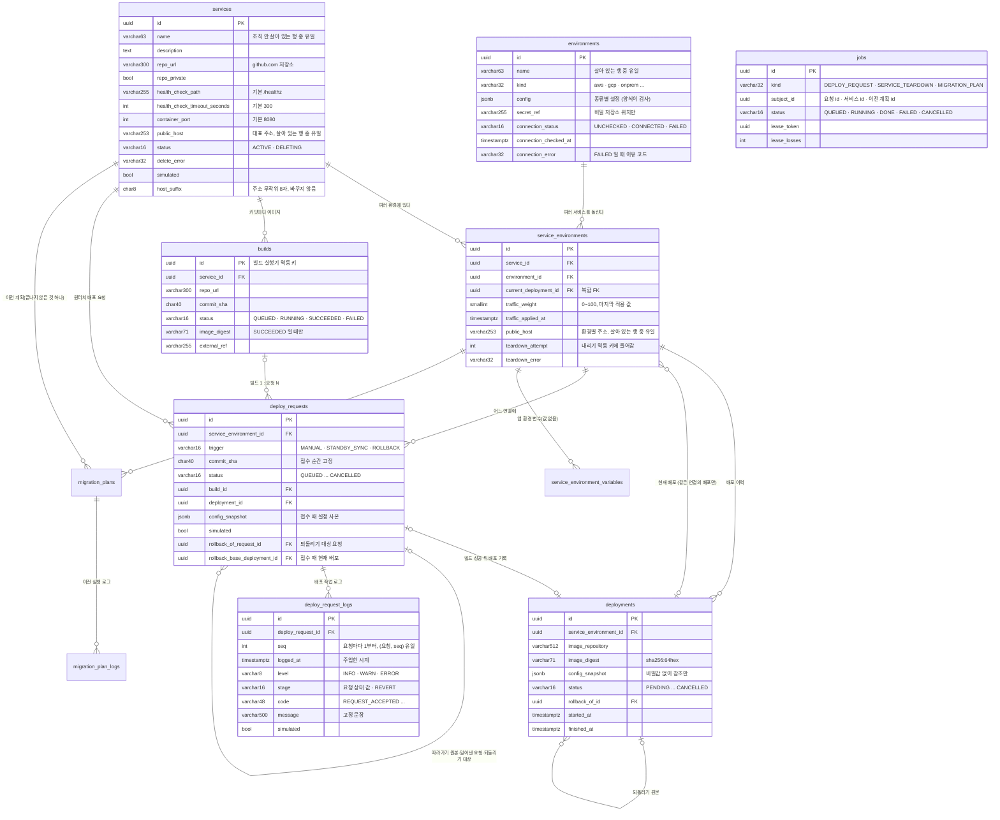
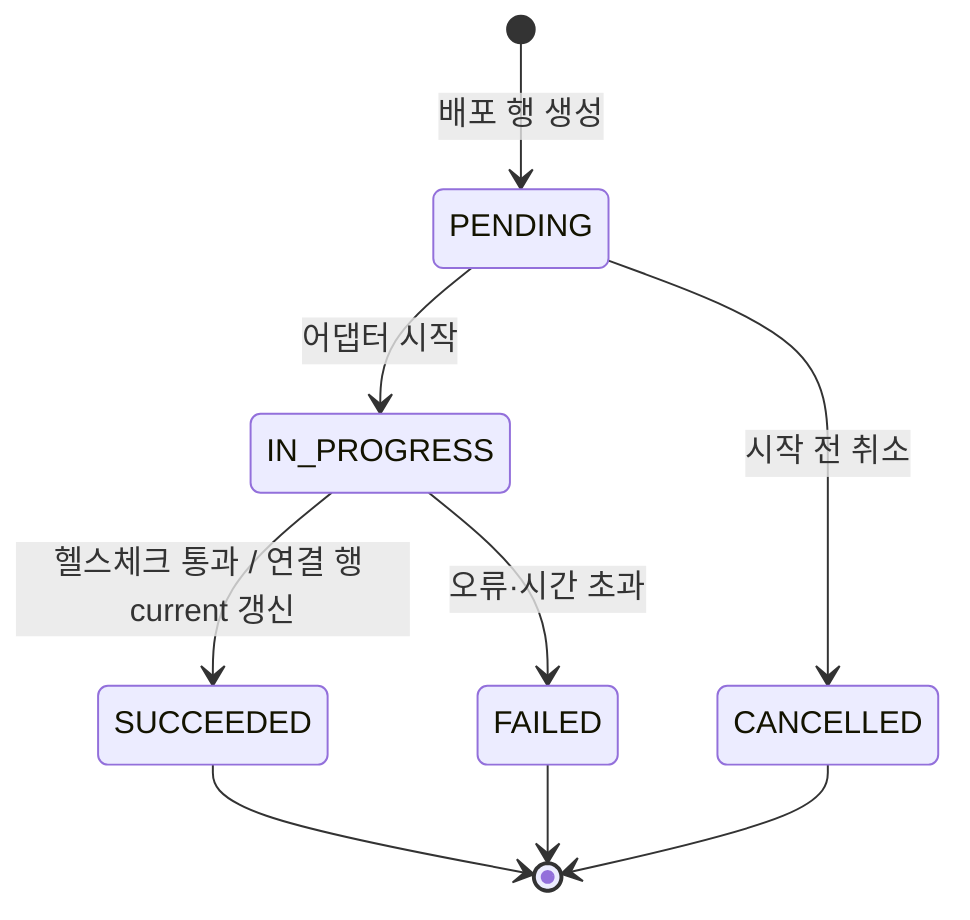
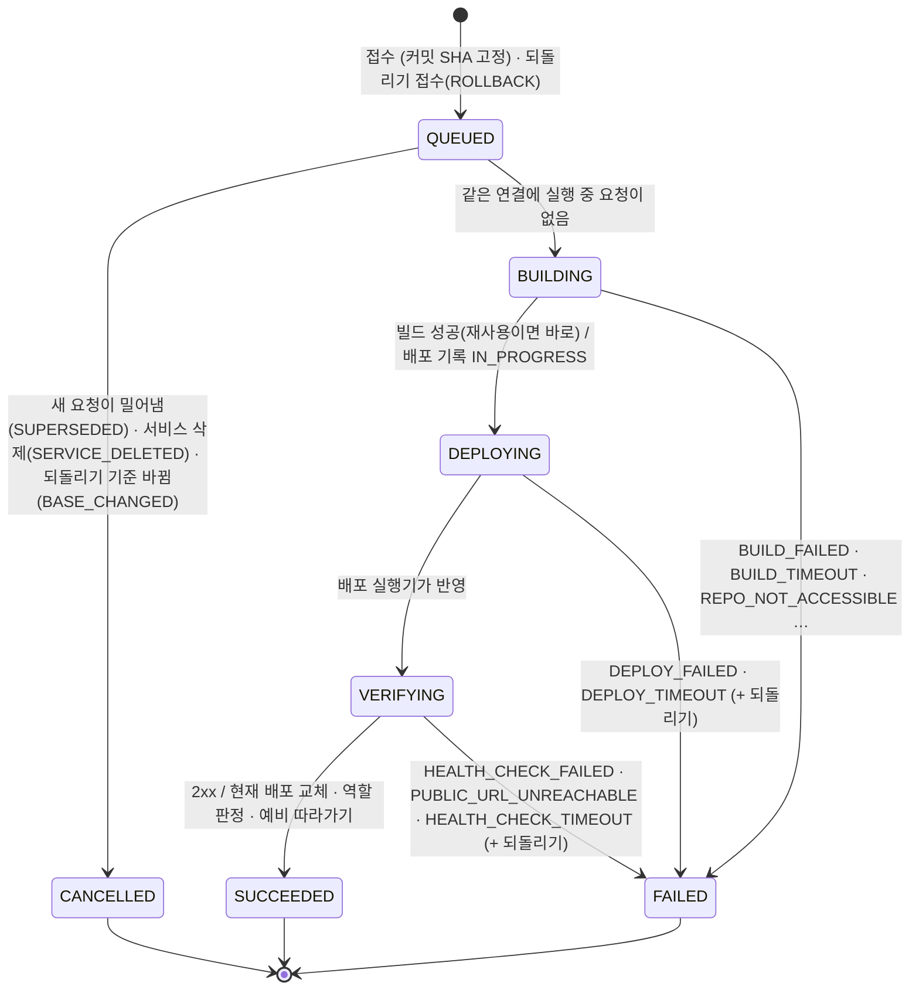
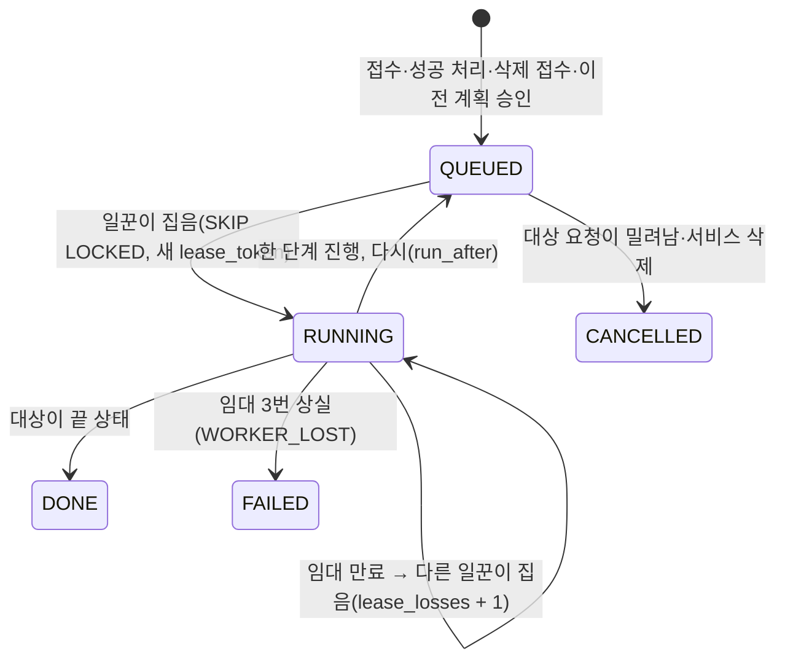
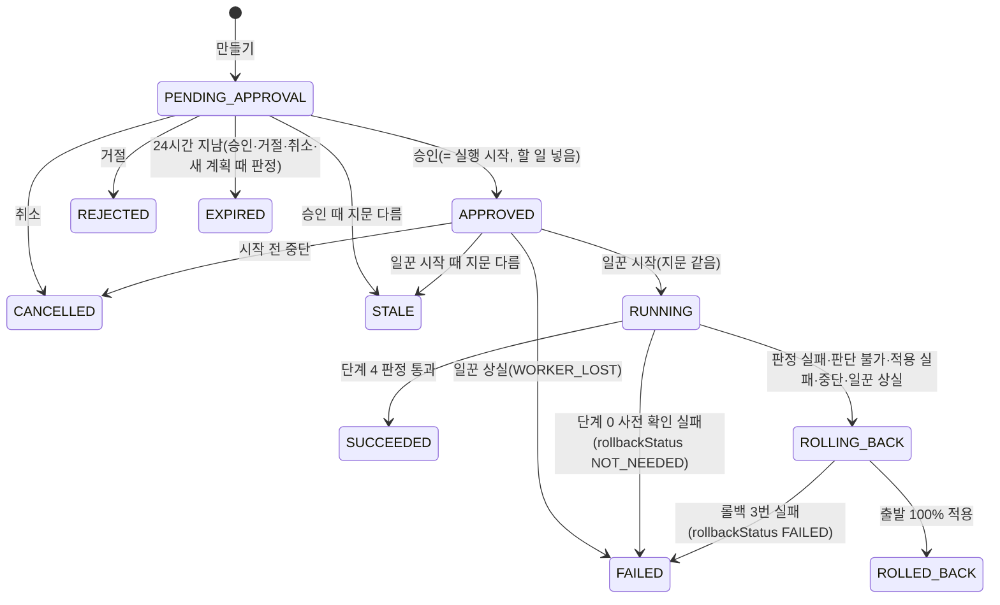
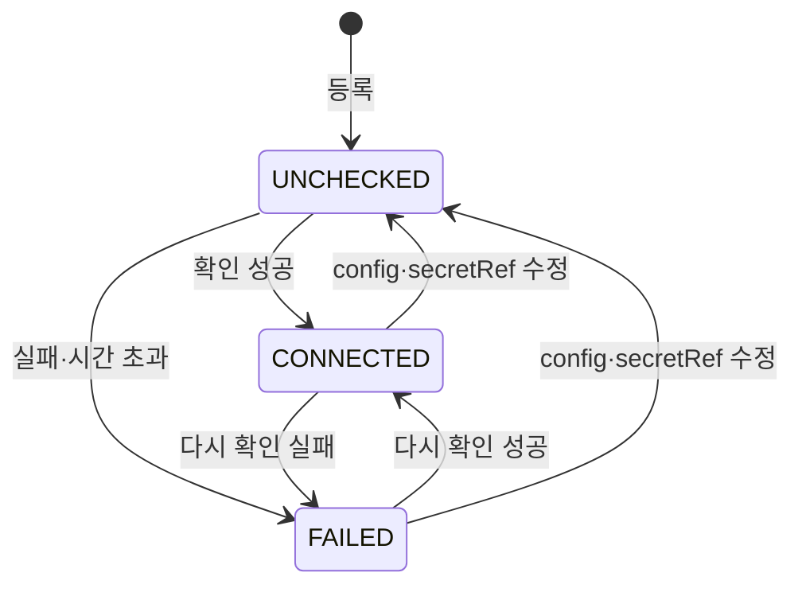
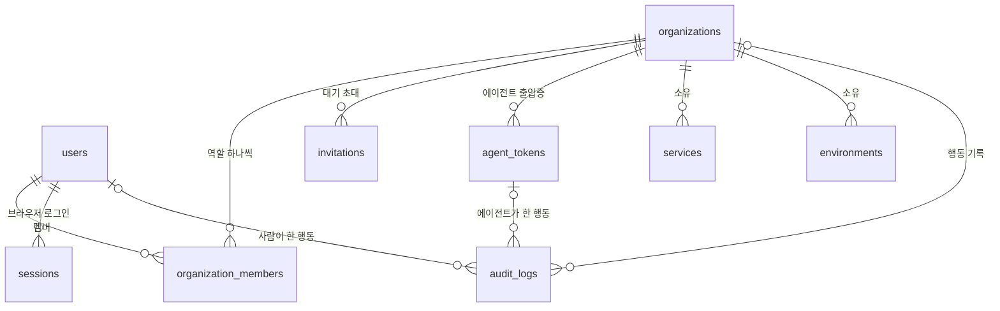

# 공통 모델 스키마 — 환경·서비스·배포·조직

> 서비스 하나가 여러 환경(AWS·GCP·온프레)에 **동시에** 있을 수 있다. 클라우드 간 이전 중에는 같은 이미지를 A·B 두 곳에서 함께 돌리며 트래픽을 옮긴다.
> 새 환경 종류는 **설정 양식 파일 하나**로 더하고 표는 고치지 않는다(NFR-15).

- 원본: 이 파일(코드와 같은 커밋에서 고친다). 노션 설계 문서는 이 파일을 옮긴 것이다.
- 물리 DDL: [.claude/rules/db-schema.sql](../.claude/rules/db-schema.sql) (`scripts/dump_schema.sh` 로 뽑음) · 용어: [term-dictionary.md](../.claude/rules/term-dictionary.md)
- 근거: 원장 F1(원터치 배포·되돌리기), F2(공통 모델·어댑터), F3(환경 카드), F4·F5·F16(역할·거부 기록·에이전트 읽기 전용), F7(단계적 트래픽 전환), NFR-07(권한), NFR-15(이식성)
- **조직(API 서버 6)**: 서비스·환경은 고객 조직 하나에 속한다(`organization_id`). 배포 연결·배포·배포 요청·빌드·할 일은 서비스를 통해 조직에 속한다. 사람·조직·멤버·초대·세션·에이전트 토큰·거부 기록 표는 ⑨.

---

## ① 한눈에 보기 (ER)



`services`·`environments`·`service_environments` 는 소프트 삭제 칸(`is_deleted`, `deleted_at`)을, 모든 표가 `created_at`·`updated_at` 을 가진다(그림에서는 생략, 원터치 배포 표의 칸도 일부만 적었다. 전체는 ②).

---

## ② 표별 칸 설명

공통 규칙

- PK 는 `id uuid`. ORM 은 Python 에서 만들고(flush 전에 id 를 알 수 있게), SQL 로 직접 넣으면 DB 가 `gen_random_uuid()` 로 만든다.
- `created_at`·`updated_at`: `timestamptz NOT NULL DEFAULT now()`. `updated_at` 은 ORM 으로 수정할 때 갱신된다.
- 소프트 삭제: `is_deleted boolean NOT NULL DEFAULT false`, `deleted_at timestamptz NULL`, `CHECK (is_deleted = (deleted_at IS NOT NULL))`. 유일성은 `WHERE is_deleted = false` 부분 unique index 로 건다 → 지운 이름은 다시 쓸 수 있다.
- 이름 칸: Kubernetes 이름 규칙 `^[a-z0-9]([-a-z0-9]{0,61}[a-z0-9])?$` CHECK (클러스터 리소스 이름으로 그대로 쓴다).
- FK 삭제 동작은 모두 `RESTRICT`. 상태·범위 값은 PostgreSQL ENUM 대신 `varchar`/`smallint` + CHECK (값 추가가 `ALTER TYPE` 보다 쉽다).

### `services` — 서비스

| 칸 | 타입 | NULL | 제약 | 뜻 |
|---|---|---|---|---|
| `id` | uuid | N | PK | |
| `name` | varchar(63) | N | 이름 형식 CHECK, `uq_services_org_name_live`(`organization_id`, `name`) | 서비스 이름(예 `shop-api`). 바꿀 수 없다(주소가 이름에서 나온다). **조직 안에서** 유일(API 서버 3-1. 주소 유일성은 `host_suffix` 가 맡으므로 다른 조직과는 겹쳐도 된다) |
| `description` | text | Y | | 설명 |
| `repo_url` | varchar(300) | N | | 정규화한 `https://github.com/<owner>/<repo>` |
| `repo_private` | boolean | N | | 등록·수정 때 GitHub 가 알려 준 비공개 여부 |
| `health_check_path` | varchar(255) | N | 기본 `/healthz`, `LIKE '/%'` | 헬스체크 경로 |
| `health_check_timeout_seconds` | integer | N | 기본 300, `BETWEEN 10 AND 1800` | 헬스체크 마감(VERIFYING 시작부터) |
| `container_port` | integer | N | 기본 8080, `BETWEEN 1 AND 65535` | 앱이 듣는 포트 |
| `public_host` | varchar(253) | N | `uq_services_public_host_live` | 대표 주소 `{name}-{host_suffix}.{public_base_domain}`(예 `shop-api-a1b2c3d4.echoport.uk`). 만들 때 한 번 정한다. 레이블이 63자를 넘으면 `{name}` 을 54자로 자르고 끝의 `-` 를 뗀다 |
| `status` | varchar(16) | N | 기본 `ACTIVE`, `ACTIVE`·`DELETING` CHECK | 삭제를 받으면 `DELETING`, 다 내리면 소프트 삭제 |
| `delete_error` | varchar(32) | Y | `delete_error IS NULL OR status = 'DELETING'` | 내리기 실패 이유(`TEARDOWN_FAILED`·`TEARDOWN_TIMEOUT`·`WORKER_LOST`) |
| `simulated` | boolean | N | 기본 false | 가짜 소스 저장소 클라이언트로 등록했는지(저장 값) |
| `organization_id` | uuid | N | FK `organizations.id`, `ix_services_organization_id` | 서비스가 속한 조직(API 서버 6) |
| `host_suffix` | char(8) | N | `ck_services_host_suffix_format`(`^[a-z0-9]{8}$`) | 대표·환경별 주소에 붙는 무작위 8자(`secrets`). 만들 때 한 번 정하고 바꾸지 않는다(API 서버 3-1) |

- **고객 앱 주소(API 서버 3-1, [SPEC](../specs/api-3-1-public-host-format.md))**: 대표 `{서비스}-{suffix}.{도메인}`, 환경별 `{서비스}-{환경}-{같은 suffix}.{도메인}`. 기본 도메인 바로 아래 한 단계라 DNS·인증서 `*.도메인` 하나로 모든 고객 앱을 덮는다. 무작위 suffix 때문에 지운 서비스와 같은 이름으로 새 서비스를 만들어도 옛 주소를 잇지 못한다(하위 도메인 탈취 방지). 대표 주소가 이미 쓰이면(서비스·연결 표 어디든) 새 suffix 로 3번까지 다시 시도하고 그래도 겹치면 409 `PUBLIC_HOST_CONFLICT`. 이 SPEC 이 [API 6 SPEC](../specs/api-6-github-login-roles.md) 의 "서비스 이름은 Echo 전체 유일"을 "조직 안에서 유일"로 바꾼다.
- `host_suffix` revision(`1d1601c0111a`)은 NOT NULL·기본값 없는 칸을 더하고 주소 형식을 바꾸므로 `services`·`service_environments` 가 비어 있다고 가정한다(옛 주소를 백필하지 않는다). 행이 있으면 분명한 메시지(`services has N rows …`)로 실패한다.
- 원터치 배포 칸은 기존 표에 `add_column` 으로 더해 DB 에서 맨 뒤에 놓인다(모델은 `sort_order=APPENDED_COLUMN_SORT_ORDER`). 이 revision 은 `services`·`service_environments` 행이 0개라고 가정하고, 행이 있으면 칸을 더하기 전에 분명한 메시지로 실패한다(NOT NULL·기본값 없는 칸).

### `environments` — 환경

| 칸 | 타입 | NULL | 제약 | 뜻 |
|---|---|---|---|---|
| `id` | uuid | N | PK | |
| `name` | varchar(63) | N | 이름 형식 CHECK, `uq_environments_org_name_live`(`organization_id`, `name`) | 환경 이름(예 `aws-seoul`). **조직 안에서** 유일 |
| `kind` | varchar(32) | N | **DB CHECK 없음** — 설정 양식 레지스트리가 검사 | 환경 종류(`aws`·`gcp`·`onprem`) |
| `config` | jsonb | N | 기본 `{}`, `jsonb_typeof(config) = 'object'` | 종류별 설정. 형식은 종류의 설정 양식이 저장 전에 검사 |
| `secret_ref` | varchar(255) | Y | API 가 형식 검사(아래) | 접속 자격 증명의 **보관 위치**(값 아님). API 등록 때는 필수 |
| `connection_status` | varchar(16) | N | 기본 `UNCHECKED`, 3개 값 CHECK(`ck_environments_connection_status_valid`) | 마지막 접속 확인 결과. ④-2 상태 흐름 |
| `connection_checked_at` | timestamptz | Y | `(status = 'UNCHECKED') = (checked_at IS NULL)` (`ck_environments_connection_checked_at_consistency`) | 마지막 확인 시각 |
| `connection_error` | varchar(32) | Y | `(status = 'FAILED') = (error IS NOT NULL)` (`ck_environments_connection_error_consistency`). **값 CHECK 없음** — 앱이 `ConnectionErrorCode` 값만 쓴다 | 실패 이유 코드(`TIMEOUT`·`SECRET_NOT_FOUND` …) |
| `organization_id` | uuid | N | FK `organizations.id` | 환경이 속한 조직(API 서버 6) |

- 접속 상태 세 칸은 기존 표에 `add_column` 으로 더해 DB 에서 맨 뒤(소프트 삭제 칸 뒤)에 놓인다. 모델도 `sort_order=APPENDED_COLUMN_SORT_ORDER`(200)로 같은 순서를 쓴다.
- `secret_ref` 형식(저장소 이름은 첫 콜론에서 나눈다): `env:ECHO_SECRET_<조직 키>__<NAME>`(서버 프로세스 환경변수, 지금 실제 조회하는 유일한 저장소. 조직 키 = slug 대문자·`-`→`_`) · `k8s:<namespace>/<secret>/<key>` · `aws-sm:<이름 또는 ARN>` · `gcp-sm:projects/<p>/secrets/<s>[/versions/<v>]`. 자세한 규칙은 [docs/api/environments.md](api/environments.md).

### `service_environments` — 서비스-환경 연결

| 칸 | 타입 | NULL | 제약 | 뜻 |
|---|---|---|---|---|
| `id` | uuid | N | PK | |
| `service_id` | uuid | N | FK `services.id` | |
| `environment_id` | uuid | N | FK `environments.id` | |
| `current_deployment_id` | uuid | Y | 복합 FK `(current_deployment_id, id)` → `deployments(id, service_environment_id)` | 지금 이 연결에서 돌고 있는 배포 |
| `traffic_weight` | smallint | N | 기본 0, `BETWEEN 0 AND 100` | 마지막으로 앞단 프록시에 적용한 비율(%) |
| `traffic_applied_at` | timestamptz | Y | | 그 비율을 적용한 시각 |
| `public_host` | varchar(253) | N | `uq_service_environments_public_host_live` | 환경별 주소 `{서비스}-{환경}-{서비스의 host_suffix}.{public_base_domain}`. 만들 때 한 번 정한다(환경 이름이 바뀌어도 그대로). 레이블이 63자를 넘으면 `{서비스}-{환경}` 을 54자로 자른다(서비스 이름이 53자 이상이면 대표 주소와 같아지고, 같은 서비스의 두 번째 연결은 409 `PUBLIC_HOST_CONFLICT`) |
| `teardown_attempt` | integer | N | 기본 0 | 서비스 삭제 재시도 횟수. 내리기 멱등 키 = `{id}:{teardown_attempt}` |
| `teardown_requested_at` | timestamptz | Y | | 내리기를 요청한 시각(제한 시간 기준) |
| `teardown_external_ref` | varchar(255) | Y | | 내리기 실행기의 작업 번호 |
| `teardown_error` | varchar(32) | Y | | 이 연결 내리기 실패 이유 |
| (유일성) | | | `uq_service_environments_service_id_environment_id_live` | 같은 서비스×환경의 살아 있는 연결은 하나 |

- **연결을 만드는 쪽(API 서버 3 배포 요청 접수)은 대상 환경 행을 `SELECT ... FOR SHARE` 로 잠근 뒤 연결을 만든다.** 환경 삭제는 같은 행을 `FOR UPDATE` 로 잠그고 살아 있는 연결이 있는지 본 뒤 소프트 삭제하므로(있으면 409 `ENVIRONMENT_IN_USE`), 둘은 서로 기다려 "지운 환경에 새 연결"이 생기지 않는다. `FOR UPDATE` 가 아니라 `FOR SHARE` 인 이유: 일꾼이 서비스 행을 잡은 채 이 환경을 FK 로 가리키는 행을 쓰면 `FOR KEY SHARE` 를 잡는데, 접수가 `FOR UPDATE` 를 쥐고 서비스 행을 기다리면 교착이 생긴다(`FOR SHARE` 는 `FOR KEY SHARE` 와 부딪히지 않는다). API 서버 2 SPEC 의 "FOR UPDATE" 를 이렇게 바꿨다. 연결은 그 환경의 첫 배포 요청 때 자동으로 만든다(`traffic_weight = 0`).
- **역할은 저장하지 않고 계산한다**: `traffic_weight > 0` 이면 서비스 중(SERVING), 0 이고 현재 배포가 있으면 예비(STANDBY), 현재 배포가 없으면 NONE. 첫 성공 연결은 가짜 대표 주소 라우터가 "적용했다"고 답한 뒤 `traffic_weight = 100` 이 된다.

### `service_environment_variables` — 고객 앱 환경 변수 (API 서버 10)

**값 칸이 없다.** 값은 비밀 보관함(GCP Secret Manager)에만 있고 여기에는 위치와 최신 버전 번호만 둔다(NFR-17). API 는 [api/variables.md](api/variables.md), 주입 규칙은 [executors.md](executors.md#앱-환경-변수-ns-env-api-서버-10).

| 칸 | 타입 | NULL | 제약 | 뜻 |
|---|---|---|---|---|
| `id` | uuid | N | PK | |
| `service_environment_id` | uuid | N | FK `service_environments.id` RESTRICT | 어느 연결(서비스 × 환경)의 변수인가 |
| `key` | varchar(64) | N | `^[A-Z][A-Z0-9_]{0,63}$` | 이름 |
| `secret_name` | varchar(255) | N | | 보관함 비밀 id(프로젝트 제외) |
| `latest_version` | integer | N | `> 0` | 보관함의 최신 버전 번호 |
| `updated_by_user_id` | uuid | N | FK `users.id` RESTRICT | 마지막으로 넣은 사람 |
| (유일성) | | | `uq_service_environment_variables_connection_key_live` | 같은 연결·키의 살아 있는 행은 하나 |
| (조회) | | | `ix_service_environment_variables_connection_key` | 지운 행까지 찾기(이전 `secret_name`) |

- 소프트 삭제 칸이 있다. 키 삭제·서비스 삭제는 행만 삭제 표시하고 보관함 비밀은 남긴다.
- 같은 키를 지운 뒤 다시 넣으면 새 행이 **이전 행의 `secret_name` 을 그대로 쓰고** 보관함 버전이 이어진다. 그래서 옛 배포 기록의 `versions/<n>` 이 다른 값을 가리키지 않는다.
- 배포 기록은 이 표를 다시 읽지 않는다. 배포 때 고른 버전을 `deployments.config_snapshot.envVars` 에 참조로 고정한다.

### `builds` — 빌드

| 칸 | 타입 | NULL | 제약 | 뜻 |
|---|---|---|---|---|
| `id` | uuid | N | PK | 빌드 실행기의 멱등 키 |
| `service_id` | uuid | N | FK `services.id` | |
| `repo_url` | varchar(300) | N | | 접수 때 고정한 저장소 |
| `commit_sha` | char(40) | N | `^[0-9a-f]{40}$` | |
| `status` | varchar(16) | N | 기본 `QUEUED`, 4개 값 CHECK | ④-3 |
| `image_repository`·`image_digest` | varchar(512)·varchar(71) | Y | digest 형식 CHECK, `SUCCEEDED ⇔ 둘 다 있음` | 빌드 결과 |
| `start_requested_at` | timestamptz | Y | | 시작을 요청한 시각(호출 전에 커밋) |
| `external_ref` | varchar(255) | Y | | 빌드 실행기의 작업 번호 |
| `error_code` | varchar(32) | Y | `FAILED ⇔ 값 있음` | `BUILD_FAILED`·`BUILD_TIMEOUT`·`REPO_NOT_ACCESSIBLE`… |
| `simulated` | boolean | N | | 가짜 빌드 실행기 결과인지 |
| `started_at`·`finished_at` | timestamptz | Y | 끝 상태 ⇔ `finished_at` 있음 | 제한 시간은 `started_at` 기준 |
| (재사용) | | | `uq_builds_service_id_repo_url_commit_sha_not_failed` (`WHERE status <> 'FAILED'`) | 같은 서비스·저장소·커밋의 실패하지 않은 빌드는 하나. 실패 뒤에는 새 빌드 |

### `deploy_requests` — 배포 요청 (지우지 않는 이력)

| 칸 | 타입 | NULL | 제약 | 뜻 |
|---|---|---|---|---|
| `id` | uuid | N | PK | 접수 번호 |
| `service_id`·`environment_id`·`service_environment_id` | uuid | N | FK | 어느 서비스를 어느 연결에 |
| `trigger` | varchar(16) | N | `MANUAL`·`STANDBY_SYNC`·`ROLLBACK`, `STANDBY_SYNC ⇔ source_request_id 있음` | 사람이 보냈나, 예비 따라가기인가, 되돌리기인가(API 서버 4) |
| `source_request_id` | uuid | Y | FK 자기 참조 | 따라가기의 원본 요청 |
| `ref_type`·`ref_value` | varchar(8)·varchar(255) | N | `BRANCH`·`COMMIT` | 사용자가 준 브랜치·커밋 |
| `repo_url`·`commit_sha` | varchar(300)·char(40) | N | SHA 형식 CHECK | **접수 순간 고정**한 저장소·커밋 |
| `status` | varchar(16) | N | 7개 값 CHECK | ④-3 |
| `cancel_reason` | varchar(16) | Y | `SUPERSEDED`·`SERVICE_DELETED`·`BASE_CHANGED`, `CANCELLED ⇔ 값 있음` | `BASE_CHANGED`: 되돌리기를 시작할 때 현재 배포가 접수 때와 달랐다 |
| `superseded_by_id` | uuid | Y | FK 자기 참조 | 이 요청을 밀어낸 새 요청 |
| `error_code` | varchar(32) | Y | `FAILED ⇔ 값 있음`, 값 CHECK 없음 | 실패 이유 코드 |
| `build_id`·`build_reused` | uuid·boolean | Y | FK `builds.id`, 둘은 함께 NULL | 쓰는 빌드와 재사용 여부 |
| `deployment_id` | uuid | Y | FK `deployments.id` | 빌드 성공 뒤 만든 배포 기록(배포 실행기 멱등 키) |
| `deploy_requested_at`·`deploy_external_ref` | timestamptz·varchar(255) | Y | | 배포 실행기 호출 기록 |
| `revert_status`·`revert_external_ref` | varchar(16)·varchar(255) | Y | `SUCCEEDED`·`FAILED` | 배포 기록이 생긴 뒤 실패했을 때 되돌리기 결과 |
| `last_health_result` | varchar(16) | Y | `OK`·`HTTP_ERROR`·`UNREACHABLE` | 마지막 헬스체크 결과 종류(마감 때 실패 코드를 정한다) |
| `config_snapshot` | jsonb | N | object CHECK | 접수 때 설정 사본 `{healthCheckPath, healthCheckTimeoutSeconds, containerPort, mainUrl, environmentUrl}`. 비밀값 없음 |
| `simulate` | jsonb | Y | object CHECK | `{"failAt": …}` 가짜 모드 실패 지정 |
| `simulated` | boolean | N | | 가짜 실행기로 처리했는지(저장 값) |
| `building_at`·`deploying_at`·`verifying_at`·`started_at`·`finished_at` | timestamptz | Y | 끝 상태 ⇔ `finished_at` 있음 | 단계 시각(배포·헬스 제한 시간 기준) |
| `rollback_of_request_id` | uuid | Y | FK 자기 참조, `ROLLBACK ⇔ 값 있음`, 자기 자신 금지 | 되돌리기 대상(이력에서 고른 `SUCCEEDED` 요청). API 서버 4 |
| `rollback_base_deployment_id` | uuid | Y | FK `deployments.id`, `ROLLBACK ⇔ 값 있음` | 되돌리기 접수 순간 연결의 현재 배포. 시작 때 다르면 `CANCELLED(BASE_CHANGED)` |
| (실행 1 + 대기 1) | | | `uq_deploy_requests_service_environment_id_active`(`BUILDING`·`DEPLOYING`·`VERIFYING`), `uq_deploy_requests_service_environment_id_queued`(`QUEUED`) | 같은 연결에 실행 중 1개 + 대기 1개까지 |
| (삭제 금지) | | | `BEFORE DELETE` 트리거 `trg_deploy_requests_prevent_delete` → 공용 함수 `prevent_append_only_delete()` | 행 DELETE 는 예외(23001) |

- 인덱스: `(service_id, created_at)`(목록), `(service_environment_id, created_at)`(연결별 최근 요청), `build_id`(빌드를 기다리는 요청), `rollback_of_request_id`(되돌리기 대상).
- 되돌리기 요청은 대상의 `commit_sha`·`repo_url`·`build_id`(`build_reused = true`)와 대상 배포 기록의 `config_snapshot` 사본을 쓰고 `ref = COMMIT` 이다. 새 배포 기록은 `deployments.rollback_of_id = 대상 요청의 deployment_id` 다.

### `deploy_request_logs` — 배포 작업 로그 (지우지 않는 기록, API 서버 4)

| 칸 | 타입 | NULL | 제약 | 뜻 |
|---|---|---|---|---|
| `id` | uuid | N | PK | |
| `deploy_request_id` | uuid | N | FK `deploy_requests.id`(RESTRICT) | 어느 요청의 줄인가 |
| `seq` | int | N | `>= 1`, unique(`deploy_request_id`, `seq`) | 요청마다 1부터 빈틈없이. 서비스 행 잠금 안에서 `max(seq) + 1` |
| `logged_at` | timestamptz | N | | 주입한 `Clock.now()`(DB `now()` 아님) |
| `level` | varchar(8) | N | `INFO`·`WARN`·`ERROR` | |
| `stage` | varchar(16) | N | | 요청 상태 값 또는 `REVERT` |
| `code` | varchar(48) | N | 값 CHECK 없음(`DeployLogCode`) | `REQUEST_ACCEPTED`·`STARTED`·`BUILD_ATTACHED`·`BUILD_REUSED`·`DEPLOYMENT_CREATED`·`DEPLOY_REQUESTED`·`DEPLOY_APPLIED`·`HEALTH_PROBE_*`·`SUCCEEDED`·`STANDBY_SYNC_REQUESTED`·`FAILED`·`REVERT_*`·`CANCELLED_*`·`LOG_TRUNCATED` |
| `message` | varchar(500) | N | | 코드별 **고정 문장**(`FAILED` 는 실패 코드 문장). 외부 응답 원문·토큰 없음 |
| `simulated` | boolean | N | | 그 요청의 `simulated` |
| `created_at` | timestamptz | N | | |
| (삭제 금지) | | | `BEFORE DELETE` 트리거 `trg_deploy_request_logs_prevent_delete` → 공용 함수 `prevent_append_only_delete()` | |

- 줄은 그 줄을 일으킨 상태 전환(또는 요청 삽입)과 **같은 트랜잭션**에서, 조건부 UPDATE 가 실제로 반영됐을 때만 쓴다. 그래서 일꾼이 다시 시작해도 줄이 겹치거나 빠지지 않는다. 쓰는 지점은 접수·밀어내기·예비 따라가기·일꾼 단계·서비스 삭제 API·내리기 일꾼이 전부다([api/deploy-requests.md](api/deploy-requests.md#배포-작업-로그-줄)).
- 요청당 500줄. 500번째 자리에 `LOG_TRUNCATED` 를 쓰고 그 뒤 줄은 쓰지 않는다(상태 진행은 계속).
- 빌드 로그·실행 로그는 저장하지 않는다. 로그 API 가 실행기의 `read_logs`·`read_runtime_logs` 로 즉석 조회한다([executors.md](executors.md)).

### `jobs` — 할 일 (일꾼 큐)

| 칸 | 타입 | NULL | 제약 | 뜻 |
|---|---|---|---|---|
| `id` | uuid | N | PK | |
| `kind` | varchar(32) | N | `DEPLOY_REQUEST`·`SERVICE_TEARDOWN`·`MIGRATION_PLAN`(API 서버 8) | 일꾼이 kind 마다 처리기 하나로 보낸다. 모르는 kind 는 예외(조용히 DONE 으로 닫지 않는다) |
| `subject_id` | uuid | N | 열린 할 일 부분 unique `uq_jobs_subject_id_open`(`QUEUED`·`RUNNING`) | 배포 요청 id · 서비스 id · 이전 계획 id |
| `status` | varchar(16) | N | 5개 값 CHECK | ④-4 |
| `run_after` | timestamptz | N | 인덱스 `(status, run_after)` | 이 시각 뒤에 집는다 |
| `lease_token`·`lease_owner`·`lease_expires_at` | uuid·varchar(128)·timestamptz | Y | `RUNNING ⇔ token·만료 시각 있음` | 임대. 결과는 같은 토큰일 때만 반영 |
| `lease_losses` | integer | N | 기본 0, `>= 0` | 임대를 잃은 횟수. 3이면 `WORKER_LOST` |
| `last_error_code` | varchar(32) | Y | | 할 일을 FAILED 로 닫은 이유 |

### `migration_plans` — 이전 계획 (지우지 않는 기록, API 서버 8)

| 칸 | 타입 | NULL | 제약 | 뜻 |
|---|---|---|---|---|
| `id` | uuid | N | PK | |
| `service_id` | uuid | N | FK `services.id`, 인덱스 `(service_id, created_at)`, **부분 unique** `uq_migration_plans_service_id_open`(`WHERE status IN ('PENDING_APPROVAL','APPROVED','RUNNING','ROLLING_BACK')`) | 서비스당 끝나지 않은 계획은 하나 |
| `source_service_environment_id`·`target_service_environment_id` | uuid | N | FK `service_environments.id`, `target <> source` | 출발(지금 100%)·도착(같은 이미지의 예비) 연결 |
| `status` | varchar(16) | N | 11개 값 CHECK | ④-5 |
| `steps` | jsonb | N | 배열 | 고정 5단계 `[{index, kind, sourceWeight, targetWeight, requiredRequests, maxWaitSeconds, observeSeconds, expectedSeconds}]`. 만든 뒤 바꾸지 않는다. `observeSeconds` 는 롤링 배포 중 옛 파드용으로 `maxWaitSeconds` 와 같은 값을 적는다(응답에 없음, 8-1 전 계획은 `requiredRequests`·`maxWaitSeconds` 가 없다) |
| `step_results` | jsonb | N | 배열 | 같은 길이 `[{index, status, startedAt, finishedAt, metrics, failureCode, counting?, judgeReason?}]`. 바꿀 때 통째로 다시 넣는다. 비율 단계의 `counting` 은 건수 세기 상태(`requiredRequests`·`allowedErrors5xx`·`startedAt`·`updatedAt`, 출발·도착마다 `baseline`·`last`·`carried`·`lastReadAt`), `judgeReason` 은 세기를 끝낸 이유(`COUNT_REACHED`·`LOW_TRAFFIC`) |
| `rollback_conditions` | jsonb | N | 객체 | `{maxErrorRatePercent, maxP95Ms, maxReplicationLagSeconds}` |
| `observe_seconds`·`expected_seconds` | int | N | 1~600 · `>= 0` | 비율 단계 최대 대기(API `maxWaitSeconds`, 8-1 전 계획은 지켜보기 시간) · 계획 전체 예상 시간 |
| `fingerprint` | jsonb | N | 객체 | 만든 순간의 상태(서비스 상태·연결 값·출발/도착 환경의 config·secret_ref **해시**와 접속 상태·열린 배포 요청). 승인·일꾼 시작 때 다시 계산해 다르면 `STALE` |
| `simulate`·`simulated` | jsonb NULL · bool | | 객체 | 가짜 실패 지정 `{failAtStep, reason}` · 가짜 실행기로 만든 계획 |
| `current_step`·`step_phase`·`phase_started_at`·`observe_until` | smallint · varchar(8) NULL · timestamptz NULL | | 0~4 · `APPLY`·`OBSERVE`·`JUDGE` | 일꾼이 어디까지 했는지 |
| `traffic_requested_at`·`rollback_requested_at`·`rollback_attempts` | timestamptz NULL · smallint | | `>= 0` | 트래픽 실행기 "요청함 시각"(멱등 키로 다시 부를 근거)·롤백 시도 횟수 |
| `error_code`·`rollback_status` | varchar NULL | | 값 CHECK, `(ROLLING_BACK·ROLLED_BACK·FAILED) ⇔ error_code` | 원인 코드 · `SUCCEEDED`·`FAILED`·`NOT_NEEDED` |
| `created_by_user_id`(N)·`approved_by_user_id`·`rejected_by_user_id`·`cancelled_by_user_id`·`aborted_by_user_id` | uuid | | FK `users.id`, `approved_by ⇔ approved_at` | 사람 칸 |
| `self_approved` | bool | N | 기본 false | 만든 사람이 승인했나(조직 스위치가 켜져 있을 때만 가능) |
| `approved_at`·`started_at`·`finished_at`·`abort_requested_at`·`expires_at`(N) | timestamptz | | `끝 상태 ⇔ finished_at` | 승인 대기 만료는 만든 시각 + 24시간 |
| (삭제 금지) | | | `BEFORE DELETE` 트리거 `trg_migration_plans_prevent_delete` → `prevent_append_only_delete()` | |

### `migration_plan_logs` — 이전 실행 로그 (지우지 않는 기록, API 서버 8)

| 칸 | 타입 | NULL | 제약 | 뜻 |
|---|---|---|---|---|
| `migration_plan_id` | uuid | N | FK `migration_plans.id` | |
| `seq` | int | N | `>= 1`, unique(`migration_plan_id`, `seq`) | 계획마다 1부터 빈틈없이(서비스 행 잠금 안에서 `max + 1`) |
| `step` | smallint | Y | 0~4 | 계획 단계 번호. 계획 전체 줄(만들기·승인 등)은 NULL |
| `logged_at`·`level`·`code`·`message` | | N | `level` CHECK, `code` 는 값 CHECK 없음(`MigrationLogCode`) | 주입 시계 · 코드별 고정 문장 |
| `data` | jsonb | Y | 객체 | 비율·지표 숫자(낡은 계획이면 `changed` 항목 이름)만 |
| `simulated` | bool | N | | 그 계획의 `simulated` |
| (삭제 금지) | | | 트리거 `trg_migration_plan_logs_prevent_delete` | |

- 계획당 500줄(500번째 자리에 `LOG_TRUNCATED`). 줄은 상태 변경과 같은 트랜잭션에서 반영됐을 때만 쓴다.
- `organizations.allow_self_approval`(bool, 기본 false): 만든 사람의 자기 승인 허용 스위치(⑨).
- revision `4cea1ec99f1b` downgrade 는 `MIGRATION_PLAN` 할 일 행이 있으면 분명한 메시지(`jobs has N MIGRATION_PLAN rows …`)로 실패한다.

### `findings` — 보안 증거 (보안·거버넌스 2)

검사 원문(Trivy·gitleaks·TLS 접속 시험)이나 사람 점검 기록을 공통 형태로 바꾼 한 건. 보안 규칙표(`app/services/security_rules.py`)가 판정에 쓴다. 결과는 고치지 않고, 다시 검사하면 새 행이다.

| 칸 | 타입 | NULL | 제약 | 뜻 |
|---|---|---|---|---|
| `organization_id` | uuid | N | FK `organizations.id` | 조회는 늘 조직 조건을 건다 |
| `service_id`·`environment_id` | uuid | Y | FK | 통제가 정한 범위만 채운다 |
| `image_digest`·`config_commit`·`was_version` | varchar | Y | digest 형식 | 이미지·설정 커밋·WAS 버전 범위 |
| `control_id`·`result`·`mode`·`source` | varchar | N | 값 CHECK | 통제 ID(`C-IMG-1` 등)·결과·모드·출처(용어 사전 §3 보안 판정 값) |
| `reason` | varchar(64) | N | 값 CHECK 없음(`SecurityFindingReason`) | 정규화 이유 |
| `policy_version`·`tool_version` | varchar | N·Y | | 결과를 만든 규칙표 버전 · 검사 도구 버전 |
| `source_ref` | varchar(500) | Y | | 원문 위치(검사 워크플로 실행·산출물 등) |
| `items`·`total_items` | jsonb·int | N | 배열, `>= 0` | 근거 줄(최대 50, 값 없는 칸은 키 없음)과 전체 개수. **비밀값 원문 없음** |
| `reviewer_user_id`·`basis_url` | uuid·text | Y | `source = MANUAL_REVIEW` 면 둘 다 필수 | 사람 점검자·근거 링크 |
| `confirmation` | varchar | Y | `source = AI_REVIEW` 일 때만 있음 | AI 결과의 사람 확인 상태 |
| `collected_at`·`expires_at` | timestamptz | N | `expires_at > collected_at` | 수집 시각·만료(수집 + 통제 유효기간) |

- `source = AI_REVIEW` 인 행은 `result` 가 `WARN`·`FAIL`·`UNKNOWN` 만 된다(`ck_findings_ai_result_not_pass`). AI 결과로 PASS 를 만들 수 없다.
- 인덱스 `(organization_id, control_id, collected_at)`. 판정용 조회는 만료 전 증거를 최신순으로 최대 500건 읽는다.

### `security_exceptions` — 기한부 예외 (보안·거버넌스 3)

통제 하나를 범위 안에서 최대 7일 막지 않게 하는 기록. 걸린 통제는 PASS 가 아니라 WARN 으로 보인다. 판정 규칙(`security_rules._is_valid_exception`)이 승인·자기 승인·기간·범위를 다시 본다.

| 칸 | 타입 | NULL | 제약 | 뜻 |
|---|---|---|---|---|
| `organization_id` | uuid | N | FK | 조직 |
| `control_id` | varchar(16) | N | 값 CHECK | 막지 않을 통제(`C-DB-1` 등) |
| `service_id`·`environment_id`·`image_digest`·`config_commit`·`was_version` | | Y | FK·digest 형식 | 범위(통제가 정한 것만, `findings` 와 같은 방식) |
| `reason` | text | N | 공백 아님, 1000자 이하 | 사유 |
| `requested_by_user_id` | uuid | N | FK `users` | 요청한 사람(에이전트는 못 함) |
| `approved_by_user_id`·`approved_at` | | Y | 둘이 함께 | 승인한 사람. 승인 전에는 판정에 쓰지 않는다 |
| `expires_at` | timestamptz | N | `created_at` 뒤, 7일 안 | 만료 |
| `revoked_by_user_id`·`revoked_at` | | Y | 둘이 함께 | 철회 |

### `agent_runners` — AI 러너 신원 (WAS ↔ 러너 계약 v1)

샌드박스 VM 의 러너 하나. 조직에 묶이지 않는다. 러너 토큰(`echo_rnr_…`)은 어드민 명령으로만 발급하고 `token_hash`(SHA-256 16진 64자, unique)만 둔다. `name` 은 RFC 1123 label, `revoked_at` 이 있으면 쓰지 않는다.

### `agent_runs` — AI 실행 (WAS ↔ 러너 계약 v1)

| 칸 | 타입 | NULL | 제약 | 뜻 |
|---|---|---|---|---|
| `organization_id`·`service_id` | uuid | N | FK | 실행 대상 |
| `kind` | varchar(16) | N | `PRECHECK`·`APPLY_PATCH`·`CHANGE_PROPOSAL` | 사전 점검 · 승인한 패치 반영 · (P1) 수정안만 |
| `status` | varchar(16) | N | 값 CHECK, 기본 `QUEUED` | ④-6 흐름 |
| `source_environment_id`·`target_environment_id` | uuid | Y | FK. `PRECHECK` 은 도착 필수 | 출발·도착 환경 |
| `parent_run_id` | uuid | Y | FK `agent_runs`. `APPLY_PATCH` 은 필수 | 패치를 낸 사전 점검 |
| `scenario_ref` | varchar(200) | Y | | 점검·수정할 사본(시나리오) 위치 |
| `input_snapshot`·`input_hash` | jsonb·varchar(71) | N | 객체 · `sha256:` 64자 | 만들 때 고정한 입력(비밀 참조만)과 그 해시 |
| `requested_by_user_id` | uuid | N | FK `users` | 요청한 사람(반영 실행은 승인한 사람) |
| `claimed_by_runner_id`·`run_token_hash`·`lease_until`·`claimed_at` | | Y | `CLAIMED`·`RUNNING` 이면 러너·토큰 해시·임대 필수, 토큰 해시 unique | 가져간 러너와 실행 토큰(실행 하나만, 해시만) |
| `deadline_at` | timestamptz | N | `created_at` 뒤 | 마감(기본 15분) |
| `started_at`·`finished_at` | timestamptz | Y | 끝 상태 ⇔ `finished_at` 있음 | |
| `failure_code` | varchar(32) | Y | `FAILED`·`TIMED_OUT` 일 때만 | 실패 이유 |
| `result` | jsonb | Y | `SUCCEEDED`·`FAILED` 일 때만, 객체 | 러너 결과(WAS 가 스키마·크기·AI PASS 금지를 검증한 뒤) |
| `model_id`·`prompt_version`·`simulated` | | | | 쓴 모델·프롬프트 버전·가짜 여부 |

- 같은 서비스에 열린 실행(`QUEUED`·`CLAIMED`·`RUNNING`)은 하나(`uq_agent_runs_service_id_open`). 가져가기는 `QUEUED` 를 오래된 순으로(`ix_agent_runs_queued_created_at`).

### `agent_run_events` — AI 실행 이벤트

러너가 낸 진행 줄. `(run_id, seq)` unique 라 같은 seq 를 다시 보내면 무시한다. `step`(러너 단계)·`level`(INFO·WARN·ERROR)은 값 CHECK, `message` 는 고정 영어 문장(200자), `data` 는 객체(비밀 가리기를 거친 값만).

### `agent_patch_approvals` — AI 패치 결정

패치 하나에 대한 사람의 결정(`APPROVED`·`REJECTED`). `(run_id, patch_id)` unique. 지문 = `patch_hash`·`checks_digest`(둘 다 `sha256:` 64자) + `policy_version`. 승인했을 때만 반영 실행 `apply_run_id` 가 있다.

### `deployments` — 배포 (지우지 않는 이력)

| 칸 | 타입 | NULL | 제약 | 뜻 |
|---|---|---|---|---|
| `id` | uuid | N | PK, `UNIQUE (id, service_environment_id)` | 복합 FK 가 가리키는 대상 |
| `service_environment_id` | uuid | N | FK, 인덱스 `(service_environment_id, created_at)` | 어느 연결에 올렸나 |
| `image_repository` | varchar(512) | N | | 저장소 URI(tag 없음) |
| `image_digest` | varchar(71) | N | `^sha256:[0-9a-f]{64}$` | 배포 기준 이미지 |
| `config_snapshot` | jsonb | N | 기본 `{}`, object CHECK | 배포 때 쓴 설정. 비밀값 없이 참조만. `envVars` = 앱 환경 변수 `{KEY: "<참조>/versions/<n>"}`(API 서버 10, 키가 없으면 이 기능 이전 기록) |
| `status` | varchar(16) | N | 기본 `PENDING`, 5개 값 CHECK | ④ 상태 흐름 |
| `rollback_of_id` | uuid | Y | FK `deployments.id`, `rollback_of_id <> id` | 되돌리기라면 원본 배포 |
| `started_at`·`finished_at` | timestamptz | Y | | 시작·끝 시각 |
| (삭제 금지) | | | `BEFORE DELETE` 트리거 `trg_deployments_prevent_delete` | 행 DELETE 는 예외(23001) |

### 환경 설정 양식 (`app/adapters/`)

| kind | `config` 필드 | 검사 | 환경 카드 "위치" |
|---|---|---|---|
| `aws` | `region`, `cluster_name` | region `^[a-z]{2}(-[a-z]+)+-\d{1,2}$` | `region` |
| `gcp` | `project_id`, `region`, `cluster_name` | project_id `^[a-z][a-z0-9-]{4,28}[a-z0-9]$`, region `^[a-z]+-[a-z]+\d{1,2}$` | `region` |
| `onprem` | `location`, `kube_context` | 빈 값·앞뒤 공백 거부 | `location` |

모든 양식은 모르는 키를 거부(`extra="forbid"`)하고 빈 문자열을 거부한다. 위반은 `ENVIRONMENT_CONFIG_INVALID`(422), 모르는 종류는 `UNKNOWN_ENVIRONMENT_KIND`(422)이며, 오류에는 위반한 **필드 경로와 이유 코드만**(로그용 `invalid_fields`, 응답용 `details`) 담고 입력 값은 담지 않는다.

- **키 표기**: DB(`config` 칸)는 snake_case(`cluster_name`), API 는 camelCase(`clusterName`)다. 양식 하나가 두 표기를 알고, API 경계는 camelCase 만, DB 쪽(모델 이벤트·`parsed_config()`)은 snake_case 만 받는다.
- **동작 클래스**: 종류마다 `EnvironmentAdapter`(`check_connection`·`read_cluster_info`, 모두 async)를 같은 파일에 하나 둔다. 이번 aws·gcp·onprem 은 네트워크 호출이 없는 **가짜(simulated)** 이고 결과에 `simulated=True` 를 단다(aws `v1.31.0`/노드 3, gcp `v1.31.1-gke.1000`/3, onprem `v1.31.4+k3s1`/1).

---

## ③ 실제 행 예시 — shop-api 가 AWS 90%·GCP 10% 로 같은 이미지를 돌리는 순간

GCP 로 이전하는 중이다. 같은 digest 를 두 클라우드에 올리고 프록시 가중치를 90:10 으로 둔 상태다. 온프레 환경은 등록만 돼 있고 아직 이 서비스가 없다. (id 는 실제로 uuid 다. 읽기 쉽게 별칭으로 적는다.)

**services**

| id | name | description |
|---|---|---|
| `svc-shop` | `shop-api` | 데모 쇼핑몰 API |

**environments** — 세 종류가 같은 칸에 들어간다(F2 데모 증거)

| id | name | kind | config | secret_ref | connection_status |
|---|---|---|---|---|---|
| `env-aws` | `aws-seoul` | `aws` | `{"region": "ap-northeast-2", "cluster_name": "echo-eks"}` | `env:ECHO_SECRET_AWS_SEOUL_KUBECONFIG` | `CONNECTED` |
| `env-gcp` | `gcp-seoul` | `gcp` | `{"project_id": "echo-hack-123", "region": "asia-northeast3", "cluster_name": "echo-gke"}` | `env:ECHO_SECRET_GCP_SEOUL_KUBECONFIG` | `CONNECTED` |
| `env-onp` | `onprem-k3s` | `onprem` | `{"location": "team-laptop", "kube_context": "k3d-echo"}` | `env:ECHO_SECRET_ONPREM_K3S_KUBECONFIG` | `FAILED` (`connection_error = SECRET_NOT_FOUND`) |

API 응답에서는 같은 행의 `config` 키가 camelCase(`clusterName`, `projectId`, `kubeContext`)로 나간다.

**service_environments** — 한 서비스, 두 환경, 동시에 가동

| id | service_id | environment_id | current_deployment_id | traffic_weight | traffic_applied_at |
|---|---|---|---|---|---|
| `link-aws` | `svc-shop` | `env-aws` | `dep-aws-1` | 90 | 2026-11-08 14:02:10+00 |
| `link-gcp` | `svc-shop` | `env-gcp` | `dep-gcp-1` | 10 | 2026-11-08 14:02:10+00 |

**deployments** — 같은 digest, 연결마다 한 행

| id | service_environment_id | image_repository | image_digest | config_snapshot | status | rollback_of_id |
|---|---|---|---|---|---|---|
| `dep-aws-1` | `link-aws` | `ghcr.io/team-echo/shop-api` | `sha256:4f4f…4f` | `{"replicas": 2, "env": {"DB_PASSWORD": {"secret_ref": "shop-api/db"}}}` | `SUCCEEDED` | |
| `dep-gcp-1` | `link-gcp` | `ghcr.io/team-echo/shop-api` | `sha256:4f4f…4f` | (위와 같음) | `SUCCEEDED` | |

환경 카드(F3)는 이 네 표를 한 번에 읽는다: 클라우드 = `environments.kind`, 위치 = 설정 양식의 `display_location()`, 버전 = 현재 배포의 `image_digest`, 트래픽 = `traffic_weight`(+ `traffic_applied_at`).

```sql
-- 살아 있는 연결과 현재 배포 (AC-4 테스트와 같은 조회)
SELECT e.name, e.kind, se.traffic_weight, d.image_digest
FROM service_environments se
JOIN environments e ON e.id = se.environment_id
LEFT JOIN deployments d ON d.id = se.current_deployment_id
WHERE se.service_id = :shop_api_id AND se.is_deleted = false;
```

이 예시는 테스트 데이터(`tests/integration/factories.py`)와 같은 모양이고, `test_live_links_one_service_two_environments_share_same_digest` 가 2행·같은 digest 를 확인한다.

---

## ④ 배포 상태 흐름



- 재시도와 되돌리기는 상태를 되감지 않고 **새 배포 행**을 만든다. 되돌리기 행은 `rollback_of_id` 로 원본을 가리키고 원본의 `image_repository`·`image_digest`·`config_snapshot` 을 복사한다(F1: 이미지와 설정을 함께 되돌린다).
- DB 는 상태 **값**만 CHECK 로 막는다. 전환 규칙은 API 서버 3 의 상태 전환 코드가 지킨다.

- 원터치 배포(API 서버 3)에서 배포 기록은 빌드 성공 뒤 `IN_PROGRESS` 로 만들고(`PENDING` 을 거치지 않는다), 헬스체크를 통과해 성공 처리가 끝나면 `SUCCEEDED`, 배포 기록이 생긴 뒤의 실패는 `FAILED` 다.

### ④-3 배포 요청 상태 흐름 (`deploy_requests.status`)과 빌드 상태



- 일꾼이 임대를 3번 잃으면 어느 진행 상태에서든 `FAILED`(`WORKER_LOST`)로 끝난다(배포 기록이 있으면 되돌리기).
- 되돌리기(`trigger = ROLLBACK`, API 서버 4)는 같은 흐름이다. `BUILDING` 은 대상의 성공한 빌드를 재사용해 바로 지나고, 시작할 때 연결의 현재 배포가 `rollback_base_deployment_id` 와 다르면 `CANCELLED(BASE_CHANGED)` 로 끝난다. 서비스 중 연결에서 성공하면 예비 연결이 따라간다(예비를 직접 되돌리면 따라가기 없음).
- 빌드(`builds.status`): `QUEUED` → `RUNNING`(실행기 시작) → `SUCCEEDED`·`FAILED`. 끝 상태는 조건부 UPDATE 로 한 번만 적는다. 빌드가 `FAILED` 면 그 빌드를 기다리는 요청은 모두 같은 코드로 끝난다.
- 서비스(`services.status`): `ACTIVE` → `DELETING`(삭제 접수) → 소프트 삭제(모든 연결을 내림). 내리기 실패면 `DELETING` + `delete_error` 로 남고, 다시 DELETE 하면 남은 연결만 내린다.

### ④-4 할 일 상태 흐름 (`jobs.status`)



### ④-5 이전 계획 상태 흐름 (`migration_plans.status`, API 서버 8)



### ④-6 AI 실행 상태 흐름 (`agent_runs.status`, WAS ↔ 러너 계약 v1)

```text
QUEUED ──(러너가 가져감: 러너·실행 토큰 해시·임대)──▶ CLAIMED ──(시작)──▶ RUNNING ──▶ SUCCEEDED | FAILED
   │                                                    │                       │
   └──(사람이 취소)──▶ CANCELLED ◀──────────────────────┴───────────────────────┤
                                       임대·마감이 지나면 ──────────────────────▶ TIMED_OUT
```

- 상태는 조건부 UPDATE 로만 바꾼다. 끝 상태에는 `finished_at` 이 있고 실행 토큰은 무효다. 자동 재시도는 없다(사람이 새 실행을 만든다).

### ④-2 환경 접속 상태 흐름 (`environments.connection_status`)



- 등록·다시 확인·config/secret_ref 수정 직후 요청 안에서 한 번 확인한다(제한 시간 기본 5초). 자동 주기 확인은 없다(API 서버 5).
- 확인은 DB 트랜잭션·행 잠금 없이 하고, 결과는 행을 다시 `FOR UPDATE` 로 읽어 저장한다. 그 사이 config·secret_ref 가 바뀌었으면 결과를 버린다(옛 설정의 결과가 새 설정에 붙지 않게).
- 단건 조회는 클러스터 정보를 그 자리에서 읽지만 이 칸들은 바꾸지 않는다. 확인 도중 서버가 죽으면 `UNCHECKED` 로 남고 '다시 확인'으로 풀린다.

---

## ⑤ 설계 이유

| 결정 | 이유 | 대안과 버린 이유 |
|---|---|---|
| 환경 종류는 `kind` 문자열 + `config` jsonb 한 칸, 형식은 설정 양식(Pydantic)이 검사 | 새 환경 = 파일 하나, **마이그레이션 0**(NFR-15). 종류별 표를 두면 환경을 더할 때마다 표·FK·조회가 늘어난다 | 종류별 표(`aws_environments` …), 칸 나열(`aws_region`, `gcp_project_id` …): 둘 다 새 종류마다 스키마 변경 |
| JSON 의 약점(오타)은 저장 전 검사로 막는다 | Session flush 때 매퍼 이벤트가 양식을 검사하고 정규화한 값만 저장한다. 검사를 건너뛰는 ORM 문장 경로(`insert(Environment)`)는 코드가 거부한다 | DB CHECK 로 종류별 JSON 스키마 검사: 새 종류마다 마이그레이션이 생겨 NFR-15 와 충돌 |
| 접속 정보는 `secret_ref` 만 저장 | **DB 에 비밀값 0개.** DB 가 새도 클라우드 키는 없다. 값은 Secrets Manager·k8s Secret(로컬은 프로세스 환경변수 `ECHO_SECRET_*`)에 둔다. API 도 비밀값을 받지 않는다 | 암호화 칸: 키 관리가 DB 와 앱에 섞이고, 덤프·로그로 새기 쉽다 |
| 접속 상태는 환경 행의 칸 3개(`connection_*`) | 목록이 어댑터를 부르지 않고도 상태·실패 이유를 보여 준다(클러스터 하나가 죽어도 목록이 뜬다). 이유 코드는 CHECK 없이 앱 enum 으로만 막아 코드를 더해도 마이그레이션이 없다 | 별도 확인 이력 표: 지금은 마지막 결과만 필요 |
| 배포 행은 지우지 않는다 | 되돌리기·감사의 근거. "언제 무엇이 돌았나"를 항상 답할 수 있다. 트리거가 `DELETE` 를 막고 소프트 삭제 칸도 없다 | 소프트 삭제: 이력을 숨길 수 있어 감사 근거로 약하다 |
| 현재 배포는 복합 FK `(current_deployment_id, id) → deployments(id, service_environment_id)` | "연결 A 의 현재 배포가 연결 B 의 배포" 같은 앱 실수를 **DB 가 거부**한다 | 단일 FK + 앱 검사: 버그 하나로 환경 카드가 다른 클라우드의 버전을 보여 줄 수 있다 |
| 순환 FK 는 표를 다 만든 뒤 추가(`use_alter`), ORM 관계는 읽기 전용 | 두 표가 서로 가리켜 생성·삭제 순서가 꼬이는 문제와, 복합 FK 에 들어 있는 PK(`id`)를 ORM 이 덮어쓰는 문제를 피한다 | |
| `traffic_weight` 는 "마지막으로 적용한 값" + `traffic_applied_at` | 실제 분배는 앞단 프록시(Envoy)가 한다. DB 값과 실제 비율이 다를 수 있음을 칸 이름·시각으로 드러낸다(사전 부검 P2). 실제 비율은 측정(F17)으로 본다 | DB 가 실제 비율이라고 가정: 프록시 적용 실패 때 화면이 거짓말을 한다 |
| 비율 합계 100% 는 DB 가 검사하지 않음 | 전환 중에는 연결 행을 하나씩 바꾸므로 잠깐 합계가 맞지 않는다. 이전 엔진(API 서버 8)이 맞춘다 | 트리거로 합계 검사: 단계적 전환(10→50→100%)을 막는다 |
| 이미지는 `image_digest` 로만 | 같은 digest 를 여러 환경에 올리면 "같은 버전"이 보장된다. tag 는 바뀔 수 있어 두지 않는다 | |
| 빌드는 별도 표(API 서버 3) | 빌드 1 : 배포 N. 한 번 만든 이미지를 여러 환경에 올린다. 같은 서비스·저장소·커밋은 다시 빌드하지 않는다(부분 unique) | 배포 행에 빌드 칸: 같은 빌드를 환경마다 반복 기록 |
| 배포 요청(`deploy_requests`)과 배포 기록(`deployments`)을 나눔 | 요청은 "원터치 한 번"(빌드·대기·취소·실패 이유 포함), 배포 기록은 "연결에 이미지를 올린 것"이다. 빌드 실패·취소 요청은 배포 기록을 만들지 않는다. `deployments` 표와 상태 값은 그대로 둔다 | 배포 표에 요청 칸 추가: 기존 계약(`DeploymentStatus`)이 바뀐다 |
| 같은 연결은 실행 1 + 대기 1, 새 요청이 대기 요청을 밀어냄 | 최신 요청이 이긴다(Render·Vercel 기본 동작). 부분 unique 2개가 DB 에서도 막는다 | 무제한 큐: 오래된 커밋이 줄줄이 배포된다 |
| 할 일 표 + 별도 일꾼(`FOR UPDATE SKIP LOCKED` + 임대) | API 재시작·일꾼 장애에도 일이 남고, 임대가 끝나면 다른 일꾼이 같은 단계부터 이어 간다. 외부 호출은 우리 행 id 를 멱등 키로 넘겨 두 번 만들지 않는다 | 요청 안에서 처리·인메모리 큐: 재시작하면 일이 사라진다 |
| 잠금 순서 하나(조직(멤버 변경·초대·설정만) → 환경 → 서비스 → 연결(id 순) → 이전 계획 → 요청 → 빌드 → 할 일) + 조건부 UPDATE | 교착을 막고, 동시에 같은 행을 바꾸려는 두 쪽 중 하나만 반영된다 | |
| `simulated` 를 행에 저장 | 실제 실행기로 바꾼 뒤에도 과거 가짜 기록을 구분한다(해커톤 목업 공개 규칙) | 응답 때 설정으로 계산: 모드를 바꾸면 과거 기록이 진짜처럼 보인다 |
| 되돌리기 = `trigger = ROLLBACK` 배포 요청(API 서버 4) | 겹침 규칙·헬스체크·실패 때 직전 버전 유지·가짜 실패 주입을 그대로 쓴다. 새 빌드 없이 대상의 빌드를 재사용하고, 접수 순간 현재 배포를 적어 두어 그사이 다른 배포가 성공했으면 덮어쓰지 않는다(`BASE_CHANGED`) | 별도 되돌리기 API·표: 대기열·헬스체크·실패 처리를 다시 만들어야 한다 |
| 배포 작업 로그는 DB, 빌드·실행 로그는 실행기 즉석 조회 | 작업 로그는 상태 전환과 같은 트랜잭션이라 겹침·누락이 없다. 실행 로그는 끝없이 늘어 DB 에 담지 않고, 실제 실행기로 바꿀 때 구현만 바꾼다 | 모든 로그 저장: 표가 끝없이 커진다 |
| 상태 값은 `varchar` + CHECK | 값 추가가 `ALTER TYPE` 보다 쉽고 되돌리기도 쉽다 | PostgreSQL ENUM |
| 이름은 Kubernetes 이름 규칙 | 서비스·환경 이름을 클러스터 리소스 이름으로 그대로 쓴다 | |
| 이전 계획은 단계·결과를 JSONB 두 칸(`steps` 고정 + `step_results` 같은 길이)으로(API 서버 8) | 단계 5개가 고정이라 "계획 / 실제"를 한 행에서 나란히 보여 준다. 진행 위치(`current_step`·`step_phase`·요청함 시각)는 칸으로 두어 조건부 UPDATE 로 바꾼다 | 단계 표 따로: 고정 5단계에 조인·잠금이 늘어난다 |
| 낡은 계획은 지문 비교로 거부(API 서버 8) | 만든 순간의 연결 값·열린 요청·환경 설정 해시를 저장하고 승인·일꾼 시작 때 다시 계산한다(API 4 `BASE_CHANGED` 와 같은 생각). 비밀값·설정 값 자체는 넣지 않는다. 접속 재확인 시각은 빼서 재확인만으로 낡지 않게 한다 | `updated_at` 비교: 상관없는 칸 변경에도 낡는다 |
| 고객 앱 주소 = 이름 + 무작위 8자, 도메인 바로 아래 한 단계(`host_suffix`) | 지운 서비스와 같은 이름의 새 서비스가 옛 주소를 잇지 못한다(하위 도메인 탈취 방지). `*.도메인` 와일드카드 하나로 DNS·인증서를 덮는다. 주소 유일성을 suffix 가 맡으니 서비스 이름은 조직 안에서만 유일하면 된다 | `{서비스}.{도메인}`·`{서비스}.{환경}.{도메인}`: 이름이 Echo 전체에서 유일해야 하고, 지운 이름을 남이 다시 쓰면 옛 주소를 이어받으며, 두 단계 주소는 환경마다 와일드카드가 따로 필요하다 |

---

## ⑥ 새 환경 추가 방법 — Azure 예

`app/adapters/azure.py` **파일 하나**(설정 양식 + 동작 클래스)를 더한다. 표·마이그레이션·레지스트리(`registry.py`)·모델·라우터·서비스는 고치지 않는다.

```python
from app.adapters.base import (
    EnvironmentConfig,
    NonEmptyStr,
    SimulatedEnvironmentAdapter,
    register_environment_adapter,
    register_environment_kind,
)


@register_environment_kind("azure")
class AzureEnvironmentConfig(EnvironmentConfig):
    subscription_id: NonEmptyStr  # API 에서는 subscriptionId
    location: NonEmptyStr  # 예: koreacentral
    cluster_name: NonEmptyStr

    def display_location(self) -> str:
        return self.location


@register_environment_adapter("azure")
class AzureEnvironmentAdapter(SimulatedEnvironmentAdapter):
    """가짜. 실제 AKS 접속은 EnvironmentAdapter 를 상속해 check_connection·read_cluster_info 를 쓴다."""

    simulated_server_version = "v1.30.5"
    simulated_node_count = 2
```

- 레지스트리는 앱을 만들 때(`app.main` 로드) `app.adapters` 패키지의 모듈을 모두 불러와 등록한다(`discover()`). 설정 양식과 동작 클래스가 짝을 이루지 않는 종류가 있으면 여기서 `MissingEnvironmentAdapterError` 로 실패한다.
- 이제 등록 API·목록 API·종류 목록 API(`configSchema` 포함)에 azure 가 다른 종류와 같은 칸으로 나온다. 저장 전 검사·`parsed_config()`·환경 카드 위치도 그대로 동작한다.
- 증명: `tests/integration/test_environment_api.py::test_new_kind_file_registers_lists_and_passes_contract` 가 임시 폴더에 이 파일 하나만 만들어 API 로 등록·목록·종류 목록을 부르고 공통 계약 검사(`tests/adapter_contract.py::assert_adapter_contract`)를 통과시킨다. `tests/integration/test_environment_config_guard.py` 는 모델·마이그레이션·레지스트리에 `azure` 라는 글자가 없음을 확인한다.
- 실제 어댑터도 같은 계약 검사를 스텁 전송으로 통과해야 한다(비밀값이 repr·로그에 없음, 실패 이유는 정해진 코드).

---

## ⑦ 파트별 확인 요청

아래 칸을 읽거나 쓰는 파트는 **필요한 칸이 빠졌는지** 확인해 주세요. 칸 추가는 revision 하나로 끝나는 구조지만, 늦게 알수록 비용이 큽니다(사전 부검 P1).

| 파트 | 읽는 칸 | 쓰는 칸 | 확인할 것 |
|---|---|---|---|
| 프론트(환경 카드·목록, F3) | `environments.name·kind·config`(위치), `service_environments.traffic_weight·traffic_applied_at`, 현재 배포 `image_digest·status·finished_at` | — | 카드에 더 필요한 값(예: 상태 색, 퍼블릭 URL)이 있는가 |
| 인프라 / 이전 엔진(F6·F7·F9) | `environments.kind·config·secret_ref`, 연결·현재 배포 | `service_environments.traffic_weight·traffic_applied_at`, 이후 이전 계획 표 | 프록시(Envoy) 대상 주소·퍼블릭 URL 을 어디에 둘지, 클러스터 접속에 `config` 필드가 충분한가 |
| 보안(F12·F13) | `environments.kind·config·secret_ref` | 이후 `findings`·`policies` | finding 을 환경에 어떻게 이을지(`environment_id` FK), 비밀 참조 형식(`secret_ref`)에 요구가 있는가 |
| AI 에이전트(F14~F16) | 서비스·환경·배포 이력 | 이후 샌드박스·승인 기록 | 샌드박스를 환경 하나로 등록할지, 에이전트가 만든 배포를 구분할 칸이 필요한가 |

---

## ⑧ 후속 표

아직 만들지 않았다. 이름은 용어 사전에 "후속"으로 먼저 정해 두었다. (`builds`·`deploy_requests`·`jobs` 는 API 서버 3, 사용자·조직·역할·거부 기록은 API 서버 6, 배포 작업 로그(`deploy_request_logs`)는 API 서버 4, 이전 계획(`migration_plans`·`migration_plan_logs`)은 API 서버 8 에서 만들었다.)

| 표(예정) | 내용 | 담당 태스크 |
|---|---|---|
| (상태 조회 결과) | 환경별 상태 | API 서버 5 (환경별 상태 조회) |
| (정책은 표 없음) · 보안 판정 | 정책은 코드 규칙표(`security_rules.RULES`). `findings`(보안 2)·`security_exceptions`(보안·AI 기반 스키마)는 만들었다(②). 판정 기록 `security_decisions`(가칭) | 보안 파트 |

삭제 규칙(살아 있는 연결이 있는 서비스·환경을 지울 때): 환경은 API 서버 2 에서 정했다 — 살아 있는 연결이 있으면 409 `ENVIRONMENT_IN_USE`, 없으면 소프트 삭제(② `service_environments` 의 잠금 규칙). 서비스는 API 서버 3 에서 정했다 — `DELETING` 으로 바꾸고 대기 요청을 취소한 뒤, 진행 중 요청이 끝나면 일꾼이 연결마다 내리고 소프트 삭제한다(연결도 내린 즉시 소프트 삭제, 배포 기록·배포 요청은 남는다).

---

## ⑨ 사람·조직·권한 (API 서버 6)



| 표 | 칸(요약) | 제약 | 뜻 |
|---|---|---|---|
| `users` | `github_id` bigint, `github_login` varchar(39), `name`·`avatar_url` NULL | `uq_users_github_id` | GitHub 로 로그인한 사람. 아이디·이름·사진은 로그인마다 갱신. GitHub 토큰은 저장하지 않는다 |
| `organizations` | `slug` varchar(39), `name` varchar(100), `personal` bool, `created_by_user_id` FK, `allow_self_approval` bool(기본 false, API 서버 8) | `uq_organizations_slug`, `ck_organizations_slug_format`(`^[a-z0-9](-?[a-z0-9]){0,38}$`), `ck_organizations_name_not_empty` | 고객 조직(개인 조직 포함). slug 는 바꾸지 않는다. `allow_self_approval` 은 이전 계획 자기 승인 스위치(어드민만 바꿈) |
| `organization_members` | `organization_id`·`user_id` FK, `role` | `uq_organization_members_organization_id_user_id`, `ck_…_role_valid`(`ADMIN`·`DEVELOPER`·`VIEWER`), `ix_organization_members_user_id` | 사람 × 조직 × 역할. 내보내기·탈퇴는 행을 지운다 |
| `invitations` | `organization_id` FK, `github_id` bigint, `github_login`, `role`, `status`, `invited_by_user_id` FK, `expires_at`, `accepted_at` NULL | `ck_…_status_valid`, `ck_…_role_valid`, `ck_…_accepted_at_consistency`(`ACCEPTED ⇔ accepted_at`), **부분 unique** `uq_invitations_organization_id_github_id_pending`(`WHERE status = 'PENDING'`), `ix_invitations_github_id` | GitHub 번호 × 역할 대기. 상태 `PENDING` → `ACCEPTED`·`EXPIRED`·`REVOKED` |
| `sessions` | `user_id` FK, `token_hash` char(64), `expires_at`, `revoked_at` NULL, `created_at` | `uq_sessions_token_hash` | 쿠키 값의 SHA-256 만. 7일 고정 |
| `agent_tokens` | `organization_id`·`created_by_user_id` FK, `name`, `token_hash` char(64), `last4` char(4), `expires_at`, `revoked_at`·`last_used_at` NULL, `created_at` | `uq_agent_tokens_token_hash`, `ix_agent_tokens_organization_id_created_at` | 원문 없이 해시와 끝 4자리. 만든 사람이 떠나도 남는다 |
| `audit_logs` | `organization_id` FK NULL, `actor_type`, `actor_user_id`·`actor_agent_token_id` FK NULL, `component` NULL, `action`(행동 이름, 옛 줄은 메서드 + 경로 틀), `route`·`path` NULL, `target_type`·`target_id`·`target_label` NULL(FK 없음), `result`, `reason` NULL, `details` jsonb, `request_id`, `seq` identity, `created_at` | `ck_…_actor_type_valid`(`USER`·`AGENT`·`SYSTEM`), `ck_…_result_valid`(`SUCCEEDED`·`FAILED`·`DENIED`), `ck_…_actor_consistency`(사람·토큰·서버 중 하나), `ck_…_target_consistency`(종류 ⇔ id, 이름은 종류가 있을 때만), `ix_audit_logs_organization_id_created_at`, `ix_audit_logs_organization_id_target_id`, **DELETE 금지 트리거** `trg_audit_logs_prevent_delete`(공용 함수 `prevent_append_only_delete()`), **UPDATE 금지 트리거** `trg_audit_logs_prevent_update`(함수 `prevent_append_only_update()`) | 행동 한 건(성공·실패·거부·에이전트 읽기). 쓰기·끝 상태는 그 작업과 같은 트랜잭션, 거부·에이전트 읽기는 따로 커밋. 계약: [api/audit-logs.md](api/audit-logs.md) |

- 이 revision(`ce35cab9b2e9`)은 `services`·`environments` 에 `organization_id NOT NULL` 을 기본값 없이 더하므로 두 표가 비어 있다고 가정한다. 행이 있으면 분명한 메시지(`services has N rows …`)로 실패한다.
- downgrade 는 새 표·칸을 지우고 전역 `uq_environments_name_live` 를 다시 만든다(조직끼리 같은 환경 이름이 있으면 실패). 공용 함수는 API 서버 3 소유라 지우지 않는다.
- 잠금: 멤버 변경·초대는 조직 행을 `FOR NO KEY UPDATE` 로 잠근 뒤 행위자 역할을 다시 읽는다. 이 잠금은 서비스·환경·멤버 행을 넣을 때의 FK 확인(`FOR KEY SHARE`)과 부딪히지 않는다. 그래서 잠금 순서 맨 앞에 조직을 더해도 배포 접수·일꾼과 교착이 없다.
- 초대 적용·첫 로그인·개인 조직 slug 는 `ON CONFLICT DO NOTHING` 이라 동시에 와도 중복 키 오류로 트랜잭션이 멈추지 않는다.
- `audit_logs` 확장(revision `b7d41e6f2a93`, API 서버 7)은 더하기·넓히기만 한다. 옛 파드의 거부 기록 INSERT 는 그대로 통과한다. `result` 의 서버 기본값 `DENIED` 도 그래서 남겼다. `seq` 는 같은 시각 줄의 순서를 고정한다(`id` 는 uuid 라 무작위다). 행동 줄이 쌓인 DB 는 downgrade 할 수 없다(줄을 고치거나 지울 수 없어 분명한 메시지로 실패한다). 운영은 forward-only 다.
- 권한 규칙·검사 순서는 [docs/api/auth.md](api/auth.md), 조직 API 는 [docs/api/organizations.md](api/organizations.md).
