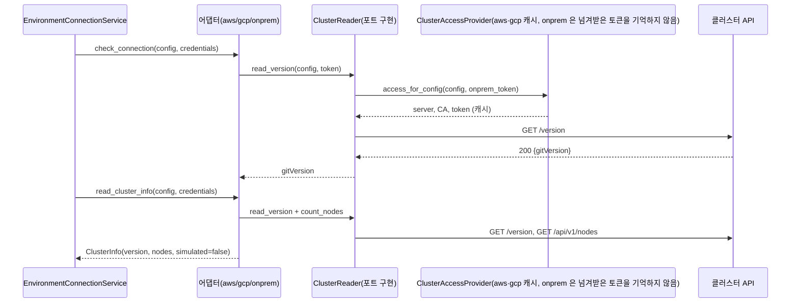

# API 서버 12: 실제 클러스터 접속 어댑터 SPEC (EKS · GKE · 온프레 k3s)

- 상태: Draft (사용자 확정 대기). 접속 증명 방식(AD-2)은 사용자가 A(`/version` + `GET /api`)로 결정했다. `GET /api` 가 우리 3곳에서 되는지는 운영 파드 시험 전까지 미검증.
- 작성일: 2026-11-04
- Depth: Deep
- 바꾸는 SPEC: [api-2-environment-api-adapters.md](api-2-environment-api-adapters.md)의 "어댑터는 가짜" 전제(`simulated` 값). 이 문서의 결정 번호(D-n)는 api-2와 별개다. 다르면 이 문서가 우선한다. 나머지(API 모양·상태 흐름·`secretRef` 형식·오류 코드)는 그대로 통과해야 한다.
- GitHub 이슈: https://github.com/Softbank-Hackathon-2026-Team-Echo/echo-was/issues/13 (제목은 EKS만 적혀 있으나 사용자가 범위를 GKE·온프레까지 넓힘 — 이슈 문구 수정은 승인 항목)
- 저장소: `echo-was` · 브랜치 `feat/real-cluster-adapters` (`main` = `42d80d5`에서)

## 1. 목표

환경 등록·다시 확인·단건 조회가 부르는 어댑터 세 종류(aws·gcp·onprem)를 가짜(고정 값)에서 **실제 클러스터에 붙어 확인하고 읽는** 구현으로 바꾼다. 환경 카드의 버전·노드 수가 실제 값(`simulated: false`)이 되고, 실패 이유가 `AUTH_FAILED`·`UNREACHABLE`·`CONFIG_INVALID`·`TIMEOUT`으로 가려진다. 배포·내리기·트래픽은 건드리지 않는다.

## 2. 확인된 사실

- 어댑터: `app/adapters/{aws,gcp,onprem}.py`는 `SimulatedEnvironmentAdapter` 하위(고정 값). 인터페이스 `EnvironmentAdapter.check_connection(config, credentials)`·`read_cluster_info(config, credentials) -> ClusterInfo` (`app/adapters/base.py`). 생성은 `registry.get_environment_adapter(kind)` = `adapter_class()`(요청마다 새로 만듦, 인자 없음).
- 호출 쪽: `EnvironmentConnectionService._prepare`가 어댑터 호출 **전에** `secretRef`를 파싱·조회하고 `credentials`로 넘긴다. 제한 시간 `ENVIRONMENT_CHECK_TIMEOUT_SECONDS`(5초)가 전체에 걸린다. `check_connection` 실패 = `FAILED`(+이유), `read_cluster_info`만 실패 = `CONNECTED` 유지 + `clusterInfo = null`·`clusterInfoError`. 어댑터가 `ConnectionCheckError` 밖 예외를 내면 `UNKNOWN`.
- 접속 상태는 배포 접수(`_check_environment_accepts`)와 이전 계획 만들기·지문이 읽는다: `FAILED`면 409 `ENVIRONMENT_UNHEALTHY`.
- 실제 배포 실행기의 접속 경로가 이미 있다: `app/executors/kubernetes/access.py::ClusterAccessProvider` (aws: 메타데이터 ID 토큰 → STS AssumeRoleWithWebIdentity → `eks:DescribeCluster` → presigned 토큰 / gcp: 메타데이터 액세스 토큰 + GKE API / onprem: `apiUrl` + 서비스 계정 토큰). 예외: `ClusterAuthError`·`ClusterConfigError`·`TransientError`. HTTP 클라이언트 `KubeHttpClients`(창구별 재사용).
- `access.py`가 `app.adapters.aws.AwsEnvironmentConfig` 등을 import한다 → `app.adapters`가 `app.executors`를 import하면 순환. `app.adapters`는 `app.models`도 import 금지.
- 운영 읽기 전용 시험 2회(2026-11-04, API 파드 안, `~/archive/softbank-hackathon-2026/api-12/probe-result-2026-11-04.txt`·`probe2-result-…`):
  - 단계별 합계: EKS 0.8~1.1초(DescribeCluster ≈0.3초가 최대), GKE 0.3~0.5초, 온프레 0.1~0.3초.
  - 실제 값: EKS `v1.35.9-eks-577a51e`·노드 2, GKE `v1.36.4-gke.2046003`·노드 2, 온프레 `v1.36.5+k3s1`·노드 목록 **403**(`echo-executor` ClusterRole에 nodes 없음, `echo-infra/onprem/manifests/echo-executor.yaml`).
  - 세 클러스터 모두 틀린 토큰·토큰 없음으로 `GET /version`이 **401**. 진짜 토큰으로 `GET /version` 200.
- 운영 시연 조직 `echo-demo`의 aws·gcp `secretRef`는 자리 표시 `env:ECHO_SECRET_ECHO_DEMO__FAKE_KUBECONFIG`(값 `fake-executor-placeholder`), onprem은 실제 실행기 토큰. aws·gcp 배포 실행기는 `secretRef`를 읽지 않는다(`docs/api/environments.md`).
- `ClusterInfo.server_version` 패턴 `^v\d+\.\d+\.\d+([-+].*)?$`: 위 실제 버전 세 개 모두 통과.
- 이전 시험 코드: `tests/adapter_contract.py::assert_adapter_contract`(등록된 모든 종류, 가짜 비밀값, 실패 묶음, 로그에 비밀값 없음), `tests/real_executor_fakes.py`(`FakeCloud` 메타데이터·STS·EKS, `FakeCluster` 쿠버네티스 가짜).

## 3. 범위

### 포함
- aws·gcp·onprem 어댑터의 실제 구현(접속 확인 + 버전·노드 수 읽기).
- 실제/가짜 전환 설정 `ENVIRONMENT_ADAPTER_MODE`(`simulated` 기본, `real`).
- 클러스터 읽기 포트(어댑터가 쓰는 Protocol)와 그 구현(실행기 접근 경로 재사용).
- 시험(스텁 전송), 공통 계약 시험 확장, 문서.
- (별도 PR·별도 승인) echo-infra 온프레 `echo-executor` ClusterRole에 `nodes: get, list` 추가.
- (두 번째 echo-was PR) 운영 설정 `ENVIRONMENT_ADAPTER_MODE: real`.

### 제외
- 배포·내리기·트래픽·헬스체크 실행기 변경, 자동 주기 확인(API 서버 5).
- `secretRef` 형식·필수 규칙·조회 저장소(`k8s:`·`aws-sm:`·`gcp-sm:`) 변경, 앱 환경변수 주입(echo-was#10·프론트 4.5).
- 클러스터 분리, 실행기 권한 축소(후속 결정 후보).
- 고객 클러스터가 `/version`을 비로그인에 여는 경우의 추가 방어(미검증, 후속).
- 프론트 변경(응답 모양 불변).

## 4. 사용자 시나리오

- 개발자가 환경을 등록·수정하거나 "다시 확인"을 누르면, 환경 카드에 실제 클러스터의 버전·노드 수가 나오고 접속이 안 되면 이유 코드가 나온다.
- 배포·이전은 접속 상태가 `FAILED`인 환경을 계속 거절한다(기존 동작).

## 5. 흐름

## 6. 기능 요구사항

- `FR-1` 어댑터는 `ClusterReadPort`(아래 8.1)를 생성자로 받는다. 포트가 없으면(`reader=None`) 지금처럼 가짜 값(`simulated=True`)을 돌려준다. `registry.get_environment_adapter(kind)`의 인자 없는 호출은 그대로 동작한다(공통 계약 시험·기존 시험 유지).
- `FR-2` `check_connection` = 클러스터에 `GET /version`(도달·쿠버네티스 확인)을 보내 200을 받고, 이어서 인증이 있어야만 열리는 `GET /api`(API 목록, `system:discovery`는 로그인한 사용자에게만 바인딩)가 200 + `versions` 목록이면 성공. 반환값 없음(`None`). `/api` 가 401·403 이면 `AUTH_FAILED`, 모양이 다르면 `CONFIG_INVALID`. `read_cluster_info` 는 `/api` 를 부르지 않는다.
- `FR-3` `read_cluster_info` = `GET /version`의 `gitVersion` + `GET /api/v1/nodes`의 `items` 길이. `ClusterInfo(server_version, node_count, simulated=False)`. 노드 목록은 쿼리 없이 전체를 읽는다.
- `FR-4` 인증 자료: aws·gcp는 `credentials`(자리 표시 비밀)를 **읽지 않는다**. 접속 경로는 배포 실행기와 같다(`ClusterAccessProvider`). onprem은 서비스가 이미 조회해 넘긴 `credentials`를 토큰으로 쓴다(`apiUrl` 필수, 비밀 이중 조회 없음).
- `FR-5` 이유 코드 매핑(8.2)을 따른다. 권한 오류를 시간 초과로 뭉개지 않는다.
- `FR-6` 일시 오류(연결 실패·5xx·429 = `TransientError`, 그리고 STS 가 HTTP 400 으로 주는 `IDPCommunicationError`·`Throttling`·`ThrottlingException`·`RequestLimitExceeded`·`ServiceUnavailable`·`InternalFailure`)는 0.5초 뒤 한 번 더 시도하고, 그래도 실패하면 `UNREACHABLE`. 실패한 시도 하나가 1.5초를 넘었으면 다시 시도하지 않는다(전체 5초 안에서 원인을 `TIMEOUT` 에 가리지 않으려고). 401 은 일시 오류가 아니라 토큰을 다시 얻어 한 번 더 부른다(재시도와 별개). 403·404·그 밖 4xx 는 다시 시도하지 않는다. 메타데이터 서버 503 은 0.5초로 안 풀릴 수 있고 그때 결과는 `UNREACHABLE` 이다.
- `FR-6a` STS 오류 분류는 공용 `access.py` 에서 하므로 배포 실행기에도 같이 적용된다(사용자 승인, D-9).
- `FR-7` 노드 목록 읽기가 401·403이면 `read_cluster_info`는 `ConnectionCheckError(AUTH_FAILED)`로 실패한다. 이때 `check_connection`은 성공이므로 접속 상태는 `CONNECTED`, `clusterInfo = null`, `clusterInfoError = AUTH_FAILED`.
- `FR-8` 비밀값·토큰·응답 본문·클러스터 이름·주소는 로그·예외 메시지·응답·`external_ref`에 넣지 않는다. 실패 로그는 `kind`·`reason`·`stage`만.
- `FR-9` 포트 구현 객체(`ClusterAccessProvider`·`KubeHttpClients`·`GoogleMetadataClient`)는 프로세스당 하나를 만들어 재사용하고 앱 종료 때 닫는다. 만들 때 네트워크·비밀 조회를 하지 않는다.
- `FR-10` 설정 `ENVIRONMENT_ADAPTER_MODE`: `simulated`(기본) 이면 포트를 주입하지 않고, `real`이면 주입한다. 모르는 값은 시작 오류.

## 7. 상태와 예외

- 접속 상태 흐름·`FAILED`의 배포 접수 차단은 그대로다. 달라지는 것은 `FAILED`가 실제로 나올 수 있다는 점이다.
- 경계: 노드 0개 응답 → `node_count = 0`(성공). `gitVersion`이 패턴에 안 맞으면 `ClusterInfo` 검증 실패 대신 `CONFIG_INVALID`(주소가 쿠버네티스가 아님으로 본다).
- 단건 조회는 응답 때마다 실제 호출을 한다(캐시된 토큰·창구 재사용). 환경 목록은 어댑터를 부르지 않는다(그대로).

## 8. 계약

### 8.1 포트와 구현
- `app/adapters/base.py`에 `ClusterReadPort` Protocol: `read_version(config, token) -> str`, `count_nodes(config, token) -> int`. 두 메서드는 실패를 `ConnectionCheckError(reason)`로만 낸다.
- 구현 `app/executors/kubernetes/reader.py::ClusterReader`: `ClusterAccessProvider`에 `access_for_config(config, *, onprem_token, refresh=False)`(새 공개 메서드, 기존 `access()` 불변)로 접속 정보를 얻고 `KubeHttpClients`로 부른다. 401이면 `refresh=True`로 한 번 다시 얻어 부른다.
- 어댑터 파일은 종류마다 하나를 유지한다(NFR-15): `registry.py`·모델·마이그레이션·라우터는 고치지 않는다. 세 어댑터는 `SimulatedEnvironmentAdapter`를 상속한 채 `reader`가 있을 때만 두 메서드를 재정의한다.
- 전환: `app/dependencies.py`에 포트 보관함(`ExecutorSetHolder`와 같은 모양, 앱 종료 때 `aclose`)을 두고 `get_adapter_resolver`가 설정에 따라 `reader`를 넣어 어댑터를 만든다.

### 8.2 이유 코드 매핑

| 상황 | 이유 코드 |
|---|---|
| 클러스터 401(토큰을 다시 얻은 뒤에도)·403, STS·EKS·GKE API 거절, 메타데이터 서버가 토큰을 거절(4xx·빈 본문, `MetadataAuthError`) (`ClusterAuthError`) | `AUTH_FAILED` |
| 역할 ARN 없음(config·설정 모두), 클러스터 조회 404·그 밖 4xx, 온프레 `apiUrl` 없음, `/version` 404 또는 본문이 쿠버네티스 모양이 아님 (`ClusterConfigError` 등) | `CONFIG_INVALID` |
| 연결 실패·TLS 검증 실패·5xx·429(한 번 더 시도한 뒤), 메타데이터 서버 자체의 연결 실패·5xx·429, STS 일시 오류 400 (`TransientError`) | `UNREACHABLE` |
| `/version`·`/nodes` 의 그 밖 비성공 응답(400·404·409 등), JSON 이 아니거나 객체가 아닌 본문, `gitVersion` 이 `v1.2.3` 모양이 아님 | `CONFIG_INVALID` (주소가 쿠버네티스 창구가 아니라고 본다) |
| 전체 제한 시간 5초 초과 | `TIMEOUT` (서비스가 판정, 어댑터가 직접 내지 않음) |
| 그 밖 예외 | 어댑터가 삼키지 않는다 → 서비스가 `UNKNOWN` |

### 8.3 설정
- `ENVIRONMENT_ADAPTER_MODE` (`simulated`|`real`, 기본 `simulated`). `real`이어도 aws 역할은 환경 `config.roleArn` 또는 기존 `EXECUTOR_AWS_ROLE_ARN`을 쓴다(새 칸 없음).
- 읽기 호출 제한 시간은 `ENVIRONMENT_CHECK_TIMEOUT_SECONDS`와 같은 값. 읽기용 `ClusterAccessProvider`·`KubeHttpClients`·`GoogleMetadataClient` 는 배포 실행기와 **별개 인스턴스**(`ClusterReaderHolder`)라 `KUBE_REQUEST_TIMEOUT_SECONDS`(배포용, 15초)를 건드리지 않는다. 대가: STS 임시 키·EKS 토큰·엔드포인트 캐시가 API 프로세스에 두 벌 생긴다. 호출 1건 상한(httpx)과 전체 상한(서비스)이 둘 다 5초라, 느린 클러스터의 결과는 `TIMEOUT` 또는 `UNREACHABLE` 중 먼저 걸린 쪽이다(AC-9 는 서비스 단계의 `TIMEOUT` 만 고정한다).
- `ENVIRONMENT_ADAPTER_MODE` 의 모르는 값은 시작 오류이고, `Settings` 는 API·일꾼·마이그레이션이 같은 ConfigMap 을 읽으므로 오타 하나가 세 프로세스를 모두 멈춘다.
- `real` 모드에서 포트(`reader`)가 주입되지 않는 경로는 없다(`get_adapter_resolver` 가 항상 넣고 시험으로 고정한다). 포트 없는 어댑터 생성은 시험·`simulated` 전용이다.

## 9. 호환성·배포·복구

- DB·마이그레이션·API 요청·응답 모양 **변화 없음**. `clusterInfo.simulated`가 `false`로 바뀌는 환경이 생긴다(프론트의 시뮬레이션 표시는 값에 따라 자연히 사라진다).
- **1단계 PR**(코드): 기본 `simulated`라 운영 동작이 바뀌지 않는다. 병합 → 배포 확인.
- **2단계 PR**(설정): `deploy/base.yaml` ConfigMap에 `ENVIRONMENT_ADAPTER_MODE: real` 추가, 자리 표시 비밀 주석을 "존재 확인용(aws·gcp는 읽지 않음)"으로 고침(비밀 환경변수 자체는 유지). 켠 직후 시연 조직 환경 3곳을 `POST …/connection-check`로 다시 확인한다.
- 롤링 중 옛 파드(가짜)와 새 파드(실제)가 잠시 섞여 응답하면 값이 다를 수 있다. 저장되는 접속 상태는 확인 요청 때만 바뀐다.
- 복구: 설정을 `simulated`로 되돌리거나 PR을 되돌린다. 이미 저장된 `FAILED`는 `connection-check`를 다시 호출해야 풀린다.
- 인프라(별도 승인): 온프레 `echo-executor` ClusterRole에 `nodes: get, list`를 더하기 전에는 온프레가 `CONNECTED` + `clusterInfo = null`(`AUTH_FAILED`)이다.
- 알려진 상호작용: 이전 계획의 지문이 `connectionStatus`를 포함하므로, 승인 대기 중 환경 상태가 바뀌면 그 계획은 `STALE`이 된다(기존 설계). 이전 진행 중에는 다시 확인하지 않는다.

## 10. Acceptance criteria

- `AC-1` Given `ENVIRONMENT_ADAPTER_MODE=simulated`(기본), When 기존 시험을 모두 돌리면, Then 통과한다(어댑터 값·`simulated=true` 그대로).
- `AC-2` Given 스텁 전송으로 정상 응답하는 aws·gcp·onprem 클러스터, When `check_connection`·`read_cluster_info`를 부르면, Then `None`·`ClusterInfo(server_version=<스텁 gitVersion>, node_count=<스텁 노드 수>, simulated=False)`.
- `AC-3` Given 스텁이 STS 거절, 클러스터 401·403(재발급 뒤에도), 메타데이터 토큰 실패, When 부르면, Then `ConnectionCheckError(AUTH_FAILED)`.
- `AC-4` Given 스텁이 연결 실패·5xx·429를 두 번 모두 내면, Then `UNREACHABLE`. 첫 번째만 실패하고 두 번째가 성공이면 성공한다(재시도 1회, 시험은 sleep을 바꿔 기다리지 않는다).
- `AC-5` Given 역할 ARN이 없거나 클러스터 조회가 404이거나 온프레 `apiUrl`이 없거나 `/version`이 쿠버네티스 모양이 아니면, Then `CONFIG_INVALID`.
- `AC-6` Given 노드 목록이 403이고 `/version`이 200, When 서비스를 통해 다시 확인하면, Then 접속 상태 `CONNECTED`·`clusterInfo = null`·`clusterInfoError = AUTH_FAILED`.
- `AC-7` Given 서로 구별되는 가짜 토큰·ID 토큰·임시 키 문자열로 성공·각 실패 경로를 돌렸을 때, Then 잡은 로그 전체·응답 본문·예외 문자열·`repr`에 그 문자열이 0회 나온다.
- `AC-8` `tests/test_real_cluster_adapters.py` 가 세 종류의 실제 어댑터(스텁 전송 주입)에 대해 같은 계약 항목(접속 확인 성공·실패 코드, 정보 읽기, 비밀값이 로그에 없음)을 확인한다. 기존 `assert_adapter_contract` 는 인자 없는 `get_environment_adapter(kind)` 를 부르는 가짜 어댑터 계약으로 **그대로 둔다**(AD-1): 종류별 성공 설정·스텁이 필요해 같은 함수에 얹지 않는다.
- `AC-12` 어댑터 파일(`app/adapters/*.py`)은 `app.executors`·`app.models` 를 import 하지 않는다(순환 방지, AST 시험).
- `AC-13` `real` 모드의 `get_adapter_resolver` 가 포트가 든 어댑터를 만들고 같은 앱에서 읽기 구현을 재사용한다.
- `AC-14` STS 가 400 + `IDPCommunicationError`/`Throttling` 이면 한 번 다시 시도하고, 그 밖 400 코드는 다시 시도하지 않고 `AUTH_FAILED`. 실패한 시도가 1.5초를 넘으면 다시 시도하지 않는다.
- `AC-9` Given 느린 스텁(5초 초과), When 서비스를 통해 확인하면, Then `TIMEOUT`이고 어댑터 예외로 새지 않는다.
- `AC-10` (운영 확인, 이 PR 밖의 별도 추적: 2단계 PR + echo-infra 노드 권한 승인 뒤. 이 PR 의 완료 판정은 AC-1~9·11~14 로 한다) 시연 조직 aws-tokyo·gcp-seoul·onprem을 다시 확인하면 세 환경 모두 `CONNECTED`이고 `clusterInfo`가 `simulated=false`의 실제 버전·노드 수다(aws `v1.35.x`·2, gcp `v1.36.x`·2, onprem 버전 + 노드 권한 적용 뒤 노드 수). 확인한 명령·응답은 이슈 댓글로 남긴다.
- `AC-11` `ruff`·`ruff format --check`·`mypy`·`pytest`(DB 포함) 통과, `git grep -E 'AKIA[0-9A-Z]{16}|BEGIN (RSA |EC )?PRIVATE KEY|ghp_[A-Za-z0-9]{20}'` 0건. DB 스키마는 바꾸지 않는다.

## 11. 비기능

- 보안: 쓰기 호출 없음, 비밀값·응답 본문·원문 예외 미기록(FR-8). 저장 비밀 0건(D-2).
- 성능: 한 번 확인 = 호출 3건 이상(`check_connection`의 `/version`, `read_cluster_info`의 `/version`·`/nodes`). 운영 시험 최악 1.1초(EKS 콜드), 캐시된 뒤는 호출 1건당 수십~수백 ms. 전체 5초는 기존 서비스가 판정한다.
- 로그: 실패마다 `kind`·`reason`만 남기는 경고 1줄(reader). 서비스의 "예상 밖 예외" 로그는 기존대로.

## 12. 리스크 (premortem)

| 리스크 | 처리 | 연결 |
|---|---|---|
| 일시 오류 한 번이 정상 환경을 `FAILED`로 만들어 배포 접수가 막힘 | 접속 가능 여부만 `FAILED` 기준, 일시 오류 1회 재시도, 두 단계로 켬(운영 확인 뒤 전환) | FR-6, FR-7, §9 |
| 권한·신뢰 조건 어긋남이 "시간 초과"로 보여 원인 추적 실패 | 이유 코드 구분 고정 | FR-5, AC-3 |
| 토큰·출입증 문자열이 로그·예외에 샘 | 예외 원문 버림, 문자열 포함 검사 | FR-8, AC-7 |
| 고객 클러스터가 `/version`을 비로그인 허용 | 수용(이 세 클러스터는 401 확인), 후속 과제 | §3 제외 |
| 단건 조회가 매번 실제 호출 | 토큰·창구 캐시, 환경 목록은 어댑터 미호출, 5초 상한 | FR-9 |
| 등록자가 임의의 `roleArn`·클러스터 이름·온프레 `apiUrl`·`secretRef` 를 넣어 플랫폼 신원으로 버전·노드 수를 읽음(배포 실행기와 같은 구조) | **수용**. 허용 목록(대상 계정·프로젝트·도메인 제한)은 후속. 반환 정보는 버전·노드 수뿐 | D-10 |
| 단계 1의 `UNREACHABLE`·`TIMEOUT` 도 `FAILED` 라 배포 접수(409 `ENVIRONMENT_UNHEALTHY`)가 막힘 | 서비스 불변(기존 SPEC 그대로). 일시 오류는 1회 재시도로 완화. 다음 "다시 확인" 성공 때 풀림 | D-11 |
| API 파드의 메타데이터 서버 문제가 "고객 클러스터 `UNREACHABLE`" 로 보임 | 8.2 에 코드 명시. 2단계 전에 운영 파드에서 먼저 확인 | §9 |

## 13. 결정 기록

| ID | 결정 | 근거 | 출처 |
|---|---|---|---|
| D-1 | `secretRef` 위치 참조 의도·필수 칸 유지, aws·gcp 자리 표시 유지(어댑터는 안 읽음) | 이슈 범위 최소안, 온프레는 실제로 읽음 | 사용자 |
| D-2 | DB에 비밀값을 저장하지 않는다 | NFR-17 | 사용자 |
| D-3 | 접속 경로는 배포 실행기와 같은 방식 재사용(저장 비밀 0건) | 운영 검증된 경로, 남의 인프라 변경 없음 | 사용자 |
| D-4 | 범위: aws·gcp·onprem 모두 | 사용자 선택(추천은 EKS만이었음) | 사용자 |
| D-5 | 구현 전 운영 파드 읽기 전용 시험 2회 | 5초 제한·접속 증명 확인 | 사용자 |
| D-6 | 온프레 노드 권한 한 줄 추가(PR, 적용은 별도 승인) + 노드 읽기 실패 시 `AUTH_FAILED`·`CONNECTED` 유지 | 같은 모양의 카드 + 고객 클러스터 대비 | 사용자 |
| D-7 | 사전 부검 3건 요구사항화 | 시연 안정성·원인 추적·보안 | 사용자 |
| D-9 | STS 의 HTTP 400 일시 오류 코드를 재시도 대상으로 분류(공용 `access.py`, 배포 실행기에도 적용, 최소 범위) | 검증 3: AWS 문서상 400 이라 `AUTH_FAILED` 로 오분류됨 | 사용자 |
| D-10 | 임의 대상 등록 위험은 수용, 허용 목록은 후속 | 마감 11/7, 배포 실행기와 같은 구조 | 사용자 |
| D-11 | 단계 1 실패(`UNREACHABLE`·`TIMEOUT` 포함)의 `FAILED` 판정은 서비스 불변 | 기존 SPEC 유지 | 사용자 |
| D-8 | 두 단계로 켠다(코드 → 확인 → 설정 전환) | 처음으로 실제 문이 되는 `FAILED` 차단 | 사용자 |
| AD-1 | 어댑터는 `reader`가 없으면 가짜로 동작(상속 유지) | 인자 없는 `get_environment_adapter`·공통 계약·기존 시험 불변 | AI-default |
| AD-2 | **A 로 결정(사용자)**: `/version` + `GET /api`. 방어 한 겹 더일 뿐이다 — 공식 문서상 틀린 토큰은 401 이라, 이 호출이 막아 주는 것은 "토큰은 받아들이지만 익명으로 처리하는" 변칙 인증 구성과 권한 제거(`system:discovery`)다. 이전 판단 근거:  검증 1: 기본 설정 클러스터(kubeadm·kind)는 비로그인 `/version` 이 200 이라 인증 증명이 안 됨(틀린 토큰은 401). 후보: A `/version` + 인증이 있어야 열리는 `GET /api`(우리 3곳 확인 필요), B + SelfSubjectReview(POST, 3곳 201 확인), C `/version` 만 + 한계 명시 | 시험 2(우리 3곳 무토큰 401)는 우리 클러스터에서만 성립 | 검증 1 |
| AD-3 | 노드 목록은 쿼리 없이 전체 | 해커톤 규모, 단순성 | AI-default |
| AD-4 | 재시도 간격 0.5초 1회, 실패한 시도가 1.5초를 넘으면 재시도 안 함 | 확인 1회는 호출 3건 이상이라 호출마다 재시도하면 5초 초과 가능(검증 3). 첫 호출만 콜드(EKS 1.1초) | AI-default |
| AD-5 | 요청별 TIMEOUT은 어댑터가 내지 않고 서비스 판정에 맡김 | 전송 오류가 `TransientError`로 합쳐지는 기존 접근 경로 | AI-default |

## 14. 구현 계획으로 위임한 low-impact 세부사항

- 파일 배치(`reader.py`)·포트 메서드 이름·보관함 클래스 이름.
- 스텁에 `/version`·`/api/v1/nodes`를 더하는 방식(`FakeCluster` 확장).
- 문서 문구(`docs/api/environments.md` 어댑터 절, README 환경변수 표, `.env.example`, `CLAUDE.md` 어댑터 줄).
