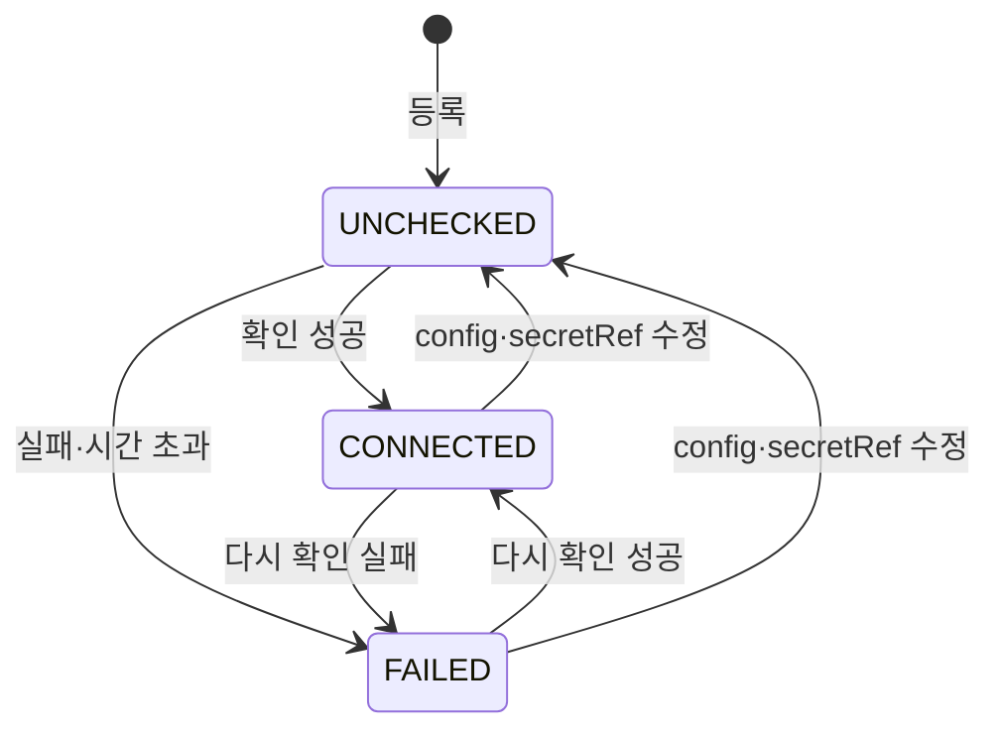

# API 서버 2: 환경 등록 API + 환경 어댑터 인터페이스 SPEC

- 상태: Confirmed
- 확인일: 2026-11-01
- Depth: Deep
- Ambiguity: Low (≈ 10% / 목표 ≤ 20%)
- High-impact unresolved decisions: None
- Interview rounds: 12 + 검토 반영 질문 3 (상태 파일 `.deep-interview/api-2-environments.state.md`)
- GitHub 이슈: https://github.com/Softbank-Hackathon-2026-Team-Echo/echo-was/issues/2 (Project #4, `part:API 서버`, `phase:1차`)
- 출처 노션 태스크(과거 기록): https://app.notion.com/p/1d5d94dbcdb446079e4d7382ef9fa1d5
- 저장소: `echo-was` · 브랜치 `feat/environment-api` (`main` = `f2d5688`에서)
- 체크포인트 그림: `~/archive/softbank-hackathon-2026/api-2/api2-checkpoint.html` (M1, 지민 확인 11/1)

## 1. 목표

환경(AWS·GCP·온프레 클러스터)을 등록·조회·수정·삭제하는 API를 만든다. 환경 종류마다 다른 조작을 같은 메서드로 부르는 **어댑터 동작 인터페이스**를 만든다. 이번 어댑터는 가짜(fake) 구현이다. 실제 클러스터 접속은 인프라 파트가 클러스터를 만든 뒤 별도 작업에서 바꾼다. 들어오고 나가는 값의 모양은 이번에 실제와 같게 고정한다.

GitHub 이슈 완료 기준(원문): **환경 목록에 AWS·GCP·온프레가 같은 열로 조회된다. 새 환경은 어댑터 하나만 추가해 등록한다.**

## 2. 현재 맥락과 확인된 사실

- `main` = `f2d5688` (API 서버 1 골격·공통 모델 병합). 라우터·서비스·리포지토리 레이어는 아직 없다. `app/main.py`에는 `/healthz`·`/readyz`만 있다.
- `app/models/environment.py`: `Environment`(`name`, `kind`, `config` jsonb, `secret_ref` varchar(255) NULL, 소프트 삭제·타임스탬프 믹스인). `before_insert`·`before_update` 이벤트가 `validate_environment_config(kind, config)`로 config를 검사하고 `model_dump(mode="json")` 결과(snake_case)로 바꿔 저장한다. `insert(Environment)`·`update(Environment)` 문장은 거부한다(Session 객체 경로만). 살아 있는 행 중 `name` 유일(`uq_environments_name_live`, 부분 unique index).
- `app/models/base.py`: 믹스인 칸(`created_at`·`updated_at`·`is_deleted`·`deleted_at`)은 `sort_order=100`이라 표의 맨 뒤에 놓인다. 제약 이름은 naming convention(`ck_<table>_<name>` 등)을 따른다.
- `app/adapters/`: `base.py`(`EnvironmentConfig` — `extra="forbid"`, `frozen=True`, `display_location()`; `@register_environment_kind`; `UnknownEnvironmentKindError` 422 `UNKNOWN_ENVIRONMENT_KIND`; `InvalidEnvironmentConfigError` 422 `ENVIRONMENT_CONFIG_INVALID`, `fields.invalid_fields`에 경로만), `registry.py`(`discover()`는 패키지별로 한 번만 실행하고 `_discovered_packages`에 기억, `validate_environment_config()`, `search_environment_kinds()`), `aws.py`(`region`, `cluster_name`), `gcp.py`(`project_id`, `region`, `cluster_name`), `onprem.py`(`location`, `kube_context`). `app.adapters`는 `app.models`를 import하지 않는다(테스트가 확인).
- `tests/test_adapters.py`·`tests/conftest.py`: 새 종류 파일 추가 시험은 임시 패키지 + `discover(pkg)` + 격리 픽스처(`isolated_environment_kinds`)로 한다(`AZURE_ADAPTER_SOURCE`).
- `app/core/exception_handlers.py`: `AppError` → 봉투(`success=false`, `code`, `message`), `details` 없음. `RequestValidationError` → 422 `VALIDATION_ERROR` + `details[{field, reason}]`(pydantic 메시지를 reason에 넣음). 봉투는 `model_dump(by_alias=True, exclude_none=True)`로 만든다 — `exclude_none`은 `data` 안까지 적용된다(`tests/test_response.py`가 이 동작을 고정).
- `app/schemas/response.py`: `ApiModel`(camelCase alias, `populate_by_name`), `ApiResponse[T]`, `ErrorDetail`, `Page[T]`(`items`, `total`, `page`(0부터), `size`).
- `app/core/config.py`: `Settings`(`database_url`, `log_level`, `env_file=".env"`, `extra="ignore"`). `app/core/database.py`: `get_engine()`(`lru_cache` 전역 엔진)만 있다. 세션 의존성 없음.
- `tests/integration/conftest.py`: `TEST_DATABASE_URL` DB, 테스트마다 표 4개 TRUNCATE, 세션 동안 advisory lock. `tests/integration/test_migrations.py`: 메타데이터와 마이그레이션 결과를 칸 순서(ordinal_position)·CHECK(`pg_catalog`)까지 비교. `tests/test_db_schema_file.py`: DB 없이 칸 순서를 비교.
- `tests/integration/factories.py:41`, `docs/schema.md` 예시의 `secret_ref`는 `echo/environments/<name>` 모양이라 이번 형식(FR-8)과 다르다.
- pydantic 2.14.2(`model_validate(..., by_alias=, by_name=)` 지원), pydantic-settings 2.16.2(python-dotenv는 전이 의존성일 뿐 직접 선언돼 있지 않음).
- `CLAUDE.md`: 레이어 `routers/ → services/ → repositories/`, 외부 호출은 `clients/`·`adapters/` 동작 코드. 필드는 snake_case, JSON은 camelCase alias. 시크릿은 `BaseSettings`로 주입하고 `os.getenv` 직접 호출 금지. 로그·예외에 시크릿·설정 값 금지. 시각은 UTC aware. 스키마 변경은 모델 → Alembic revision → `scripts/dump_schema.sh` 한 세트. 광범위한 `except` 금지.
- 원장 `final_features_v6.md` F2: 데모 증거 = 환경 목록에 AWS·GCP·온프레가 같은 열 + 새 환경은 어댑터 하나. F3(환경 카드의 앱 버전·트래픽)는 API 서버 5. NFR-15: 새 환경 추가 = 어댑터 1개 추가, 공통 모델 변경 0.
- 해커톤 규칙: 목업은 목업이라고 밝힌다.
- 실제 EKS·GKE·k3s 클러스터는 아직 없다(인프라 1·2 미완).

### API 서버 1에서 넘겨받은 결정
- `secret_ref` 형식·조회 → 이번에 정함(D-3, D-16, AD-9).
- 설정 오류 응답의 `details` 노출 → 이번에 정함(D-8).
- 환경 소프트 삭제 시 살아 있는 연결 처리 → 이번에 정함(D-5).

## 3. 범위

### 포함
- 환경 API 7개(§8.1): 등록, 목록, 단건, 수정, 삭제, 다시 확인, 종류 목록
- 어댑터 동작 인터페이스(접속 확인, 클러스터 정보 읽기) + 종류별 가짜 구현 + 모든 어댑터 공통 계약 검사
- 비밀값 조회기(`secret_ref` 형식 검사 4종, `env` 저장소만 실제 조회)
- 환경 표 칸 3개 + CHECK 3개 + Alembic revision 1개 + `db-schema.sql` 갱신
- 응답 봉투 직렬화 변경(D-15): `data` 안의 null 유지
- 설정 오류 응답 `details`(칸 경로 + 오류 종류)
- 문서: `docs/schema.md`, 용어 사전, API 문서(환경 API 계약, id로만 참조, `simulated` 뜻, null 규칙), `backend-conventions.md`(env 저장소 예외), `README.md`(로컬 비밀값 넣는 법, 인터넷 비공개)
- 기존 시험 데이터·문서 예시의 `secret_ref`를 새 형식으로 고침
- 테스트: 단위 + DB 통합(API 호출 포함) + 마이그레이션 왕복

### 제외
- 인증·로그인·역할 검사(D-6). 라우터에 권한 검사 자리 표시만 둔다. GitHub 로그인 + 역할은 echo-was#6에서 만든다(D-17).
- 실제 클러스터 접속(EKS·GKE·k3s 클라이언트) → 클러스터가 생긴 뒤 별도 작업
- `k8s`·`aws-sm`·`gcp-sm` 비밀 저장소 실제 조회 → 형식 검사만
- 자동 주기 접속 확인 → API 서버 5에서 정함(D-10)
- 앱 버전·트래픽 등 환경 카드 상태 → API 서버 5
- 배포 메서드 → API 서버 3
- 감사 로그 → API 서버 7
- 비밀값을 받거나 저장하는 API (운영자가 비밀 저장소에 직접 넣는다)
- GitHub Actions CI, push, `main` 병합(지민 확인 뒤 M1이 한다)

## 4. 구성 요소

| 구성 요소 | 상태 | 비고 |
|---|---|---|
| 환경 API | active | routers → services → repositories |
| 어댑터 동작 인터페이스 + 가짜 구현 | active | 종류 파일 하나에 설정 양식 + 동작 클래스 |
| 비밀값 조회기 | active | `app/clients/`. `env`만 실제 조회 |
| 문서·계약 | active | schema.md, 용어 사전, API 문서, 응답 null 규칙 |

## 5. 흐름

### 5.1 등록 (`POST /api/v1/environments`)
1. 요청 스키마 검사: `name`(이름 규칙), `kind`, `config`(object), `secretRef`(필수, FR-8). 틀리면 422 `VALIDATION_ERROR`.
2. `kind`의 설정 양식으로 `config` 검사(camelCase 키만 받음, §8.3). 모르는 종류 422 `UNKNOWN_ENVIRONMENT_KIND`, 양식 위반 422 `ENVIRONMENT_CONFIG_INVALID` + `details`.
3. 트랜잭션 1: 환경 행을 `connection_status = UNCHECKED`로 저장하고 커밋한다. 이름 중복은 409 `ENVIRONMENT_NAME_CONFLICT`.
4. 접속 확인(§5.4)을 DB 트랜잭션·행 잠금 없이 실행한다.
5. 트랜잭션 2: 결과를 저장한다(§5.4-4).
6. 행을 다시 읽어 201 + `EnvironmentDetail`을 돌려준다. 접속 확인이 실패해도 201이다.

### 5.2 수정 (`PATCH /api/v1/environments/{id}`)
- 트랜잭션 1에서 환경 행을 `SELECT ... FOR UPDATE`로 잠근다.
- 바꿀 수 있는 칸: `name`, `config`(전체 교체, 부분 병합 없음), `secretRef`.
- `kind`가 들어오고 지금 값과 다르면 422 `ENVIRONMENT_KIND_IMMUTABLE`. 같으면 무시.
- 모든 칸에서 `null`은 422 `VALIDATION_ERROR`.
- 정규화한 새 `config`(snake_case) 또는 `secretRef`가 저장된 값과 다르면: 같은 트랜잭션에서 접속 상태를 `UNCHECKED`(시각·이유 NULL)로 되돌린다. 값이 이미 같아도 반드시 UPDATE에 들어가게 한다(`flag_modified` 등). 커밋 뒤 접속 확인(§5.4)을 다시 실행하고 결과를 저장한다.
- `name`만 바뀌면 접속 확인을 다시 하지 않는다.
- 사용 중인(살아 있는 연결이 있는) 환경도 수정할 수 있다.
- 응답 200 + `EnvironmentDetail`(행을 다시 읽어 만든다). 다시 확인하지 않은 경우 `clusterInfo`는 단건 조회처럼 즉시 읽는다.
- 아무 칸도 없으면 200 + 현재 값(변경·확인 없음).

### 5.3 삭제 (`DELETE /api/v1/environments/{id}`)
- 한 트랜잭션에서 환경 행을 `SELECT ... FOR UPDATE`로 잠그고, 살아 있는 `service_environments` 행이 있으면 409 `ENVIRONMENT_IN_USE`.
- 없으면 소프트 삭제(`is_deleted = true`, `deleted_at = now`) → 204. 이후 단건·수정·삭제·다시 확인은 404 `ENVIRONMENT_NOT_FOUND`이고, 같은 이름을 다시 등록할 수 있다.
- 연결을 만드는 쪽(API 서버 3)도 같은 환경 행을 `FOR UPDATE`로 잠근 뒤 연결을 만든다는 규칙을 schema.md에 적는다.

### 5.4 접속 확인 (등록·다시 확인·config/secretRef 수정 직후)
요청 안에서 `await`로 끝낸다. 백그라운드 작업으로 넘기지 않는다.

1. 기준값: 확인 직전에 **커밋된 행**의 `config`(정규화된 snake_case dict)와 `secret_ref`를 기억한다.
2. 제한 시간(`Settings.environment_check_timeout_seconds`, 기본 5.0초) 하나를 아래 전체에 건다. 판정은 `asyncio.timeout` 컨텍스트의 `expired()`로 한다(어댑터 안의 다른 `TimeoutError`와 구분).
   1. 저장된 `secret_ref` 파싱 → 형식이 틀리면 `FAILED`/`SECRET_REF_INVALID`. NULL이면 `FAILED`/`SECRET_REF_MISSING`.
   2. 저장된 `config` 파싱(`parsed_config()`) → 실패하면 `FAILED`/`CONFIG_INVALID`.
   3. 비밀값 조회 → 실패 이유는 §7.2.
   4. 어댑터 `check_connection`. 이 단계까지의 시간 초과는 `FAILED`/`TIMEOUT`.
   5. 어댑터 `read_cluster_info`. 이 단계의 실패·시간 초과는 상태를 `CONNECTED`로 두고 응답의 `clusterInfo = null`, `clusterInfoError = <코드>`(`TIMEOUT` 포함).
3. 예상하지 못한 예외는 `FAILED`/`UNKNOWN`. 이 처리 한 곳에서만 `except Exception`을 허용하고 `asyncio.CancelledError`는 잡지 않는다. 로그에는 예외 종류 이름만 남기고 메시지·값은 응답·로그에 넣지 않는다.
4. 결과 저장(트랜잭션 2, 같은 세션 팩토리의 새 트랜잭션): 행을 `FOR UPDATE`로 다시 읽는다.
   - 행이 없거나 소프트 삭제됐으면 저장하지 않고 404 `ENVIRONMENT_NOT_FOUND`를 돌려준다.
   - `config`·`secret_ref`가 1번 기준값과 다르면 결과를 버린다(그 변경이 자기 확인을 따로 돈다). 응답은 그 시점 DB 값(대개 `UNCHECKED`)으로 2xx.
   - 같으면 `connection_status`, `connection_checked_at`(UTC now), `connection_error`를 저장한다.
5. 비밀값은 메모리에서만 쓰고 저장·로그·응답·예외 메시지에 넣지 않는다.

### 5.5 단건 조회 (`GET /api/v1/environments/{id}`)
- 저장된 값 + 그 자리에서 읽은 `clusterInfo`(§5.4-2의 1~3, 5단계와 같은 규칙, 제한 시간 동일). **저장된 접속 상태는 바꾸지 않는다.** 읽기에 실패하면 `clusterInfo = null`, `clusterInfoError = <코드>`, 200.

### 5.6 저장 값을 읽지 못하는 행
- 저장된 `config`가 지금 양식으로 읽히지 않거나(종류 파일 삭제·양식 변경) `secret_ref`가 형식에 맞지 않는 행이 있어도 목록 전체가 실패하지 않는다. 그 항목은 `location = null`, `config = null`(secretRef는 저장된 문자열 그대로)로 보여 주고 `environment_id`와 함께 경고 로그를 남긴다. 단건도 같다. 접속 확인은 §5.4-2의 코드로 `FAILED`가 된다.

### 5.7 접속 상태 흐름

- 같은 상태로 다시 확인해도 `connection_checked_at`은 새로 적는다.
- 확인 도중 서버가 죽으면 `UNCHECKED`로 남고 '다시 확인'으로 풀린다.
- 삭제는 어느 상태에서나 가능하다(사용 중이면 409).

## 6. 기능 요구사항

### 어댑터
- `FR-1` 어댑터 동작 인터페이스를 `app/adapters/`의 기반 모듈에 둔다. 메서드 2개, 모두 `async`:
  - `check_connection(config: EnvironmentConfig, credentials: SecretValue) -> None`
  - `read_cluster_info(config: EnvironmentConfig, credentials: SecretValue) -> ClusterInfo`
  - 둘 다 실패하면 `ConnectionCheckError(reason: ConnectionErrorCode)`를 낸다. 다른 예외는 서비스가 `UNKNOWN`으로 처리한다.
- `FR-2` `ClusterInfo`(불변): `server_version: str`(쿠버네티스 `gitVersion` 모양 `^v\d+\.\d+\.\d+([-+].*)?$`), `node_count: int`(0 이상), `simulated: bool`.
- `FR-3` `SecretValue`는 `repr`·`str`·직렬화에서 값을 숨긴다(pydantic `SecretStr` 또는 동등). 값은 명시적 메서드로만 꺼낸다.
- `FR-4` 새 종류 = `app/adapters/<kind>.py` 파일 하나. 그 파일이 설정 양식과 동작 클래스를 함께 등록한다. `registry.py`·모델·마이그레이션·라우터·서비스를 고치지 않고 새 종류가 등록·목록·종류 목록·계약 검사에 나타나야 한다(NFR-15). 등록 방식은 구현이 정한다. 동작 클래스가 없는 종류는 `discover()` 때 오류가 난다. 기존 `AZURE_ADAPTER_SOURCE` 시험 픽스처에 가짜 동작 클래스를 더해 기존 시험이 계속 통과하게 한다.
- `FR-5` 이번 aws·gcp·onprem 동작 클래스는 가짜다. 네트워크 호출을 하지 않고, 종류별 고정 값(예: `v1.31.0`, 노드 3)과 `simulated=True`를 돌려준다. 가짜임을 클래스 docstring과 API 문서에 적는다.
- `FR-6` 공통 계약 검사를 재사용 함수(예: `assert_adapter_contract(kind)`)로 둔다. 검사 내용(모두 오프라인): 동작 클래스가 있다, 두 메서드가 `async`다, 가짜 비밀값으로 부른 성공 결과가 `ClusterInfo` 모양이다, 실패를 일으키는 비밀값·설정 픽스처를 줄 수 있는 어댑터는 `ConnectionCheckError`의 이유가 §7.2 코드다, `repr(credentials)`·잡은 로그에 비밀값이 없다. 등록된 모든 종류를 매개변수로 도는 시험과 AC-2 시험이 둘 다 이 함수를 부른다. 실제 어댑터로 바꿀 때도 스텁 전송으로 이 검사를 통과해야 한다.
- `FR-7` 앱을 만들 때(`app.main` 모듈 로드) `discover()`를 불러 동작 클래스 누락을 첫 요청 전에 드러낸다. 마이그레이션 실행 금지 규칙과는 무관하다.

### 비밀값 조회기
- `FR-8` `secret_ref` 형식: 저장소 이름은 **첫 콜론**에서만 나눈다. 전체 길이 255 이하.
  - `env:<NAME>` — `NAME`은 `^ECHO_SECRET_[A-Z0-9_]+$` (D-16)
  - `k8s:<namespace>/<secret>/<key>` — namespace·secret은 RFC 1123 이름, key는 `^[-._a-zA-Z0-9]+$`
  - `aws-sm:<이름 또는 ARN>` — 공백 없음(ARN의 콜론 허용)
  - `gcp-sm:projects/<project>/secrets/<secret>` 또는 끝에 `/versions/<version>`
  - 그 외 → 422 `VALIDATION_ERROR`, `details.field = "secretRef"`. 요청 검사는 `field_validator`로 하고, `reason`은 값·정규식이 없는 고정 문구(예 `INVALID_SECRET_REF`)를 쓴다.
- `FR-9` 조회기는 `app/clients/`의 파일 한 곳에 둔다. `env`는 **프로세스 환경변수만** 본다. 로컬은 `uv run --env-file .env uvicorn …` 또는 compose `env_file`로 넣고 README에 적는다. 이름이 동적이라 `BaseSettings` 필드로 선언할 수 없으므로 환경변수 직접 읽기를 이 파일에만 허용하고 `backend-conventions.md`에 예외로 적는다. 조회기는 의존성으로 주입해 시험에서 바꿀 수 있게 하고, 시험은 `monkeypatch`로 환경변수를 넣고 지운다(개발자 `.env`와 섞이지 않게). 값이 없거나 빈 문자열이면 `SECRET_NOT_FOUND`.
- `FR-10` `k8s`·`aws-sm`·`gcp-sm`은 조회하지 않고 `SECRET_STORE_UNSUPPORTED`로 접속 확인을 실패시킨다(등록은 됨).

### API
- `FR-11` 라우터는 `/api/v1` 접두어. 7개 엔드포인트(§8.1). 모든 JSON 응답은 `ApiResponse[T]`. 각 라우터에 "권한 검사 자리(API 서버 6)" 표시를 남긴다(주석 또는 no-op 의존성).
- `FR-12` 목록: `Page[EnvironmentSummary]`, `page`(0부터, 기본 0), `size`(기본 20, 1~100), `kind`(선택, 정확히 일치). 소프트 삭제 제외. `created_at` 오름차순, 같으면 `id`. 저장된 값만 쓰고 어댑터·조회기를 부르지 않는다.
- `FR-13` 종류 목록 `GET /api/v1/environment-kinds`: 등록된 종류마다 `kind`와 `configSchema`(`model_json_schema(by_alias=True)`, camelCase 키). 이름 순.
- `FR-14` 세션: `async_sessionmaker(expire_on_commit=False)`를 의존성으로 주입한다. 요청 의존성은 트랜잭션을 열지 않은 `AsyncSession`을 넘기고, 서비스가 `async with session.begin()` 블록 단위로 커밋한다. 결과 저장(§5.4-4)도 같은 팩토리에서 연다. 엔진은 기존 `get_engine()`을 쓰고, 통합 시험은 의존성 재정의로 `TEST_DATABASE_URL` 엔진·세션 팩토리를 넣는다.
- `FR-15` 제한 시간은 `Settings` 의존성에서, 어댑터 조회는 주입 가능한 의존성(레지스트리 조회 함수 등)에서 받는다. 시험은 `dependency_overrides`로 짧은 제한 시간·느린 어댑터·예외를 내는 어댑터를 넣을 수 있다.
- `FR-16` 다른 파트·API는 환경을 `id`(uuid)로만 가리킨다. `name`은 표시용이며 바뀔 수 있다고 API 문서에 적는다.

### 응답 봉투 (D-15)
- `FR-17` 성공 응답의 `data` 안에서는 null 칸을 지우지 않는다. 봉투의 `code`·`message`·`details`만 값이 없을 때 뺀다. 실패 응답은 지금과 같다. `ApiResponse` 직렬화(또는 공통 응답 헬퍼) 한 곳에서 바꾸고, `tests/test_response.py` 기대값을 새 규칙으로 고친다. API 문서에 "모든 칸은 항상 있고, 값이 없으면 null"이라고 적는다.

### 데이터
- `FR-18` `environments`에 칸 3개(§8.4)와 CHECK 3개를 더하는 Alembic revision 1개. 기존 행은 `UNCHECKED`. downgrade는 칸·CHECK를 지운다.
- `FR-19` 새 칸 3개의 `sort_order`는 믹스인 칸(100)보다 크게(예: 200, `app/models/base.py`에 상수) 줘서 모델 메타데이터와 `op.add_column` 결과의 칸 순서가 같게 한다. `connection_status`는 `server_default=text("'UNCHECKED'")`.
- `FR-20` 접속 상태 값은 `app/enums.py`의 `EnvironmentConnectionStatus`(`UNCHECKED`·`CONNECTED`·`FAILED`), 이유 코드는 `ConnectionErrorCode`(§7.2) `StrEnum`. 이유 코드에는 DB CHECK를 걸지 않는다. 앱이 enum 값만 쓴다.
- `FR-21` `tests/integration/factories.py`와 `docs/schema.md` 예시의 `secret_ref`를 FR-8 형식(예 `env:ECHO_SECRET_AWS_SEOUL_KUBECONFIG`)으로 고친다.

### 오류 응답
- `FR-22` `ENVIRONMENT_CONFIG_INVALID` 응답에 `details`를 채운다: `field` = `config.` + camelCase 경로(예 `config.clusterName`, 루트 위반은 `config`), `reason` = `MISSING`(빠짐) | `UNKNOWN_FIELD`(모르는 칸) | `INVALID_FORMAT`(그 외). 경로는 pydantic `loc`를 그대로 쓰지 않고 양식의 필드 이름을 alias로 바꿔 만든다. `UNKNOWN_FIELD`는 들어온 키를 그대로 쓴다. 입력 값·정규식·pydantic 메시지를 넣지 않는다. 같은 칸·같은 이유는 한 번만.
- `FR-23` `AppError`에 선택 `details`를 더하고 예외 처리기가 응답으로 옮긴다. `details`가 없는 기존 오류의 응답은 바뀌지 않는다. 로그용 `invalid_fields`(기존 동작, `tests/test_adapters.py` 기대값)는 그대로 둔다.
- `FR-24` 이름 중복: 사전 조회로 409를 내고, 동시 등록 대비로 `IntegrityError`는 원인 예외의 제약 이름이 `uq_environments_name_live`일 때만 409 `ENVIRONMENT_NAME_CONFLICT`로 바꾼다. 다른 무결성 오류는 그대로 올린다. 실패한 트랜잭션은 롤백한다.

### 로그
- `FR-25` 등록·수정·삭제·확인에 구조화 로그(`action`, `environment_id`, `kind`, `connection_status`, `connection_error`). `config` 값과 비밀값은 로그에 남기지 않는다. `secret_ref`(위치 문자열)는 남겨도 된다.

## 7. 상태와 예외

### 7.1 HTTP 오류 코드

| 상황 | HTTP | code |
|---|---|---|
| 요청 스키마 위반(이름 형식, secretRef 형식, null, page·size 범위 등) | 422 | `VALIDATION_ERROR` + details |
| 모르는 종류 | 422 | `UNKNOWN_ENVIRONMENT_KIND` |
| 설정 양식 위반 | 422 | `ENVIRONMENT_CONFIG_INVALID` + details(FR-22) |
| 종류 변경 요청 | 422 | `ENVIRONMENT_KIND_IMMUTABLE` |
| 살아 있는 행과 이름 중복(등록·수정) | 409 | `ENVIRONMENT_NAME_CONFLICT` |
| 사용 중인 환경 삭제 | 409 | `ENVIRONMENT_IN_USE` |
| 없거나 삭제된 환경(확인 도중 삭제 포함) | 404 | `ENVIRONMENT_NOT_FOUND` |

### 7.2 접속 실패 이유 코드 (`connection_error`, `clusterInfoError`)

| 코드 | 뜻 |
|---|---|
| `TIMEOUT` | 제한 시간 초과 |
| `SECRET_REF_MISSING` | 행에 secret_ref 없음 |
| `SECRET_REF_INVALID` | 저장된 secret_ref가 형식에 맞지 않음 |
| `SECRET_NOT_FOUND` | 저장소에 값 없음·빈 값 |
| `SECRET_STORE_UNSUPPORTED` | 아직 조회하지 않는 저장소(k8s·aws-sm·gcp-sm) |
| `CONFIG_INVALID` | 저장된 config를 지금 양식으로 읽지 못함 |
| `AUTH_FAILED` | 자격 증명 거부(실제 어댑터용) |
| `UNREACHABLE` | 클러스터에 닿지 않음(실제 어댑터용) |
| `UNKNOWN` | 그 밖의 예외 |

### 7.3 경계 조건
- 확인 중 같은 환경을 수정하면 먼저 시작한 확인의 결과는 버린다. 삭제하면 404(§5.4-4).
- 두 '다시 확인'이 겹치면 늦게 저장한 결과가 남는다.
- `config` 키는 snake_case로 보내면 `UNKNOWN_FIELD`(+ 해당 camelCase 칸은 `MISSING`)로 거부한다.

## 8. 계약

### 8.1 엔드포인트

| 메서드 · 경로 | 요청 | 성공 |
|---|---|---|
| `POST /api/v1/environments` | `EnvironmentCreate` | 201 `ApiResponse[EnvironmentDetail]` |
| `GET /api/v1/environments?page&size&kind` | — | 200 `ApiResponse[Page[EnvironmentSummary]]` |
| `GET /api/v1/environments/{id}` | — | 200 `ApiResponse[EnvironmentDetail]` |
| `PATCH /api/v1/environments/{id}` | `EnvironmentUpdate` | 200 `ApiResponse[EnvironmentDetail]` |
| `DELETE /api/v1/environments/{id}` | — | 204 (본문 없음) |
| `POST /api/v1/environments/{id}/connection-check` | — | 200 `ApiResponse[EnvironmentDetail]` |
| `GET /api/v1/environment-kinds` | — | 200 `ApiResponse[list[EnvironmentKind]]` |

### 8.2 스키마 (JSON 이름, camelCase, 모든 칸 항상 있음 — FR-17)

- `EnvironmentCreate`: `name`(str, RFC 1123, 1~63), `kind`(str), `config`(object), `secretRef`(str, FR-8). 모르는 칸 거부.
- `EnvironmentUpdate`: `name?`, `kind?`, `config?`, `secretRef?`. 들어온 칸의 null은 거부(`model_fields_set`으로 구분). 모르는 칸 거부.
- `EnvironmentSummary`: `id`, `name`, `kind`, `location`(문자열 또는 null, §5.6), `config`(camelCase 키 object 또는 null, §5.6), `secretRef`(제약 없는 문자열 — 저장 값 그대로), `connectionStatus`, `connectionCheckedAt`(ISO 8601 UTC 또는 null), `connectionError`(코드 또는 null), `createdAt`, `updatedAt`.
- `EnvironmentDetail`: `EnvironmentSummary` + `clusterInfo`(`{serverVersion, nodeCount, simulated}` 또는 null) + `clusterInfoError`(코드 또는 null).
- `EnvironmentKind`: `kind`, `configSchema`(JSON Schema).

### 8.3 config 키 변환 (설정 양식 기반 클래스)
- `EnvironmentConfig` 설정: `alias_generator=to_camel`, `validate_by_alias=True`, `validate_by_name=True`, `serialize_by_alias=False`, `loc_by_alias=False` (+ 기존 `extra="forbid"`, `frozen=True`).
- API 경계: `model_validate(data, by_alias=True, by_name=False)` — camelCase만 받는다.
- DB 쪽(모델 이벤트, `parsed_config()`): `by_alias=False, by_name=True` — snake_case로 검사한다. 저장은 `model_dump(mode="json")`(snake_case).
- 응답: `model_dump(mode="json", by_alias=True)`(camelCase).
- `validate_environment_config`가 두 방식을 고를 수 있게 넓히되, 기존 호출(모델 이벤트)의 동작과 `invalid_fields` 기대값은 바꾸지 않는다.

### 8.4 데이터 변경 (`environments`)

| 칸 | 타입 | 제약 (naming convention 적용 전 이름) |
|---|---|---|
| `connection_status` | varchar(16) NOT NULL, `server_default 'UNCHECKED'` | `connection_status_valid`: 값 3개 |
| `connection_checked_at` | timestamptz NULL | `connection_checked_at_consistency`: `(connection_status = 'UNCHECKED') = (connection_checked_at IS NULL)` |
| `connection_error` | varchar(32) NULL | `connection_error_consistency`: `(connection_status = 'FAILED') = (connection_error IS NOT NULL)` |

- 칸 순서는 FR-19. `alembic check`는 CHECK를 비교하지 못하므로 `tests/integration/test_migrations.py`의 `pg_catalog` 비교(`EXPECTED_CONSTRAINTS`)에 새 CHECK 3개를 더한다.
- 마이그레이션 왕복 시험에서 `downgrade -1 → upgrade head`를 하면 PostgreSQL이 지운 칸 번호를 다시 쓰지 않아 칸 위치(ordinal_position)가 달라진다. 왕복 시험은 끝에 `downgrade base → upgrade head`로 표를 다시 만들어 같은 세션의 다른 비교 시험이 실행 순서에 따라 깨지지 않게 한다.

## 9. 호환성·배포·복구

- 기존 환경 행은 마이그레이션 뒤 `UNCHECKED`. 다시 확인하면 상태가 생긴다.
- 응답 null 규칙 변경(FR-17)은 아직 성공 응답을 쓰는 API가 없어 깨지는 소비자가 없다.
- 서버는 인증이 없으므로 인터넷에 열지 않는다(M5·팀 내부 실행만). README에 적는다.
- 마이그레이션 downgrade로 칸 3개를 지울 수 있다. 앱 시작 때 마이그레이션을 실행하지 않는다(기존 규칙).

## 10. Acceptance criteria

- `AC-1` (완료 기준 1) Given 빈 DB, When aws·gcp·onprem 환경을 하나씩 등록하고(한 개는 `FAILED`가 되도록 비밀값을 빼고) 목록을 부르면, Then 세 항목의 JSON 키 집합이 모두 같고 정확히 `id`, `name`, `kind`, `location`, `config`, `secretRef`, `connectionStatus`, `connectionCheckedAt`, `connectionError`, `createdAt`, `updatedAt`이다. 값이 없는 칸은 null로 들어 있다. `location`은 각각 region·region·location이다.
- `AC-2` (완료 기준 2) Given 테스트가 임시 패키지에 종류 파일 하나(설정 양식 + 가짜 동작 클래스)를 만들고 `discover(pkg)`와 격리 픽스처로 등록하면, When 다른 코드를 바꾸지 않고 등록·목록·종류 목록 API를 부르면, Then 새 종류가 다른 종류와 같은 키 집합으로 나오고 `assert_adapter_contract`도 통과한다. 테스트가 끝나면 임시 종류는 사라진다.
- `AC-3` 등록 시 `region = "seoul"`, `clusterName` 빠짐 → 422 `ENVIRONMENT_CONFIG_INVALID`, `details`에 `{config.region, INVALID_FORMAT}`, `{config.clusterName, MISSING}`. 모르는 키 → `UNKNOWN_FIELD`. snake_case 키(`cluster_name`) → `UNKNOWN_FIELD`. 응답 본문에 `"seoul"`이 없다.
- `AC-4` 등록 응답 201, `connectionStatus = CONNECTED`, `clusterInfo.simulated = true`(환경변수 `ECHO_SECRET_…`를 시험에서 넣음). env 값이 없으면 201 + `FAILED`/`SECRET_NOT_FOUND`. `k8s:` 등은 201 + `FAILED`/`SECRET_STORE_UNSUPPORTED`. 형식이 틀린 `secretRef`·`env:DATABASE_URL` → 422 `VALIDATION_ERROR`(field `secretRef`), 응답에 정규식이 없다.
- `AC-5` 수정: `kind` 변경 → 422 `ENVIRONMENT_KIND_IMMUTABLE`, 행 그대로. `name`만 변경 → 200, `connectionCheckedAt` 그대로. `config` 또는 `secretRef` 변경 → 200, 다시 확인해 `connectionCheckedAt`이 갱신된다. null 값 → 422. 다른 살아 있는 환경과 이름 중복 → 409 `ENVIRONMENT_NAME_CONFLICT`.
- `AC-6` 삭제: 살아 있는 서비스-환경 연결이 있으면 409 `ENVIRONMENT_IN_USE`, 행 그대로. 연결이 없으면 204, 이후 단건 404, 같은 이름으로 다시 등록 201.
- `AC-7` 다시 확인 API가 상태·시각·이유를 갱신한다. 단건 조회는 `clusterInfo`를 주지만 저장된 상태·시각을 바꾸지 않는다(조회 전후 DB 값 같음).
- `AC-8` (사전 부검 ②) 제한 시간을 0.2초로 바꾸고 `check_connection`이 느린 어댑터로 등록하면 201 + `FAILED`/`TIMEOUT`이고 응답이 1.2초 안에 온다. `read_cluster_info`만 느리면 `CONNECTED` + `clusterInfo = null` + `clusterInfoError = TIMEOUT`. 기본 제한 시간은 5.0초다.
- `AC-9` (사전 부검 ③) 고유한 가짜 비밀값 문자열로 성공·`SECRET_NOT_FOUND`·어댑터 `ConnectionCheckError`·어댑터 일반 예외 경로를 모두 돌렸을 때, 잡은 로그 전체·모든 응답 본문·`repr(SecretValue)`에 그 문자열이 0회 나온다.
- `AC-10` (사전 부검 ①) 계약 검사가 등록된 모든 종류에 대해 돌고 통과한다. 실패 이유가 §7.2 밖이면 실패한다.
- `AC-11` 확인 도중 config를 바꾸는 순서를 시험으로 강제한다(확인이 시작된 뒤 PATCH가 커밋되고 나서 첫 확인이 결과를 저장하려 함). 첫 확인의 결과는 저장되지 않고, 최종 상태는 두 번째 확인의 결과다. 확인 도중 삭제하면 그 요청은 404다.
- `AC-12` 저장된 config가 지금 양식으로 읽히지 않는 행(시험에서 DB에 직접 만든 행)이 있어도 목록은 200이고 그 항목은 `location`·`config`가 null이다. 그 행을 다시 확인하면 `FAILED`/`CONFIG_INVALID`.
- `AC-13` 마이그레이션: `upgrade head` → `downgrade -1` → `upgrade head` → `alembic check` 통과, 끝에 표를 다시 만든다. 새 CHECK 3개가 `pg_catalog` 비교 시험에 있다. 메타데이터·DB의 칸 순서가 같다. `.claude/rules/db-schema.sql`이 `scripts/dump_schema.sh` 결과와 같다.
- `AC-14` 문서: `docs/schema.md`(새 칸·상태 흐름·연결 생성 시 환경 행 잠금 규칙·secret_ref 예시), 용어 사전(접속 상태·이유 코드·어댑터 동작·SecretValue), API 문서(엔드포인트·오류 코드·id로만 참조·`simulated` 뜻·`secretRef` 형식·null 규칙), `backend-conventions.md`(env 저장소 예외), README(로컬 비밀값 넣는 법·인터넷 비공개)가 갱신돼 있다.
- `AC-15` 품질: `uv run ruff check .`, `uv run ruff format --check .`, `uv run mypy app`(strict), `uv run pytest`(DB를 띄운 상태에서 건너뜀 0) 모두 통과.
- `AC-16` git: 브랜치 `feat/environment-api`, 커밋 `<type>: <설명>`, SPEC 파일 포함, `.env` 미커밋, push·remote 변경 없음, `docs/PR.md`(gitignore)에 PR 본문 초안. 로컬 `main`은 `f2d5688` 그대로.

## 11. 핵심 엔티티

| 이름 | 필드 | 관계 |
|---|---|---|
| 환경 `Environment` | 기존 + `connection_status`, `connection_checked_at`, `connection_error` | 서비스-환경 연결 1:N |
| 어댑터 `EnvironmentAdapter` | `kind`, `check_connection`, `read_cluster_info` | 종류(`kind`)마다 1개, 설정 양식과 같은 파일 |
| 클러스터 정보 `ClusterInfo` | `server_version`, `node_count`, `simulated` | 저장하지 않음 |
| 비밀값 `SecretValue` | 숨긴 문자열 | 저장하지 않음 |

## 12. 리스크 (사전 부검)

| 리스크 | 처리 | 연결 |
|---|---|---|
| 가짜 어댑터 모양이 실제 클러스터와 안 맞음 | 요구사항화: 계약 검사 함수, 쿠버네티스 기준 반환형 | FR-1·2·6, AC-10 |
| 클러스터 무응답으로 등록·확인이 멈춤 | 요구사항화: 제한 시간 5초, 단계별 시간 초과 규칙 | §5.4, AC-8 |
| 비밀값이 로그·응답·오류로 샘 | 요구사항화: SecretValue, 0회 시험, env 이름 접두어 제한 | FR-3·8·25, AC-4·9 |
| 다른 파트가 이름으로 참조하다 이름 수정에 깨짐 | 요구사항화: id로만 참조 문서화 | FR-16, AC-14 |
| 인증이 없는 API | 수용(이번 태스크): 인터넷 비공개 운영. GitHub 로그인 + 역할은 echo-was#6(D-17) | §9 |

## 13. 결정 기록

| ID | 결정 | 근거 | 출처 |
|---|---|---|---|
| D-1 | 어댑터는 공통 메서드 틀 + 가짜 구현. 실제 연결은 클러스터가 생긴 뒤 별도 작업 | 비용 0, 인프라 대기 없음 | 사용자(R1) |
| D-2 | 공통 메서드는 접속 확인 + 클러스터 정보 읽기만 | 배포는 API 3, 상태는 API 5 | 사용자(R2) |
| D-3 | API는 비밀값을 받지 않고 `secretRef`만. 4개 저장소 형식, env만 실제 조회 | 비밀값은 운영자가 저장소에 직접 | 사용자(R3) |
| D-4 | 등록 직후 1회 + 다시 확인 API, 결과를 환경 행에 저장. 실패해도 등록 | 목록에 상태 표시 | 사용자(R4) |
| D-5 | 사용 중 환경 삭제 409 `ENVIRONMENT_IN_USE`, 아니면 소프트 삭제 | 연결이 끊긴 배포 기록 방지 | 사용자(R5) |
| D-6 | 이번 태스크는 인증 없음, 인터넷 비공개, 라우터에 권한 자리 표시 | 권한은 API 6 | 사용자(R6) |
| D-7 | 수정 가능 칸 name·config·secretRef, kind 변경 422 | 배포 기록이 다른 종류로 바뀌는 것 방지 | 사용자(R7) |
| D-8 | 설정 위반 details = 칸 경로 + 오류 종류, 값 제외 | 화면이 칸을 짚되 값은 새지 않게 | 사용자(R8) |
| D-9 | 목록은 저장 값만, 클러스터 정보는 단건·확인 때 즉시 읽기 | 목록이 빠르고 한 곳이 죽어도 뜸 | 사용자(R9) |
| D-10 | 자동 주기 확인 없음 | 가짜 어댑터라 의미 적음, API 5에서 정함 | 사용자(R10) |
| D-11 | 사전 부검 4개 모두 요구사항 | §12 | 사용자(R11) |
| D-12 | 체크포인트 흐름·상태·API 표 확인 | | 사용자(R12 A1) |
| D-13 | `connection_error` 칸 추가(공통 칸 3개) | 목록에서 실패 이유가 보임 | 사용자(R12 B1) |
| D-14 | AI 기본값 AD-1~AD-13 채택 | | 사용자(R12 C1) |
| D-15 | 성공 응답 `data` 안 null 유지, 봉투 code·message·details만 생략 | 상태와 무관하게 같은 칸(완료 기준) | 사용자(검토 반영) |
| D-16 | env 저장소 이름은 `ECHO_SECRET_` 접두어만 | 인증 없는 API로 서버 자체 설정(DATABASE_URL 등)을 열쇠로 쓰지 못하게 | 사용자(검토 반영) |
| D-17 | 인증 시스템(GitHub 로그인)은 이 태스크에 넣지 않고 echo-was#6(역할 4종 권한)을 "GitHub 로그인 + 역할 4종"으로 넓혀 함께 만든다 | 역할 없는 로그인은 막을 대상이 없고 사용자 모델을 한 번에 설계 | 사용자 |
| AD-1 | 경로 `/api/v1`, `Page`(0부터), 목록 필터는 `kind`만 | 기존 규약, 환경 수가 적음 | AI-default |
| AD-2 | API의 config 키도 camelCase, DB는 snake_case(§8.3) | `ApiModel` "내부 snake, JSON camel" 규약 | AI-default |
| AD-3 | 응답에 `secretRef` 포함 | 위치 문자열이고 수정 화면에 필요 | AI-default |
| AD-4 | 이름 중복 409, 다른 파트는 id로만 참조 | 이름 수정 허용(D-7) | AI-default |
| AD-5 | 등록 시 `secretRef` 필수, DB는 NULL 허용 유지 | 열쇠 없이 확인 불가, 스키마 변경 최소 | AI-default |
| AD-6 | 가짜 결과에 `simulated: true` | 해커톤 규칙 "목업은 목업이라고 밝힌다" | AI-default |
| AD-7 | `GET /api/v1/environment-kinds`(kind + configSchema) | 새 어댑터가 프론트 폼에 자동 반영 | AI-default |
| AD-8 | 단건 조회는 상태 칸을 바꾸지 않음 | 조회는 읽기만 | AI-default |
| AD-9 | `secretRef` 형식 4종(FR-8), env 외는 SECRET_STORE_UNSUPPORTED | D-3 구체화 | AI-default |
| AD-10 | 저장 커밋 뒤 잠금 없이 확인, 제한 시간은 설정값 | 네트워크 대기 중 DB 잠금 방지 | AI-default |
| AD-11 | 상태 varchar(16)+CHECK 3값, 기존 행 UNCHECKED, 이유 코드는 CHECK 없음 | 기존 `deployments.status` 방식, 코드 확장 시 마이그레이션 불필요 | AI-default |
| AD-12 | config/secretRef 수정 시 행을 잠그고 같은 커밋에서 UNCHECKED로 되돌린 뒤 확인, 확인 중 변경되면 결과 버림 | 옛 설정의 결과가 새 설정에 붙는 것 방지 | AI-default (검토 반영) |
| AD-13 | PATCH의 config는 전체 교체, snake_case 키 거부, null 거부 | 계약 단순화 | AI-default (검토 반영) |
| AD-14 | env 저장소는 프로세스 환경변수만, 로컬은 `uv run --env-file`·compose `env_file` | 의존성 추가 없음, 시험 격리 | AI-default (검토 반영) |
| AD-15 | 읽지 못하는 저장 행은 목록을 깨지 않고 null + 로그, 확인 시 `SECRET_REF_INVALID`·`CONFIG_INVALID` | D-9 "한 곳이 죽어도 뜸" | AI-default (검토 반영) |
| AD-16 | 앱 생성 시 `discover()` | 어댑터 누락을 첫 요청 전에 드러냄 | AI-default (검토 반영) |
| AD-17 | 세션·주입·시간 초과·예외 처리·칸 순서·제약 이름 규칙(FR-14·15·19, §5.4, §8.4) | 저장소 함정(검토 지적) 회피 | AI-default (검토 반영) |

## 14. 구현에 위임한 low-impact 세부사항

- 어댑터 등록 방식(데코레이터 확장·클래스 속성 등), 파일·클래스 이름(규칙 문서의 네이밍을 따른다)
- 가짜 어댑터의 고정 값(예 `v1.31.0`, 노드 3)
- 트랜잭션 헬퍼의 모양(FR-14 범위 안에서)
- API 문서 위치(`docs/api/environments.md` 권장) — FastAPI OpenAPI도 함께 확인
- 오류 메시지 문구(고정 영어 문구, 값 없음)
- 테스트 파일 구성과 픽스처
